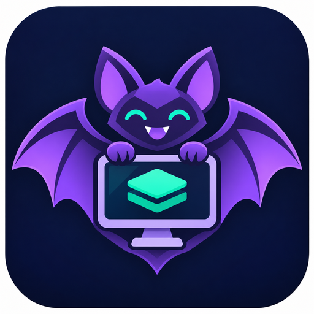
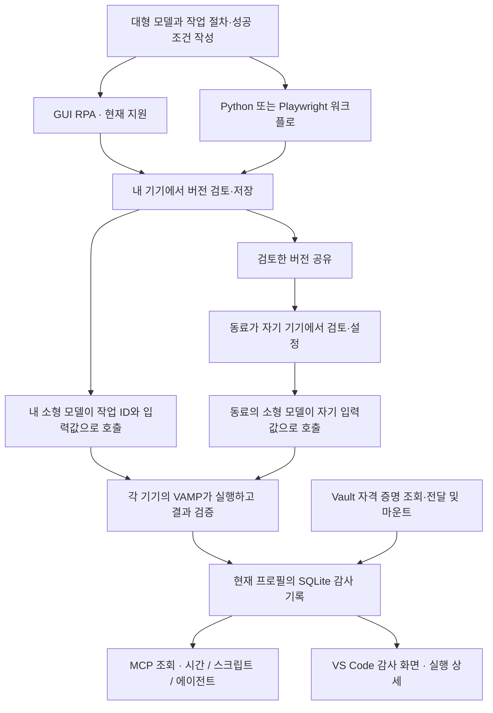
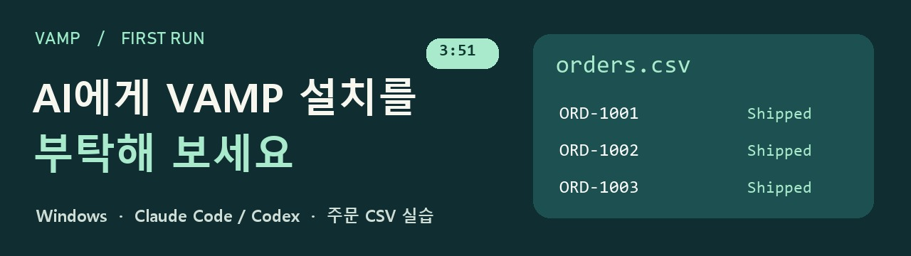
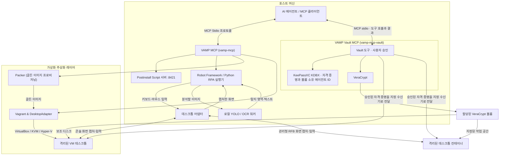

<p align="center">
  
</p>

<h1 align="center">VAMP · Virtual Agent Machine Platform</h1>

<p align="center">
  <strong>내 하드웨어의 가상머신(VM)에서 AI 컴퓨터 유즈 에이전트를 실행하세요.</strong>
</p>

<p align="center">
  <a href="https://github.com/wayfarer6/vamp-mcp/actions/workflows/ci.yml"></a>
  <a href="https://github.com/wayfarer6/vamp-mcp/releases"></a>
  <a href="https://www.npmjs.com/package/vamp-mcp"></a>
  <a href="https://www.npmjs.com/package/vamp-mcp-vault"></a>
  <a href="https://marketplace.visualstudio.com/items?itemName=wayfarer6.vamp-mcp-tools"></a>
  <a href="https://wayfarer6.github.io/vamp-script-hub/"></a>
  <a href="LICENSE"></a>
</p>

<p align="center">
  <a href="README.md">English</a> · <a href="README.ko.md">한국어</a> · <a href="docs/USER_GUIDE.md">사용자 가이드</a> · <a href="https://wayfarer6.github.io/vamp-script-hub/">스크립트 허브</a> · <a href="docs/ROADMAP.md">로드맵</a>
</p>

---

## 30초 만에 보는 VAMP

VAMP VS Code 확장에서 VirtualBox 게스트를 열고 Debian 화면이 연결되는 과정을 보여 줍니다.

[](https://raw.githubusercontent.com/wayfarer6/vamp-mcp/main/docs/media/vamp-result-ko.mp4)

[▶ 한국어 데모 보기 (0:30)](https://raw.githubusercontent.com/wayfarer6/vamp-mcp/main/docs/media/vamp-result-ko.mp4)

[한국어·영어 영상 모음](docs/VM_LAB.md)에서 30초 결과 데모, 설치와 AI 연결, 구조 소개, 실제 VM 생성과 게스트 화면 실습을 종류별로 볼 수 있습니다.

Linux KVM에서 자동으로 남은 로그 두 줄을 열고, 호출 결과와 Vault 자격 증명 조회 기록을 해석하는 방법을 확인하세요. [감사 로그 영상 · 한국어 2:08](docs/media/vamp-audit-log-ko.mp4)

## 오늘 만든 자동화를, 내일은 주문 번호만 바꿔 쓰세요

오늘은 대형 모델과 함께 ERP에서 주문을 CSV로 내보내는 절차를 만들고, 결과 파일에 요청한 주문 번호가 들어 있는지 확인하는 방법까지 저장합니다. 내일은 소형 모델에 **“주문 1042도 같은 방식으로 내보내 줘”**라고 요청하세요. 소형 모델이 RPA Library에서 작업을 찾아 MCP로 새 주문 번호를 전달하면, VAMP가 내 기기에서 절차를 실행하고 CSV를 확인합니다.

**동료에게는 검토한 워크플로를 공유할 수 있습니다.** GUI RPA의 특정 버전을 소스 ZIP으로 내보내면 동료도 코드와 입력 항목을 살펴보고 자기 기기의 호환 환경에서 자기 주문 번호로 재사용할 수 있습니다. 공유할 때는 비밀번호와 실제 주문 데이터를 제외하세요. 같은 작업을 할 때마다 대형 모델이 클릭 순서나 명령을 다시 계획하는 횟수가 줄어 반복 실행 비용을 아낄 수 있습니다.

**이 브랜치에서는 GUI 녹화와 함께 Python·Playwright 워크플로를 저장하고 실행할 수 있습니다.** RPA Library에서 주문 내보내기 예제를 가져와 내 VM에서 사용할 버전을 검토하세요. 이후 주문 번호만 바꿔 실행하면 생성된 CSV와 검증 결과를 확인할 수 있습니다. CLI 실행기는 VirtualBox·KVM·Hyper‑V의 Linux 게스트를 지원합니다. [GUI RPA 사용법](docs/WORKFLOWS.md) · [CLI 설치 및 주문 예제](docs/CLI_WORKFLOWS.md)



AI 서비스의 API 요금이 오르거나 서비스가 종료되어도, 실행 환경을 유지하고 MCP를 지원하는 다른 소형 모델을 연결하면 저장한 작업을 이어갈 수 있습니다. 스크립트를 어떻게 고치고 누구와 공유할지는 사용자가 결정합니다.

**모델을 바꿔도, 만들어 둔 업무 절차는 내 기기에 남습니다.**

## 어떤 에이전트가 어떤 스크립트를 실행했나요?

이 브랜치의 **VAMP: Open Audit Log**를 열면 최근 24시간의 기록을 실행별로 볼 수 있습니다. 기간, 스크립트 이름·UUID, 에이전트 ID, 활동 종류를 조합해 조회하고 행을 선택해 개별 사건을 확인하세요. 한 화면의 시간 입력은 현지 시간이며 MCP는 시간대가 포함된 ISO 시각을 받습니다.

AI에게 “오늘 오전 9시부터 10시까지 `orders-agent`가 주문 내보내기 스크립트를 실행한 기록과 검증 결과를 찾아줘”라고 요청하세요. 모델은 `audit_search`로 찾고 `audit_run_details`로 상세를 엽니다. 같은 에이전트를 재시작 후에도 추적하려면 전용 MCP 서버의 환경 변수 `VAMP_AGENT_ID=orders-agent`를 지정하세요. 별도 설정이 없으면 MCP 서버 프로세스에 세션 ID를 자동 부여합니다. [SQLite 위치·프로필·조회 예제](docs/AUDIT_LOG.md)

### 녹화한 버튼을 클릭 전에 확인하기

녹화를 저장할 때 클릭한 버튼의 글자 또는 YOLO 전용 클래스 이름을 입력하세요. 재생할 때는 매 클릭 직전에 게스트 화면을 확인하며, 기본 인식 점수는 90%입니다. **RPA Library → Recorded click verification**에서 1~100%로 바꾸거나 검사를 끌 수 있습니다. AI에게 “이번 실행만 95%로 해줘”라고 해도 됩니다. [인식 실패 시 동작과 MCP 사용 예](docs/RECORDED_CLICKS.md)

## 처음이라면 AI에게 설치를 부탁해 보세요

내 PC에서 명령을 실행할 수 있는 **Claude Code 또는 Codex**에 아래 문장을 붙여 넣으세요.

```text
https://github.com/wayfarer6/vamp-mcp
내 Windows PC에 최신 공식 릴리스로 VAMP MCP를 설치해 줘. 파일 해시를 확인하고
지금 쓰는 AI에 연결한 뒤, 이 PC에서 사용하는 VirtualBox 또는 Hyper-V의
가상머신 목록을 조회해서 연결됐는지 보여 줘.
```

[](https://github.com/wayfarer6/vamp-mcp/raw/refs/heads/main/docs/media/vamp-first-run-ko.mp4)

[한국어 영상 내려받기 · 3분 51초](https://github.com/wayfarer6/vamp-mcp/raw/refs/heads/main/docs/media/vamp-first-run-ko.mp4) · [웹 채팅용 프롬프트, 설치 명령, 주문 CSV 실습](docs/FIRST_RUN.ko.md)

다음 영상 · [VAMP MCP 구조 소개 (3분 04초)](https://github.com/wayfarer6/vamp-mcp/raw/refs/heads/main/docs/media/vamp-architecture-ko.mp4)에서 VirtualBox, KVM, Hyper-V의 VM 관리와 게스트 화면 경로를 비교합니다.

**영어 음성·자막판** · [설치와 AI 연결, 주문 내보내기 (3분 02초)](https://github.com/wayfarer6/vamp-mcp/raw/refs/heads/main/docs/media/vamp-first-run-en.mp4) · [VirtualBox·KVM·Hyper-V 구조 (1분 53초)](https://github.com/wayfarer6/vamp-mcp/raw/refs/heads/main/docs/media/vamp-architecture-en.mp4).

## How to use

**지원 호스트:** Windows와 Linux입니다. macOS는 지원 대상에서 제외합니다.

**Windows의 Hyper-V (실험적 지원).** Hyper-V를 활성화한 뒤 **VM Manager → Connection → Virtualization platform → Hyper-V**를 선택하세요. VAMP에서 VM을 생성하고 목록을 조회하거나 VMConnect를 열 수 있으며, 지원되는 Windows 게스트와 파일도 주고받을 수 있습니다. 게스트 화면은 VMConnect에서 여세요. Hyper-V에서는 내장 화면 뷰어와 저장된 데스크톱 작업 재생을 아직 지원하지 않습니다. [Hyper-V 설정 및 MCP 도구](backends/hyperv/README.md)

**Windows에서 VAMP 및 VAMP Vault MCP 서버를 실행하려면 관리자 권한이 필요합니다.** `vamp-mcp` CLI는 호스트 UAC 승인을 받아 서버를 별도 관리자 프로세스로 시작할 수 있습니다. 서버 명령을 직접 실행할 때는 관리자 터미널을 사용하세요. VS Code 확장이 제공하는 MCP 서버를 쓰려면 VS Code를 **관리자 권한으로 실행**하세요. Windows가 관리자 권한을 부여하지 않은 경우 서버를 직접 실행하면 시작 단계에서 종료됩니다.

기여하려면 [기여 가이드](CONTRIBUTING.md)와 [AI 에이전트 기여 지침](AGENTS.md)을 참고하세요.

호스트 PC를 계속 사용하면서 게스트에서 GUI 자동화를 실행할 수 있습니다. 저장된 RPA는 화면과 결과 파일을 로컬에서 확인할 수 있으며, 탐색이나 예외 대응 중 외부 에이전트의 클라이언트가 화면을 요청하면 그 데이터가 전달될 수 있습니다. Vault의 비밀값은 승인된 게스트 연결을 통해 전달할 수 있습니다.

SSH를 통한 원격 GUI 자동화는 [WSL2 원격 MCP 워커 가이드](docs/WSL2_REMOTE_WORKER.md)를 참고하세요.

WSL2 원격 MCP 설치·사용 영상 ([English](https://github.com/wayfarer6/vamp-mcp/releases/download/v0.3.13/17-VAMP-WSL-Remote-MCP-Guide-QHD-en.mp4) · [한국어](https://github.com/wayfarer6/vamp-mcp/releases/download/v0.3.13/17-VAMP-WSL-Remote-MCP-Guide-QHD-ko.mp4)).

[VAMP 영어 소개 영상](https://github.com/wayfarer6/vamp-mcp/releases/download/v0.3.11/14-VAMP-Overview-en.mp4)에서 시스템 구조와 시작 방법을 확인할 수 있습니다. [영어 설치 가이드](https://github.com/wayfarer6/vamp-mcp/releases/download/v0.3.11/11-VAMP-Install-Guide-X-en.mp4)는 Windows 호스트에서 MCP 패키지와 VSIX를 설치하는 화면부터 VirtualBox에서 Debian이 부팅되는 과정까지 안내합니다.

- AI에서 VAMP MCP와 Vault 사용 ([영어](https://github.com/wayfarer6/vamp-mcp/releases/download/v0.3.12/15-VAMP-MCP-Vault-AI-Walkthrough-QHD-en.mp4) · [한국어](https://github.com/wayfarer6/vamp-mcp/releases/download/v0.3.12/15-VAMP-MCP-Vault-AI-Walkthrough-QHD-ko.mp4))
- 수동 RPA 제작 및 재생 ([영어](https://github.com/wayfarer6/vamp-mcp/releases/download/v0.3.12/16-VAMP-Manual-RPA-Guide-QHD-en.mp4) · [한국어](https://github.com/wayfarer6/vamp-mcp/releases/download/v0.3.12/16-VAMP-Manual-RPA-Guide-QHD-ko.mp4))

[Windows VirtualBox 메모장 검증 한국어 영상](https://github.com/wayfarer6/vamp-mcp/releases/download/v0.3.10/04-Windows-VirtualBox-Notepad-QHD-ko.mp4)과 [영어 영상](https://github.com/wayfarer6/vamp-mcp/releases/download/v0.3.10/04-Windows-VirtualBox-Notepad-QHD-en.mp4)에서 Robot Framework가 1920×1080 게스트의 메모장을 열고 상태 표시줄의 `Windows (CRLF)`를 확인하는 과정을 볼 수 있습니다.

- Podman · Debian / VirtualBox 구성 영상 ([한국어](https://github.com/wayfarer6/vamp-mcp/releases/download/v0.3.10/03-Podman-VirtualBox-QHD-ko.mp4) · [영어](https://github.com/wayfarer6/vamp-mcp/releases/download/v0.3.10/03-Podman-VirtualBox-QHD-en.mp4))
- [한국어·영어 영상 제작용 Robot Framework 코드](https://github.com/wayfarer6/vamp-mcp/releases/download/v0.3.10/VAMP-setup-editions-robot-source.zip)
- [Robot Framework 코드 및 QA 결과](https://github.com/wayfarer6/vamp-mcp/releases/download/v0.3.10/VAMP-v0.3.10-demo-source-and-qa.zip)
- [VirtualBox에서 녹화하고 Python 스크립트를 VS Code RPA Library에 등록](docs/USER_GUIDE.md#2-vm에서-녹화한-스크립트를-목록에-넣기)
- [Windows 메모장 예제 녹화](examples/notepad_recording.py)로 [VirtualBox, SPICE 또는 VNC 게스트용 독립 Robot Framework 패키지 만들기](docs/RECORDING_CONVERSION.md#b-게스트-안에서-기록한-pyautogui-코드-변환)
- [재생·수정 시연용 독립 데모 ERP](https://github.com/wayfarer6/vamp-demo-erp)
- VirtualBox ERP 재생 검증 영상 ([한국어](https://github.com/wayfarer6/vamp-mcp/releases/download/v0.3.10/05-VirtualBox-ERP-Replay-QHD-ko.mp4) · [영어](https://github.com/wayfarer6/vamp-mcp/releases/download/v0.3.10/05-VirtualBox-ERP-Replay-QHD-en.mp4))
- VirtualBox 스크래치 복구 검증 영상 ([한국어](https://github.com/wayfarer6/vamp-mcp/releases/download/v0.3.10/06-VirtualBox-Scratch-Repair-QHD-ko.mp4) · [영어](https://github.com/wayfarer6/vamp-mcp/releases/download/v0.3.10/06-VirtualBox-Scratch-Repair-QHD-en.mp4))
- Codex ERP 리허설 편집본. 실제 게스트 녹화와 검토한 소스 포함 ([한국어](https://github.com/wayfarer6/vamp-mcp/releases/download/v0.3.11/07-ERP-Rehearsal-QHD-ko.mp4) · [영어](https://github.com/wayfarer6/vamp-mcp/releases/download/v0.3.11/07-ERP-Rehearsal-QHD-en.mp4))
- [Codex ERP Robot Framework 검증 자료](https://github.com/wayfarer6/vamp-mcp/releases/download/v0.3.11/vamp-erp-codex-scratch-evidence.zip)에 검증 시나리오, 실행 보고서, 예제 CSV가 들어 있습니다.
- ERP 화면 변경 후 설치형 MCP로 재생하는 장면 ([영어 화면](https://github.com/wayfarer6/vamp-mcp/releases/download/v0.3.11/08-Installed-MCP-ERP-v2-QHD-en.mp4) · [한국어 화면](https://github.com/wayfarer6/vamp-mcp/releases/download/v0.3.11/08-Installed-MCP-ERP-v2-QHD-ko.mp4)).
- 테스트 모달 복구 5단계 시연 ([영어](https://github.com/wayfarer6/vamp-mcp/releases/download/v0.3.11/09-Modal-Recovery-QHD-en.mp4) · [한국어](https://github.com/wayfarer6/vamp-mcp/releases/download/v0.3.11/09-Modal-Recovery-QHD-ko.mp4)).
- Codex 작성부터 설치형 MCP 재실행까지 담은 ERP 연속 시연 및 자막 ([영어](https://github.com/wayfarer6/vamp-mcp/releases/download/v0.3.11/10-ERP-Continuous-QHD-en.mp4) · [한국어](https://github.com/wayfarer6/vamp-mcp/releases/download/v0.3.11/10-ERP-Continuous-QHD-ko.mp4)).
- [ERP 실행 결과와 비교 측정 방법](docs/ROADMAP.md#observed-erp-run)
- [검토된 VirtualBox 시나리오를 실행하고 MCP 채팅에서 CSV 받기](docs/USER_GUIDE.md#채팅에서-erp-csv-받기) (현재 소스 빌드)
- [Vault MCP 또는 VS Code에서 마운트된 VeraCrypt 컨테이너의 파일을 복호화된 사본으로 내보내기](vscode-vault-extension/README.md#export-a-file-from-a-mounted-container) (현재 소스 빌드)

## 💡 왜 VAMP인가요?

화면을 직접 보고 컴퓨터를 조작하는 AI 에이전트(Computer-Using Agent, CUA)는 강력하지만, 실제 환경에서는 두 가지 치명적인 한계에 부딪힙니다:

1. **반복되는 화면 분석**. 화면 기반 에이전트는 다음 동작을 결정할 때 새 화면을 비전 모델에 보낼 수 있습니다. 같은 작업을 반복하면 모델 호출도 반복될 수 있습니다.
2. **실제 환경의 벽**: 헤드리스 브라우저나 도커(Docker) 컨테이너는 윈도우 네이티브 프로그램, 기업용 ERP, 공공 포털, 안티 매크로/보안 모듈, 하드웨어 토큰 검증 앞에서 무력하게 차단됩니다.

**VAMP는 이 문제를 단순하고 확실한 루프로 해결합니다:**

```
[1. 최초 1회 녹화]      사람이나 CUA가 깨끗한 가상머신(VM)에서 작업을 1회 수행합니다.
        │
[2. RPA 패키지화]       VAMP가 이를 검증된 결정론적 Robot Framework / Python 스크립트로 묶습니다.
        │
[3. Universal SSH]      에이전트는 화면 좌표를 다시 찍을 필요 없이, SSH로 매개변수만 넘겨 실행합니다.
        │
[4. 무토큰 로컬 검증]   VM 내부의 로컬 YOLO & OCR 데몬이 성공 여부를 검증하고 요약 결과만 LLM에 반환합니다.
```

**실행(로컬 RPA)**과 **시각 판단(멀티모달 LLM)**을 분리함으로써, VAMP는 반복 작업에서 무거운 화면 캡처 전송을 원천 회피하고 완벽한 하드웨어 가상화(VT-x) 격리 환경에서 가벼운 텍스트 요약만 주고받습니다. (화면은 검증 실패나 예외 상황에서만 로컬 비전 데몬으로 최소한만 확인합니다.)

---

## ⚖️ 기존 방식과의 비교

| 비교 항목 | 화면 기반 CUA | 고정 녹화 RPA | VAMP 저장 RPA |
| --- | --- | --- | --- |
| 비전 토큰 비용 | 화면을 모델에 전달한 횟수와 공급자 사용량에 따라 달라짐 | 고정 재생 중에는 모델 API 호출 없음 | 로컬 재생과 검증에는 공급자 비전 토큰이 들지 않음. AI 보조 수정은 별도로 측정. |
| 실행 시간 | 화면을 판단하는 모델 호출 포함 | 스크립트 입력과 대기 시간 포함 | 게스트 입력, 대기 시간, 설정한 로컬 검사 포함 |
| 화면 배치 변경 후 | 입력 전에 바뀐 화면을 확인할 수 있음 | 불일치를 감지하려면 시작 화면과 결과 검사를 별도로 구현해야 함 | 설정한 시작 화면과 다르면 입력 전에 멈추고 해당 단계의 수정을 요청할 수 있음 |

| Windows VirtualBox ERP 검증 | 소요 시간 | 확인한 결과 |
| --- | ---: | --- |
| 기존 화면 배치에서 저장된 RPA 재생 | 35.97초 | 동작 17개 실행 및 예상 주문 3건이 담긴 새 CSV 확인 |
| 격리 VM 검증과 검토를 마친 RPA 재생 | 54.44초 | 동작 30개 실행 및 새 CSV의 SHA-256 일치 확인 |
| 두 화면 배치를 검증한 Robot Framework 시나리오 | 239.05초 | CSV 2개 일치 및 이전 녹화 재생 시 입력 0건 확인 |

별도 비교 시험에서는 방식과 배치별로 3회씩 실행했습니다. VAMP 저장 RPA는 v1의 CSV 3개를 모두 검증했고 v2에서는 세 번 모두 입력 전에 멈췄습니다. 고정 키보드 재생은 v2에서 CSV 3개 모두 내용 검증에 실패했고, 화면 기반 CUA는 두 배치에서 받은 CSV 6개를 모두 검증했습니다. [시간 중앙값과 증빙](docs/ROADMAP.md#matched-erp-comparison)

---

## ⚡ 핵심 아키텍처 & 기능

### 1. 🌐 Universal SSH 단일 제어 플레인
게스트 OS에 따라 제어 방식을 바꿀 필요가 없습니다. Packer 빌드 시점에 게스트 환경을 통일합니다:
- **Windows 11**: OpenSSH Server 기능 자동 활성화, 22번 방화벽 오픈, **기본 셸을 PowerShell로 지정**.
- **Debian**: `openssh-server` 자동 설치 및 활성화, 샌드박스 계정 NOPASSWD `sudo` 구성.
- **효과**: AI 에이전트는 운영체제에 구애받지 않고 **단 하나의 표준 SSH 파이프**로 게스트를 완벽히 제어합니다.

### 2. 🎛️ Packer와 Vagrant를 통한 가상화 계층 추상화
VAMP는 **HashiCorp Packer**와 **Vagrant**를 결합하여 가상화 인프라 전반을 추상화함으로써, **다양한 하이퍼바이저와 게스트 OS를 단일 규격으로 지원**합니다:
- **이미지 빌드 자동화 (Packer)**: Windows 11과 Debian의 무인 설치, 드라이버 주입(VirtIO / Guest Additions), OpenSSH 서버 구성을 표준 골든 이미지(`.box` / OVA / QCOW2)로 완전 자동화합니다.
- **수명주기 통합 제어 (Vagrant & DesktopAdapter)**: 가상머신 생성, 기동, 스냅샷, 정지를 `DesktopAdapter` 공통 인터페이스로 제어합니다. 플랫폼 환경에 맞춰 **VirtualBox, KVM(libvirt/QEMU), Hyper-V** 등 최적의 프로바이더와 플러그인을 자동으로 판별해 연동합니다.
- **하이퍼바이저 종속성 제거**: 어떤 호스트 OS나 가상화 엔진을 쓰더라도, AI 에이전트는 동일한 MCP 도구와 표준 SSH 통로를 통해 일관되게 VM을 다룰 수 있습니다.

### 3. 🚀 비전 데몬 백그라운드 사전 예열 (Cold-Start 해소)
VAMP MCP는 시작할 때 기본 OmniParser YOLO 아이콘 가중치를 백그라운드에서 준비합니다. SHA-256을 검증하고 사용자 캐시를 재사용합니다. 설정된 OCR·YOLO 워커 예열은 MCP 연결을 기다리게 하지 않습니다. [모델 설정과 사용자 가중치 지정](docs/USER_GUIDE.md#호스트-paddleocr-준비)

### 4. 🔐 제로 트러스트 자격증명 금고 (`vamp-vault`)
- **KeePassXC** (`.kdbx`) 및 **VeraCrypt** (`.vhd`) 기반의 강력한 암호화 볼트.
- Vault가 CLI에 암호를 제공할 때는 명령 인자 대신 표준 입력(`stdin`)을 사용합니다.
- **호스트별 엄격한 격리**: 원격 서버는 각자의 로컬 볼트를 독립적으로 소유하며, 호스트 간 자격증명을 절대 공유하거나 동기화하지 않습니다.

### 5. 📦 게스트 초기 설정

VirtualBox는 빌드 NAT에서 사후 설정 파일을 받습니다. Hyper-V의 Windows 게스트는 선택한 가상 스위치의 호스트 IPv4를 사용하고, Debian 게스트는 오프라인 응답 미디어로 설치한 뒤 고정 네트워크 프로필을 사용합니다. QEMU 기본 빌드 NAT의 호스트 주소는 `10.0.2.2`이며, 배포된 libvirt VM의 네트워크와는 별개입니다. [VM MCP 설정 및 오류 진단](docs/VM_MCP.md)

Hyper-V에서 Debian 골든 이미지를 만들기 전에 WinNAT를 구성한 전용 내부 스위치를 준비하고 게스트에 사용할 고정 IP를 예약하세요. 이전 빌드가 Default Switch의 DHCP 또는 네트워크 preseed 단계에서 멈췄다면 오프라인 응답 ISO를 사용해 새로 빌드하세요. 골든 이미지 내보내기 폴더와 실행용 VM 디스크는 별도로 보관하세요. [Debian Hyper-V 설정 및 복구](backends/packer/debian-hyperv/README.md)

---

## 🚀 빠른 시작

### 1. VS Code 없이 MCP 사용

Node.js 22+ 환경에서 [GitHub 릴리즈](https://github.com/wayfarer6/vamp-mcp/releases)의 `vamp-mcp`와 선택 사항인 `vamp-mcp-vault` tarball을 내려받습니다. `RELEASE-SHA256SUMS`에서 SHA-256을 확인한 뒤 내려받은 파일을 설치합니다.

```bash
npm install -g ./vamp-mcp-0.3.13.tgz
vamp-mcp setup
# Vault를 사용할 때만
npm install -g ./vamp-mcp-vault-0.1.15.tgz
```

클라이언트에 인자 없이 `vamp-mcp`를 **VAMP MCP**로, `vamp-mcp-vault`를 **VAMP Vault**로 등록합니다. 클라이언트가 명령을 찾지 못하면 설치된 전체 경로를 사용하세요. Podman이나 하이퍼바이저를 별도로 등록하지 않습니다. 자세한 내용은 [MCP 등록 가이드](docs/MCP_REGISTRATION.md)를 참고하세요.

### 2. VS Code 확장 사용

1. [GitHub 릴리즈](https://github.com/wayfarer6/vamp-mcp/releases)에서 VSIX 파일 두 개를 받아 **Extensions: Install from VSIX**로 설치한 뒤 VS Code를 다시 로드합니다.
2. **VAMP** 사이드바에서 **Open VM Manager**로 VM을, **Open Containers**로 Podman 목록과 데스크톱을, **RPA Library**로 검토한 워크플로를 관리합니다. 자격증명은 별도의 **VAMP Vault**에서 관리합니다.
3. WSL은 [수동 설정 가이드(영문)](vscode-extension/CONTAINERS_WSL.md)를, rootless Podman과 noVNC는 [컨테이너 데스크톱 문서](docs/CONTAINER_DESKTOP.md)를 참고하세요.

Windows 호스트 PowerShell 실행 정책 및 별도의 Hyper-V/CIM 권한 확인은 [Windows 호스트 안내](docs/INSTALL.md#windows-powershell-host)를 참고하세요.

### 작업 기록, 재생, 수정

1. 게스트 초기 설정을 마치고 기록과 재생에 같은 게스트 해상도를 사용합니다. Windows VirtualBox 설치는 초기 설정 후 1920×1080을 사용합니다.
2. **RPA Library**에서 검토된 워크플로를 먼저 찾습니다. 새로 만들려면 게스트에서 작업을 기록하고, 동작을 검토해 민감한 입력을 제거한 뒤 저장합니다. 독립 Robot Framework 패키지는 [PyAutoGUI 변환 가이드](docs/RECORDING_CONVERSION.md)를 참고하세요.
3. 선택한 게스트에서 검토된 작업을 재생합니다. 기대 화면이나 결과 파일을 확인한 뒤 성공 여부를 판단합니다.
4. 화면이 달라졌다면 관련 영역을 확인하고 필요한 동작만 수정합니다. 별도 VirtualBox 게스트에서 수정본을 시험한 뒤 검증된 버전을 검토하고 다시 사용합니다. [기록 및 수정 흐름](docs/WORKFLOWS.md)을 참고하세요.

Windows VirtualBox 또는 로컬 VNC를 사용하는 KVM 게스트에서 UAC 창이 나타날 수 있는 작업을 재생할 때는 `pause_on_uac`를 켜세요. 기록 해상도와 게스트 화면은 모두 1920×1080이어야 합니다. VAMP는 로컬 OCR로 게스트 화면을 확인하고 운영자 확인이 필요하면 재생을 멈춥니다. 게스트 콘솔에서 승인한 뒤 같은 실행을 이어가려면 `uac_wait_seconds`와 대상 앱에서만 보이는 고유한 `uac_resume_text`도 설정하세요. [게스트 UAC 재생 절차](docs/WORKFLOWS.md#guest-uac-replay)를 참고하세요.

---

## 🏗️ 아키텍처 개요



Robot Framework와 Python RPA, 로컬 YOLO·OCR 워커는 제어 호스트에서
실행합니다. 사람이 VM 콘솔을 조작하듯 데스크톱 어댑터가 대상 화면을
캡처하고 키보드·마우스 입력을 보냅니다. 원격 VM은 SSH를 통해 원격
하이퍼바이저 호스트에 콘솔 캡처·입력을 요청하고, 받은 화면은 제어 호스트에서
분석할 수 있습니다. 지원하는 조작은 데스크톱 백엔드에 따라 달라집니다.

MCP 클라이언트는 데스크톱 제어에 VAMP MCP를, 자격 증명과 암호화 볼륨 관리에
VAMP Vault MCP를 각각 호출합니다. 사용자 승인 후 `vault_deliver_credential`은
지정된 수신기에 값을 직접 전달하고 MCP 호출에는 전달 결과를 반환합니다.

---

## 🌐 커뮤니티 스크립트 허브

바퀴를 다시 발명하지 마세요. **[VAMP Script Hub](https://wayfarer6.github.io/vamp-script-hub/)**에서 이미 검증된 커뮤니티 RPA 스크립트를 바로 이용할 수 있습니다:
- 주요 포털 자동 로그인 (네이버, 구글, 깃허브, 슬랙)
- 기업용 전자결재 및 PDF 인쇄 자동화
- 데이터 수집 및 상태 업데이트 정기 작업

---

## 🔒 책임 한계와 안전한 사용 (Responsible Use)

VAMP는 로컬 자동화 및 보안 인프라 연구를 위해 제작된 오픈소스입니다.
- **사용자 승인**: 민감한 작업에는 명시적 사용자 확인이 필요합니다.
- **격리된 샌드박스**: 게스트 VM 내부에서 실행된 스크립트와 에이전트 조작의 최종 책임은 사용자 본인에게 있습니다.
- **오픈소스 라이선스**: 코드는 [MIT 라이선스](LICENSE)를 따릅니다. 타사 구성 요소는 해당 라이선스를 준수합니다 ([THIRD_PARTY_NOTICES.md](THIRD_PARTY_NOTICES.md)).
