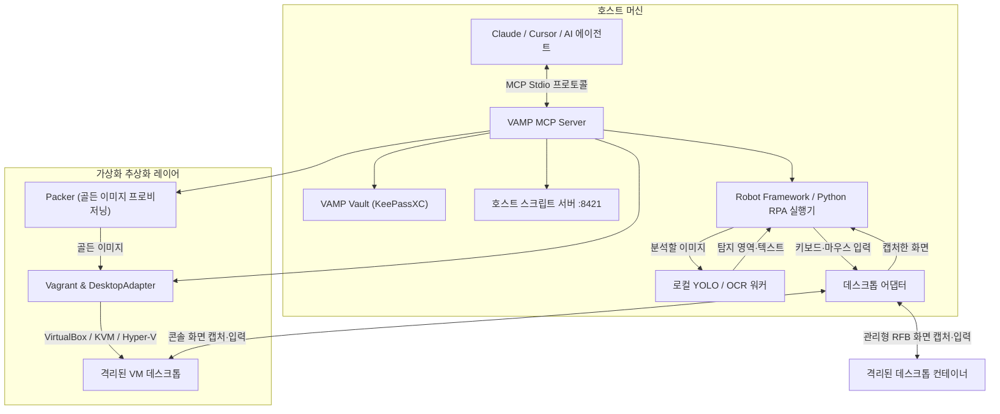

<p align="center">
  
</p>

<h1 align="center">VAMP · Virtual Agent Machine Platform</h1>

<p align="center">
  <strong>화면 캡처와 멀티모달 호출을 최대한 회피하고, 격리된 가상머신(VM)과 결정론적 RPA로 비용과 지연을 아끼는 오픈소스 플랫폼</strong>
</p>

<p align="center">
  <a href="https://github.com/wayfarer6/vamp-mcp/releases"></a>
  <a href="https://www.npmjs.com/package/vamp-mcp"></a>
  <a href="https://www.npmjs.com/package/vamp-mcp-vault"></a>
  <a href="https://marketplace.visualstudio.com/items?itemName=wayfarer6.vamp-mcp-tools"></a>
  <a href="https://wayfarer6.github.io/vamp-script-hub/"></a>
  <a href="LICENSE"></a>
</p>

<p align="center">
  <a href="README.md">English</a> · <a href="README.ko.md">한국어</a> · <a href="docs/USER_GUIDE.md">사용자 가이드</a> · <a href="https://wayfarer6.github.io/vamp-script-hub/">스크립트 허브</a> · <a href="docs/ROADMAP.md">로드맵</a>
</p>

---

## 💡 왜 VAMP인가요?

화면을 직접 보고 컴퓨터를 조작하는 AI 에이전트(Computer-Using Agent, CUA)는 강력하지만, 실제 환경에서는 두 가지 치명적인 한계에 부딪힙니다:

1. **극심한 토큰 낭비**: 버튼 하나 누르고 다음 입력창을 찾는 모든 단계마다 고해상도 화면 캡처를 멀티모달 모델로 전송합니다. 단순한 로그인이나 폼 입력 작업조차 매번 수십만 토큰을 소모합니다.
2. **실제 환경의 벽**: 헤드리스 브라우저나 도커(Docker) 컨테이너는 윈도우 네이티브 프로그램, 기업용 ERP, 공공 포털, 안티 매크로/보안 모듈, 하드웨어 토큰 검증 앞에서 무력하게 차단됩니다.

**VAMP는 이 문제를 단순하고 확실한 루프로 해결합니다:**

```
[1. 최초 1회 녹화]      사람이나 CUA가 깨끗한 가상머신(VM)에서 작업을 1회 수행합니다.
        │
[2. RPA 패키지화]       VAMP가 이를 검증된 결정론적 Robot Framework / Python 스크립트로 묶습니다.
        │
[3. Universal SSH]      에이전트는 화면 좌표를 다시 찍을 필요 없이, SSH로 매개변수만 넘겨 실행합니다.
        │
[4. 무토큰 로컬 검증]   VM 내부의 로컬 YOLO & OCR 데몬이 성공 여부를 검증하고 요약 결과만 LLM에 반환합니다.
```

**실행(로컬 RPA)**과 **시각 판단(멀티모달 LLM)**을 분리함으로써, VAMP는 반복 작업에서 무거운 화면 캡처 전송을 원천 회피하고 완벽한 하드웨어 가상화(VT-x) 격리 환경에서 가벼운 텍스트 요약만 주고받습니다. (화면은 검증 실패나 예외 상황에서만 로컬 비전 데몬으로 최소한만 확인합니다.)

---

## ⚖️ 기존 방식과의 비교

| 비교 항목 | 일반 멀티모달 CUA | 헤드리스 브라우저 / Docker | **VAMP 플랫폼** |
| :--- | :--- | :--- | :--- |
| **멀티모달 비전 토큰** | 매 조작마다 전체 화면 캡처 전송 | 없음 (DOM/텍스트 중심) | **원천 회피** (결정론적 로컬 RPA + 간결한 텍스트 검증 결과) |
| **작업 실행 속도** | 화면 왕복당 5~15초 지연 | 빠름 (스크립트) | **네이티브 속도로 즉각 실행** |
| **실행 대상 환경** | 호스트 화면 점유에 한정 | 웹 전용, 리눅스 헤드리스 | **완전한 Windows 11 & Debian 데스크톱** |
| **보안 모듈 / DRM 탐지** | OS 후킹으로 쉽게 탐지 | 즉시 차단됨 | **풀 하드웨어 VM 격리 (VT-x, USB 에뮬레이션)** |
| **자격증명 보안** | 프롬프트 컨텍스트에 노출 | 환경변수 평문 노출 | **KeePassXC/VeraCrypt 금고, `stdin` 파이프 전달** |
| **제어 프로토콜** | 호스트 키보드/마우스 하이재킹 | Chrome DevTools Protocol | **Universal SSH (Linux + Windows PowerShell 통일)** |

---

## ⚡ 핵심 아키텍처 & 기능

### 1. 🌐 Universal SSH 단일 제어 플레인
게스트 OS에 따라 제어 방식을 바꿀 필요가 없습니다. Packer 빌드 시점에 게스트 환경을 통일합니다:
- **Windows 11**: OpenSSH Server 기능 자동 활성화, 22번 방화벽 오픈, **기본 셸을 PowerShell로 지정**.
- **Debian**: `openssh-server` 자동 설치 및 활성화, 샌드박스 계정 NOPASSWD `sudo` 구성.
- **효과**: AI 에이전트는 운영체제에 구애받지 않고 **단 하나의 표준 SSH 파이프**로 게스트를 완벽히 제어합니다.

### 2. 🎛️ Packer와 Vagrant를 통한 가상화 계층 추상화
VAMP는 **HashiCorp Packer**와 **Vagrant**를 결합하여 가상화 인프라 전반을 추상화함으로써, **다양한 하이퍼바이저와 게스트 OS를 단일 규격으로 지원**합니다:
- **이미지 빌드 자동화 (Packer)**: Windows 11과 Debian의 무인 설치, 드라이버 주입(VirtIO / Guest Additions), OpenSSH 서버 구성을 표준 골든 이미지(`.box` / OVA / QCOW2)로 완전 자동화합니다.
- **수명주기 통합 제어 (Vagrant & DesktopAdapter)**: 가상머신 생성, 기동, 스냅샷, 정지를 `DesktopAdapter` 공통 인터페이스로 제어합니다. 플랫폼 환경에 맞춰 **VirtualBox, KVM(libvirt/QEMU), Hyper-V** 등 최적의 프로바이더와 플러그인을 자동으로 판별해 연동합니다.
- **하이퍼바이저 종속성 제거**: 어떤 호스트 OS나 가상화 엔진을 쓰더라도, AI 에이전트는 동일한 MCP 도구와 표준 SSH 통로를 통해 일관되게 VM을 다룰 수 있습니다.

### 3. 🚀 비전 데몬 백그라운드 사전 예열 (Cold-Start 해소)
VAMP MCP 서버는 기동 시 stdio 핸드셰이크를 블로킹하지 않고 백그라운드에서 PaddleOCR과 YOLO 비전 데몬을 비동기로 예열합니다. 에이전트가 화면 검증을 호출할 때 초기 지연 시간 없이 즉각 결과를 얻습니다.

### 4. 🔐 제로 트러스트 자격증명 금고 (`vamp-vault`)
- **KeePassXC** (`.kdbx`) 및 **VeraCrypt** (`.vhd`) 기반의 강력한 암호화 볼트.
- 암호와 인증서는 CLI 인자(`argv`) 대신 오직 **표준 입력(`stdin`) 파이프로만 전달**되어 `ps aux` 프로세스 목록 노출을 원천 차단합니다.
- **호스트별 엄격한 격리**: 원격 서버는 각자의 로컬 볼트를 독립적으로 소유하며, 호스트 간 자격증명을 절대 공유하거나 동기화하지 않습니다.

### 5. 📦 게스트 초기 설정

Packer 게스트는 사후 설정 파일을 빌드 호스트에서 받습니다. VirtualBox는 기존 NAT 경로를 유지합니다. Hyper-V는 선택한 가상 스위치의 호스트 IPv4를 사용합니다. QEMU 기본 빌드 NAT의 호스트 주소는 `10.0.2.2`이며, 배포된 libvirt VM의 네트워크와는 별개입니다. 설정과 오류 진단은 [VM MCP 문서](docs/VM_MCP.md)를 참고하세요.

---

## 🚀 빠른 시작

### 1. VS Code 없이 MCP 사용

Node.js 22+ 환경에서 [GitHub 릴리즈](https://github.com/wayfarer6/vamp-mcp/releases)의 `vamp-mcp`와 선택 사항인 `vamp-mcp-vault` tarball을 내려받습니다. 릴리즈 노트의 SHA-256을 확인한 뒤 내려받은 파일로 설치합니다.

```bash
npm install -g ./vamp-mcp-0.3.6.tgz ./vamp-mcp-vault-0.1.12.tgz
```

클라이언트에 인자 없이 `vamp-mcp`를 **VAMP MCP**로, `vamp-mcp-vault`를 **VAMP Vault**로 등록합니다. 클라이언트가 명령을 찾지 못하면 설치된 전체 경로를 사용하세요. Podman이나 하이퍼바이저를 별도로 등록하지 않습니다. 자세한 내용은 [MCP 등록 가이드](docs/MCP_REGISTRATION.md)를 참고하세요.

### 2. VS Code 확장 사용

1. [GitHub 릴리즈](https://github.com/wayfarer6/vamp-mcp/releases)에서 VSIX 파일 두 개를 받아 **Extensions: Install from VSIX**로 설치한 뒤 VS Code를 다시 로드합니다.
2. **VAMP** 사이드바에서 **Open VM Manager**로 VM을, **Open Containers**로 Podman 목록과 데스크톱을, **RPA Library**로 검토한 워크플로를 관리합니다. 자격증명은 별도의 **VAMP Vault**에서 관리합니다.
3. WSL은 [수동 설정 가이드(영문)](vscode-extension/CONTAINERS_WSL.md)를, rootless Podman과 noVNC는 [컨테이너 데스크톱 문서](docs/CONTAINER_DESKTOP.md)를 참고하세요.

Windows 호스트 PowerShell 실행 정책 및 별도의 Hyper-V/CIM 권한 확인은 [Windows 호스트 안내](docs/INSTALL.md#windows-powershell-host)를 참고하세요.

---

## 🏗️ 아키텍처 개요



Robot Framework와 Python RPA, 로컬 YOLO·OCR 워커는 제어 호스트에서
실행합니다. 사람이 VM 콘솔을 조작하듯 데스크톱 어댑터가 대상 화면을
캡처하고 키보드·마우스 입력을 보냅니다. 원격 VM은 SSH를 통해 원격
하이퍼바이저 호스트에 콘솔 캡처·입력을 요청하고, 받은 화면은 제어 호스트에서
분석할 수 있습니다. 지원하는 조작은 데스크톱 백엔드에 따라 달라집니다.

---

## 🌐 커뮤니티 스크립트 허브

바퀴를 다시 발명하지 마세요. **[VAMP Script Hub](https://wayfarer6.github.io/vamp-script-hub/)**에서 이미 검증된 커뮤니티 RPA 스크립트를 바로 이용할 수 있습니다:
- 주요 포털 자동 로그인 (네이버, 구글, 깃허브, 슬랙)
- 기업용 전자결재 및 PDF 인쇄 자동화
- 데이터 수집 및 상태 업데이트 정기 작업

---

## 🔒 책임 한계와 안전한 사용 (Responsible Use)

VAMP는 로컬 자동화 및 보안 인프라 연구를 위해 제작된 오픈소스입니다.
- **인간의 직접 승인(HITL) 원칙**: 자율적인 금전 거래(은행 송금, 결제, 가상자산 이동 등)에 사용하는 것을 권장하지 않으며, 민감한 작업은 반드시 사용자의 확인을 거쳐야 합니다.
- **격리된 샌드박스**: 게스트 VM 내부에서 실행된 스크립트와 에이전트 조작의 최종 책임은 사용자 본인에게 있습니다.
- **오픈소스 라이선스**: 코드는 [MIT 라이선스](LICENSE)를 따릅니다. 타사 구성 요소는 해당 라이선스를 준수합니다 ([THIRD_PARTY_NOTICES.md](THIRD_PARTY_NOTICES.md)).
