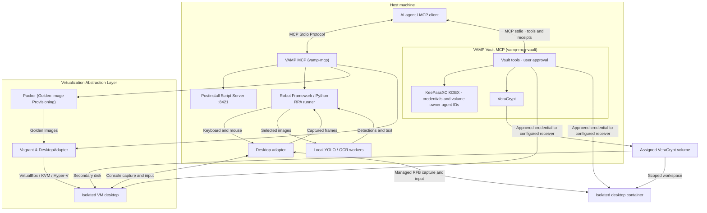

<p align="center">
  
</p>

<h1 align="center">VAMP · Virtual Agent Machine Platform</h1>

<p align="center">
  <strong>Avoid expensive multimodal tokens with VM-isolated GUI RPA and encrypted zero-trust credential vaults.</strong>
</p>

<p align="center">
  <a href="https://github.com/wayfarer6/vamp-mcp/releases"></a>
  <a href="https://marketplace.visualstudio.com/items?itemName=wayfarer6.vamp-mcp-tools"></a>
  <a href="https://wayfarer6.github.io/vamp-script-hub/"></a>
  <a href="LICENSE"></a>
</p>

<p align="center">
  <a href="README.md">English</a> · <a href="README.ko.md">한국어</a> · <a href="docs/USER_GUIDE.md">User Guide</a> · <a href="https://wayfarer6.github.io/vamp-script-hub/">Script Hub</a> · <a href="docs/ROADMAP.md">Roadmap</a>
</p>

---

## 💡 Why VAMP?

Computer-Using AI agents (CUA) are powerful, but they suffer from two fundamental problems in the real world:

1. **The Token Drain**: Every single interaction requires taking a high-resolution screenshot and feeding it into multimodal models. Repeating a routine 10-step login or data extraction task burns hundreds of thousands of tokens every single run.
2. **The Environment Wall**: Headless browsers and lightweight Docker containers fall flat when faced with native Windows desktop applications, enterprise ERPs, government portals, anti-bot software, and hardware security token checks.

**VAMP introduces an elegant, token-efficient paradigm:**

```
[1. Record Once]        Human or CUA performs the task once on a clean VM.
       │
[2. Package as RPA]     VAMP converts the action into a deterministic Robot/Python script.
       │
[3. Universal SSH]      AI agents trigger the script over a unified SSH pipe with parameters.
       │
[4. Zero-Token Check]   Local YOLO & OCR daemons verify success inside the VM without streaming frames to the LLM.
```

By decoupling **execution logic** from **visual reasoning**, VAMP avoids expensive multimodal roundtrips entirely for routine workflows, running deterministic RPA inside full hardware virtual machines (VT-x) and inspecting screens with local vision models only when verification or error handling is strictly needed.

---

## ⚖️ How VAMP Compares

| Feature | Standard Multimodal CUA | Headless Browser / Docker | **VAMP Platform** |
| :--- | :--- | :--- | :--- |
| **Multimodal Vision Tokens** | High (captures full screen every action) | None (DOM/Text only) | **Avoided entirely** (Deterministic local RPA + concise text summaries) |
| **Execution Latency** | High (5-15s per screen roundtrip) | Low (Scripted) | **Near-instant native execution** |
| **Application Support** | Limited to current host screen | Web only, Linux headless | **Full Windows 11 & Debian desktops** |
| **Anti-Bot / DRM Bypass**| Easily flagged by OS hooks | Blocked immediately | **Hardware VM isolation (VT-x, USB pass-through)** |
| **Credential Security** | Plaintext in prompt context | Environment variables | **KeePassXC / VeraCrypt vault via `stdin` (Zero leak)** |
| **Control Plane** | Host OS keyboard/mouse hijack | DevTools Protocol | **Universal SSH (Linux + Windows PowerShell)** |

---

## ⚡ Core Architecture & Highlights

### 1. 🌐 Universal SSH Control Plane
Forget OS-dependent orchestration. During Packer automated builds, VAMP automatically configures:
- **Windows 11**: OpenSSH Server capability enabled, automatic service startup, port 22 firewall rule, and **PowerShell configured as the default shell**.
- **Debian**: `openssh-server` preseeded, auto-enabled, and passwordless `sudo` set up for sandbox users.
- **Result**: AI agents interact with all guests through a **single, standardized SSH pipe**.

### 2. 🎛️ Virtualization Abstraction via Packer & Vagrant
VAMP abstracts the entire virtualization stack using **HashiCorp Packer** and **Vagrant**, enabling seamless support across diverse hypervisors and guest OSes:
- **Automated Image Provisioning (Packer)**: Builds clean, standardized golden images (`.box` / OVA / QCOW2) across **Windows 11 and Debian** with zero human intervention. Automatically injects guest drivers (VirtIO / Guest Additions) and provisions OpenSSH.
- **Unified Runtime Lifecycle (Vagrant & DesktopAdapter)**: Wraps VM creation, boot, snapshots, and networking behind a common interface. Automatically resolves the optimal provider and plugins across **VirtualBox, KVM (libvirt/QEMU), and Hyper-V**.
- **Zero Hypervisor Boilerplate**: AI agents and developers interact with the exact same MCP tools and SSH pipelines regardless of the host OS or underlying hypervisor engine.

### 3. 🚀 Instant Vision Preload (Zero Cold-Start)
VAMP MCP servers automatically warm up local OCR (PaddleOCR) and YOLO vision daemons asynchronously upon startup. Handshakes and stdio communication remain unblocked, ensuring zero initial latency when an agent requests UI element verification.

### 4. 🔐 Zero-Trust Credential Isolation (`vamp-vault`)
- Encrypted **KeePassXC** (`.kdbx`) and optional **VeraCrypt** (`.vhd`) volume storage.
- Credentials are piped exclusively via `stdin` directly into target tools—**never passed via command-line arguments (`argv`)**, preventing `ps aux` process table inspection.
- **Strict Per-Host Boundary**: Remote servers maintain their own independent vaults; credentials and master keys are never shared or synced between remote hosts.

### 5. 📦 Guest bootstrapping

Packer guests fetch post-install resources from their build host, not from a universal address. VirtualBox keeps its existing NAT path. Hyper-V uses the selected virtual switch's host IPv4; QEMU's default build NAT reaches the host at `10.0.2.2`, distinct from the deployed libvirt network. See [VM MCP](docs/VM_MCP.md) for setup and troubleshooting.

---

## 🚀 Quick Start

### 1. Use MCP without VS Code

With Node.js 22+, download the standalone `vamp-mcp` and optionally `vamp-mcp-vault` tarballs from [GitHub Releases](https://github.com/wayfarer6/vamp-mcp/releases). Verify the SHA-256 hashes against the release's `SHA256SUMS` file, then install from the downloaded files:

```bash
npm install -g ./vamp-mcp-0.3.6.tgz ./vamp-mcp-vault-0.1.12.tgz
```

Register **VAMP MCP** with command `vamp-mcp` and no arguments, and **VAMP Vault** with command `vamp-mcp-vault` and no arguments. If the client cannot resolve these commands, use their full installed paths. Do not add separate Podman or hypervisor registrations. See [MCP registration](docs/MCP_REGISTRATION.md).

### 2. Use the VS Code extensions

1. Download both VSIX files from [GitHub Releases](https://github.com/wayfarer6/vamp-mcp/releases). Use **Extensions: Install from VSIX** separately for each file. Install VAMP MCP Tools first, wait for it to finish, then install VAMP Vault and reload VS Code.
2. Open the **VAMP** activity bar. Use **Open VM Manager** for VMs, **Open Containers** for the Podman inventory and desktop actions, and **RPA Library** for reviewed workflows. Manage credentials in **VAMP Vault** separately.
3. For WSL, follow the [manual setup guide](vscode-extension/CONTAINERS_WSL.md). See [Container desktops](docs/CONTAINER_DESKTOP.md) for rootless Podman, noVNC, capture, and limitations.

For Windows host PowerShell policy and separate Hyper-V/CIM permission checks, see the [Windows host guide](docs/INSTALL.md#windows-powershell-host).

After installing, check the VAMP entries with `code --list-extensions --show-versions`. The versions should match the two downloaded file names. If a bundled Marketplace version appears, reinstall the corresponding VSIX separately.

---

## 🏗️ Architecture Overview



Robot Framework and Python run on the controller host, alongside the local YOLO
and OCR workers. The desktop adapter captures the target's screen and sends
keyboard and mouse events, as a person would through a VM console. With a
remote VM, the remote hypervisor host handles console capture and input over
SSH while the controller can analyze the returned frames locally. Supported
operations depend on the desktop backend.

The MCP client calls VAMP MCP for desktop control and calls VAMP Vault MCP
separately for credentials and encrypted volumes. After user approval,
`vault_deliver_credential` sends a value directly to the configured receiver
and returns a delivery receipt over MCP.

---

## 🌐 Community Script Hub

Don't reinvent the wheel. Browse pre-built, community-verified RPA packages on the **[VAMP Script Hub](https://wayfarer6.github.io/vamp-script-hub/)**:
- Portal logins (Naver, Google, GitHub, Slack)
- Enterprise PDF document generation
- File extraction and scheduled status reporting

---

## 🔒 Responsible Use & Security

VAMP is built for research, productivity, and secure local automation.
- **User approval**: Require explicit confirmation for sensitive actions.
- **Isolated Sandbox**: Use sandboxed credentials and test environments. You remain responsible for all operations executed inside guest VMs.
- **Open Source**: Licensed under the [MIT License](LICENSE). Third-party components retain their respective licenses (see [THIRD_PARTY_NOTICES.md](THIRD_PARTY_NOTICES.md)).
