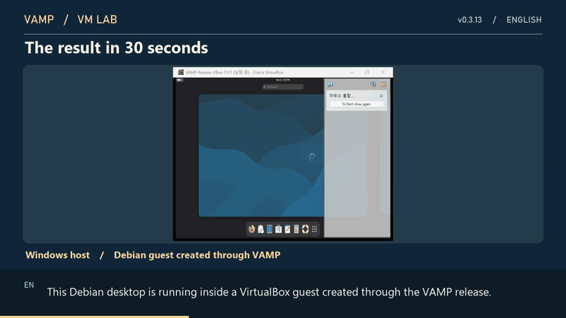
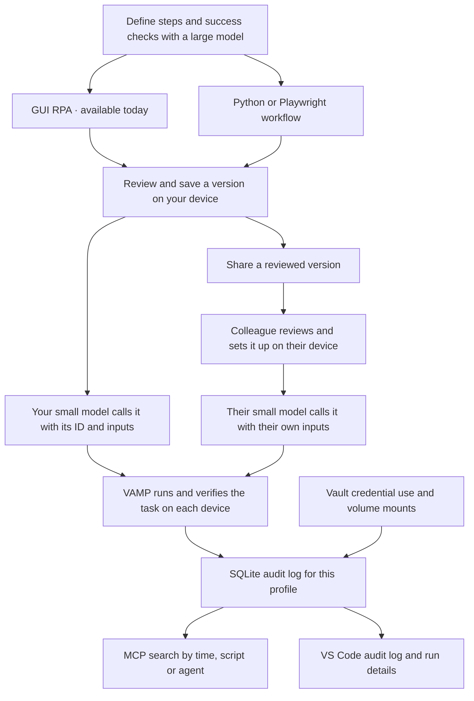
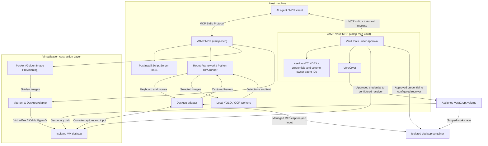

<p align="center">
  
</p>

<h1 align="center">VAMP · Virtual Agent Machine Platform</h1>

<p align="center">
  <strong>Run AI computer-use agents in VMs on your own hardware.</strong>
</p>

<p align="center">
  <a href="https://github.com/wayfarer6/vamp-mcp/actions/workflows/ci.yml"></a>
  <a href="https://github.com/wayfarer6/vamp-mcp/releases"></a>
  <a href="https://marketplace.visualstudio.com/items?itemName=wayfarer6.vamp-mcp-tools"></a>
  <a href="https://wayfarer6.github.io/vamp-script-hub/"></a>
  <a href="LICENSE"></a>
</p>

<p align="center">
  <a href="README.md">English</a> · <a href="README.ko.md">한국어</a> · <a href="docs/USER_GUIDE.md">User Guide</a> · <a href="https://wayfarer6.github.io/vamp-script-hub/">Script Hub</a> · <a href="docs/ROADMAP.md">Roadmap</a>
</p>

---

## See VAMP in 30 seconds

From the VAMP VS Code extension, open a VirtualBox guest and verify that its Debian desktop is live.

[](https://raw.githubusercontent.com/wayfarer6/vamp-mcp/main/docs/media/vamp-result-en.mp4)

[▶ Watch the English demo (0:30)](https://raw.githubusercontent.com/wayfarer6/vamp-mcp/main/docs/media/vamp-result-en.mp4)

[English and Korean video guides](docs/VM_LAB.md) include the 30-second demo, installation and AI connection, architecture, and a hands-on VM lab.

## Build the automation today. Tomorrow, just change the order number.

Today, work with a large model to export an order from your ERP to CSV. Save the steps along with a check that the new file contains the requested order number. Tomorrow, ask a smaller model to **“export order 1042 the same way.”** It finds the workflow in the RPA Library and passes the new order number through MCP. VAMP runs the saved steps on your device and checks the CSV.

**You can share a reviewed workflow with a colleague.** Export a specific version of a GUI RPA as a source ZIP. Your colleague can inspect the code and inputs, then reuse it in a compatible environment on their device with their own order number. Leave passwords and real order data out of the package. Reusing the steps can lower model costs on repeat runs because a large model no longer has to plan each click or command anew.

**This branch adds saved Python and Playwright workflows alongside GUI recordings.** Open the RPA Library to import an order-export example, review its code for your VM and run it with a different order number. The CLI worker supports Linux guests on VirtualBox, KVM and Hyper-V. [GUI RPA guide](docs/WORKFLOWS.md) · [CLI setup and order example](docs/CLI_WORKFLOWS.md)



If an AI provider raises its API prices or discontinues its service, you can keep using the saved workflow by maintaining its execution environment and connecting another small model that supports MCP. You decide how to edit the script and whom to share it with.

**Even if you switch models, the workflows you’ve built stay on your device.**

## Which agent ran a script?

In this branch, **VAMP: Open Audit Log** shows the latest matching event per run over the last 24 hours. Combine a local time range, script name or UUID, agent ID and activity type. Select a row to open its timeline.

Ask your AI to “Find runs of the order export script by `orders-agent` between 9 and 10 this morning and show their verification results.” It can use `audit_search` and `audit_run_details`. For a stable ID across restarts, set `VAMP_AGENT_ID=orders-agent` on that agent’s dedicated MCP server. Otherwise the server automatically assigns a process-session ID. [SQLite location, profiles and query examples](docs/AUDIT_LOG.md)

### Verify a recorded click

When saving a recording, enter the text on each button or its specific YOLO class. Replay checks the guest before each press. The default minimum score is 90%. In **RPA Library → Recorded click verification**, set 1–100% or turn verification off. You can also tell your agent “Use 95% for this run only.” [Recognition, fallback and MCP examples](docs/RECORDED_CLICKS.md)

## Ask your AI to install VAMP

In Claude Code or Codex with terminal access to your Windows PC, paste this request:

```text
https://github.com/wayfarer6/vamp-mcp
Install VAMP MCP on my Windows PC from the latest official release. Verify the package
checksum, connect it to this AI client, and list my VMs using the backend I use on
this PC (VirtualBox or Hyper-V) to confirm it works.
```

```text
https://github.com/wayfarer6/vamp-mcp
Install VAMP MCP on my Linux PC from the latest official release. Verify the package
checksum, connect it to this AI client, and list my VMs using the backend I use on
this PC (VirtualBox or KVM) to confirm it works.
```

[English first-run guide: web-chat prompts, install commands, screenshots, and the order CSV demo](docs/FIRST_RUN.en.md) · [English walkthrough video (3:02)](https://github.com/wayfarer6/vamp-mcp/raw/refs/heads/main/docs/media/vamp-first-run-en.mp4) · [한국어 가이드](docs/FIRST_RUN.ko.md)

Next video · [VAMP MCP architecture in Korean (3:04)](https://github.com/wayfarer6/vamp-mcp/raw/refs/heads/main/docs/media/vamp-architecture-ko.mp4). Follow a request from the AI client to the guest and compare VirtualBox, KVM, and Hyper-V.

**English architecture video** · [VirtualBox, KVM and Hyper-V architecture (1:53)](https://github.com/wayfarer6/vamp-mcp/raw/refs/heads/main/docs/media/vamp-architecture-en.mp4).

## How to use

**Supported hosts:** Windows and Linux. macOS is outside the supported host scope.

**Hyper-V on Windows (experimental).** Enable Hyper-V and select **VM Manager → Connection → Virtualization platform → Hyper-V**. VAMP can create and list VMs, launch VMConnect, and exchange files with supported Windows guests. Use VMConnect for the guest desktop. Hyper-V does not yet support the embedded viewer or saved desktop replay. [Hyper-V setup and MCP tools](backends/hyperv/README.md)

**Windows MCP requirement.** VAMP and VAMP Vault MCP servers require Windows administrator privileges. The `vamp-mcp` CLI can request UAC to start the server in a separate elevated process while the MCP client stays open. For a direct server command, start it from an administrator terminal. To use the MCP servers provided by the VS Code extensions, start VS Code with **Run as administrator**. Direct server startup exits when Windows has not granted administrator privileges.

Contributions are welcome. See the [contribution guide](CONTRIBUTING.md) and [AI contributor instructions](AGENTS.md).

Run GUI automation inside a guest while you keep using your host desktop. With saved RPA, local replay can check the screen and output files without sending frames to a model. An external agent can receive screen data if its client requests it during exploration or targeted fallback. Vault-managed secrets can be delivered through the approved guest connection.

For SSH-based remote GUI automation, see the [WSL2 remote MCP worker guide](docs/WSL2_REMOTE_WORKER.md).

WSL2 remote MCP guides ([English](https://github.com/wayfarer6/vamp-mcp/releases/download/v0.3.13/17-VAMP-WSL-Remote-MCP-Guide-QHD-en.mp4) · [한국어](https://github.com/wayfarer6/vamp-mcp/releases/download/v0.3.13/17-VAMP-WSL-Remote-MCP-Guide-QHD-ko.mp4)).

Watch the [VAMP overview in English](https://github.com/wayfarer6/vamp-mcp/releases/download/v0.3.11/14-VAMP-Overview-en.mp4) for the architecture and first steps. The [English installation guide](https://github.com/wayfarer6/vamp-mcp/releases/download/v0.3.11/11-VAMP-Install-Guide-X-en.mp4) starts on the Windows host with MCP package and VSIX installation and follows both routes through Debian startup in VirtualBox.

- VAMP MCP and Vault in an AI client ([English](https://github.com/wayfarer6/vamp-mcp/releases/download/v0.3.12/15-VAMP-MCP-Vault-AI-Walkthrough-QHD-en.mp4) · [Korean](https://github.com/wayfarer6/vamp-mcp/releases/download/v0.3.12/15-VAMP-MCP-Vault-AI-Walkthrough-QHD-ko.mp4))
- Create and replay a manual RPA ([English](https://github.com/wayfarer6/vamp-mcp/releases/download/v0.3.12/16-VAMP-Manual-RPA-Guide-QHD-en.mp4) · [Korean](https://github.com/wayfarer6/vamp-mcp/releases/download/v0.3.12/16-VAMP-Manual-RPA-Guide-QHD-ko.mp4))

Watch the [Windows VirtualBox Notepad verification in English](https://github.com/wayfarer6/vamp-mcp/releases/download/v0.3.10/04-Windows-VirtualBox-Notepad-QHD-en.mp4) or [Korean](https://github.com/wayfarer6/vamp-mcp/releases/download/v0.3.10/04-Windows-VirtualBox-Notepad-QHD-ko.mp4). The Robot Framework run opens Notepad and checks the `Windows (CRLF)` status bar in a 1920×1080 guest.

- Podman · Debian / VirtualBox setup video ([Korean](https://github.com/wayfarer6/vamp-mcp/releases/download/v0.3.10/03-Podman-VirtualBox-QHD-ko.mp4) · [English](https://github.com/wayfarer6/vamp-mcp/releases/download/v0.3.10/03-Podman-VirtualBox-QHD-en.mp4))
- [Robot Framework source for the Korean and English editions](https://github.com/wayfarer6/vamp-mcp/releases/download/v0.3.10/VAMP-setup-editions-robot-source.zip)
- [Robot Framework sources and QA results](https://github.com/wayfarer6/vamp-mcp/releases/download/v0.3.10/VAMP-v0.3.10-demo-source-and-qa.zip)
- [Record in VirtualBox and add the Python script to the VS Code RPA Library](docs/USER_GUIDE.md#2-make-a-vm-recording-appear-in-the-library)
- [Generate a standalone Robot Framework package for a VirtualBox, SPICE, or VNC guest](docs/RECORDING_CONVERSION.md#b-게스트-안에서-기록한-pyautogui-코드-변환) using the [Windows Notepad sample recording](examples/notepad_recording.py).
- [Standalone Demo ERP for replay and repair](https://github.com/wayfarer6/vamp-demo-erp)
- ERP replay verification in VirtualBox ([English](https://github.com/wayfarer6/vamp-mcp/releases/download/v0.3.10/05-VirtualBox-ERP-Replay-QHD-en.mp4) · [Korean](https://github.com/wayfarer6/vamp-mcp/releases/download/v0.3.10/05-VirtualBox-ERP-Replay-QHD-ko.mp4))
- Scratch repair verification in VirtualBox ([English](https://github.com/wayfarer6/vamp-mcp/releases/download/v0.3.10/06-VirtualBox-Scratch-Repair-QHD-en.mp4) · [Korean](https://github.com/wayfarer6/vamp-mcp/releases/download/v0.3.10/06-VirtualBox-Scratch-Repair-QHD-ko.mp4))
- Codex ERP rehearsal, edited from actual guest captures and the reviewed source ([English](https://github.com/wayfarer6/vamp-mcp/releases/download/v0.3.11/07-ERP-Rehearsal-QHD-en.mp4) · [Korean](https://github.com/wayfarer6/vamp-mcp/releases/download/v0.3.11/07-ERP-Rehearsal-QHD-ko.mp4))
- [Codex ERP Robot Framework evidence](https://github.com/wayfarer6/vamp-mcp/releases/download/v0.3.11/vamp-erp-codex-scratch-evidence.zip) includes the verification suite, reports, and sample CSVs.
- Installed MCP replay after the ERP layout change ([English labels](https://github.com/wayfarer6/vamp-mcp/releases/download/v0.3.11/08-Installed-MCP-ERP-v2-QHD-en.mp4) · [Korean labels](https://github.com/wayfarer6/vamp-mcp/releases/download/v0.3.11/08-Installed-MCP-ERP-v2-QHD-ko.mp4)).
- Five-step synthetic modal recovery demo ([English](https://github.com/wayfarer6/vamp-mcp/releases/download/v0.3.11/09-Modal-Recovery-QHD-en.mp4) · [Korean](https://github.com/wayfarer6/vamp-mcp/releases/download/v0.3.11/09-Modal-Recovery-QHD-ko.mp4)).
- Continuous Codex ERP showcase with captions, from authoring to the installed MCP rerun ([English](https://github.com/wayfarer6/vamp-mcp/releases/download/v0.3.11/10-ERP-Continuous-QHD-en.mp4) · [Korean](https://github.com/wayfarer6/vamp-mcp/releases/download/v0.3.11/10-ERP-Continuous-QHD-ko.mp4)).
- [ERP run results and comparison method](docs/ROADMAP.md#observed-erp-run)
- [Run a reviewed VirtualBox scenario and get its CSV in MCP chat](docs/USER_GUIDE.md#get-an-erp-csv-in-chat) (current source build)
- [Export a decrypted copy of a file from a mounted VeraCrypt container with Vault MCP or VS Code](vscode-vault-extension/README.md#export-a-file-from-a-mounted-container) (current source build)

## 💡 Why VAMP?

Computer-Using AI agents (CUA) are powerful, but they suffer from two fundamental problems in the real world:

1. **Repeated screen analysis**. A screenshot-driven agent may send new frames to a vision model as it makes decisions. Repeating the same workflow can incur the same model calls again.
2. **The Environment Wall**: Headless browsers and lightweight Docker containers fall flat when faced with native Windows desktop applications, enterprise ERPs, government portals, anti-bot software, and hardware security token checks.

**VAMP introduces an elegant, token-efficient paradigm:**

```
[1. Record Once]        Human or CUA performs the task once on a clean VM.
       │
[2. Package as RPA]     VAMP converts the action into a deterministic Robot/Python script.
       │
[3. Universal SSH]      AI agents trigger the script over a unified SSH pipe with parameters.
       │
[4. Zero-Token Check]   Local YOLO & OCR daemons verify success inside the VM without streaming frames to the LLM.
```

By decoupling **execution logic** from **visual reasoning**, VAMP avoids expensive multimodal roundtrips entirely for routine workflows, running deterministic RPA inside full hardware virtual machines (VT-x) and inspecting screens with local vision models only when verification or error handling is strictly needed.

---

## ⚖️ How VAMP Compares

| Metric | Screen-driven CUA | Fixed recorded RPA | VAMP saved RPA |
| --- | --- | --- | --- |
| Vision token cost | Provider usage depends on screenshot calls | No provider calls during fixed replay | Local replay and verification use no provider vision tokens. AI-assisted repair is measured separately. |
| Execution latency | Includes screen-driven model calls | Includes scripted inputs and waits | Includes guest inputs, waits, and configured local checks |
| After a layout change | Can inspect the new screen before acting | Requires explicit starting-screen and outcome checks to detect a mismatch | Can stop before input on a configured starting-screen mismatch and hand off for targeted repair |

| Windows VirtualBox ERP check | Elapsed time | Verified outcome |
| --- | ---: | --- |
| Saved replay on the original layout | 35.97 s | 17 actions and a fresh CSV with all three expected orders |
| Saved replay after scratch verification and review | 54.44 s | 30 actions and a fresh CSV with the expected SHA-256 |
| Robot Framework scenario across both layouts | 239.05 s | Two matching CSVs and zero inputs from the stale replay |

In a separate matched comparison with three runs per method and layout, VAMP saved replay verified all three v1 CSVs and stopped all three v2 runs before sending input. Fixed keyboard replay produced three incorrect v2 CSVs, and screen-driven CUA verified all six CSVs across both layouts. [Median timings and evidence](docs/ROADMAP.md#matched-erp-comparison)

---

## ⚡ Core Architecture & Highlights

### 1. 🌐 Universal SSH Control Plane
Forget OS-dependent orchestration. During Packer automated builds, VAMP automatically configures:
- **Windows 11**: OpenSSH Server capability enabled, automatic service startup, port 22 firewall rule, and **PowerShell configured as the default shell**.
- **Debian**: `openssh-server` preseeded, auto-enabled, and passwordless `sudo` set up for sandbox users.
- **Result**: AI agents interact with all guests through a **single, standardized SSH pipe**.

### 2. 🎛️ Virtualization Abstraction via Packer & Vagrant
VAMP abstracts the entire virtualization stack using **HashiCorp Packer** and **Vagrant**, enabling seamless support across diverse hypervisors and guest OSes:
- **Automated Image Provisioning (Packer)**: Builds clean, standardized golden images (`.box` / OVA / QCOW2) across **Windows 11 and Debian** with zero human intervention. Automatically injects guest drivers (VirtIO / Guest Additions) and provisions OpenSSH.
- **Unified Runtime Lifecycle (Vagrant & DesktopAdapter)**: Wraps VM creation, boot, snapshots, and networking behind a common interface. Automatically resolves the optimal provider and plugins across **VirtualBox, KVM (libvirt/QEMU), and Hyper-V**.
- **Zero Hypervisor Boilerplate**: AI agents and developers interact with the exact same MCP tools and SSH pipelines regardless of the host OS or underlying hypervisor engine.

### 3. 🚀 Instant Vision Preload (Zero Cold-Start)
VAMP MCP prepares its default OmniParser YOLO icon weights in the background at startup, checks their SHA-256, and reuses the user cache. Configured OCR and YOLO workers warm up without delaying the MCP handshake. [Model setup and overrides](docs/USER_GUIDE.md#호스트-paddleocr-준비)

### 4. 🔐 Zero-Trust Credential Isolation (`vamp-vault`)
- Encrypted **KeePassXC** (`.kdbx`) and optional **VeraCrypt** (`.vhd`) volume storage.
- Credentials are piped exclusively via `stdin` directly into target tools—**never passed via command-line arguments (`argv`)**, preventing `ps aux` process table inspection.
- **Strict Per-Host Boundary**: Remote servers maintain their own independent vaults; credentials and master keys are never shared or synced between remote hosts.

### 5. 📦 Guest bootstrapping

VirtualBox fetches post-install resources over its build NAT. Hyper-V Windows uses the selected switch's host IPv4, while Hyper-V Debian reads offline answer media and uses a static network profile after installation. QEMU's default build NAT reaches the host at `10.0.2.2`, independently of the deployed libvirt network. [VM MCP setup and troubleshooting](docs/VM_MCP.md)

For a Debian golden image on Hyper-V, prepare a dedicated internal switch with WinNAT and reserve a static guest address before starting the build. If an older image build stalled at Default Switch DHCP or network preseed, start a fresh build with the offline answer ISO. Keep the golden export separate from the live VM disk. [Debian Hyper-V setup and recovery](backends/packer/debian-hyperv/README.md)

---

## 🚀 Quick Start

### 1. Use MCP without VS Code

With Node.js 22+, download the standalone `vamp-mcp` and optionally `vamp-mcp-vault` tarballs from [GitHub Releases](https://github.com/wayfarer6/vamp-mcp/releases). Verify the tarball hashes against `RELEASE-SHA256SUMS`, then install the packages you downloaded.

```bash
npm install -g ./vamp-mcp-0.3.13.tgz
vamp-mcp setup
# Optional Vault
npm install -g ./vamp-mcp-vault-0.1.15.tgz
```

Register **VAMP MCP** with command `vamp-mcp` and no arguments, and **VAMP Vault** with command `vamp-mcp-vault` and no arguments. If the client cannot resolve these commands, use their full installed paths. Do not add separate Podman or hypervisor registrations. See [MCP registration](docs/MCP_REGISTRATION.md).

### 2. Use the VS Code extensions

1. Download both VSIX files from [GitHub Releases](https://github.com/wayfarer6/vamp-mcp/releases). Use **Extensions: Install from VSIX** separately for each file. Install VAMP MCP Tools first, wait for it to finish, then install VAMP Vault and reload VS Code.
2. Open the **VAMP** activity bar. Use **Open VM Manager** for VMs, **Open Containers** for the Podman inventory and desktop actions, and **RPA Library** for reviewed workflows. Manage credentials in **VAMP Vault** separately.
3. For WSL, follow the [manual setup guide](vscode-extension/CONTAINERS_WSL.md). See [Container desktops](docs/CONTAINER_DESKTOP.md) for rootless Podman, noVNC, capture, and limitations.

For Windows host PowerShell policy and separate Hyper-V/CIM permission checks, see the [Windows host guide](docs/INSTALL.md#windows-powershell-host).

After installing, check the VAMP entries with `code --list-extensions --show-versions`. The versions should match the two downloaded file names. If a bundled Marketplace version appears, reinstall the corresponding VSIX separately.

### Record, replay, and repair a task

1. Set up the guest and use the same guest resolution for recording and replay. The Windows VirtualBox setup uses 1920×1080 after initialization.
2. In **RPA Library**, search for a reviewed workflow first. To create a new one, record the task in the guest, review the captured actions, and remove sensitive input before saving. For a standalone Robot Framework package, use the [PyAutoGUI conversion guide](docs/RECORDING_CONVERSION.md).
3. Replay the reviewed workflow on the selected guest. Check the expected screen or output file before treating it as successful.
4. If the screen changed, inspect the affected area and propose a targeted repair. Test the repair in a separate VirtualBox guest, then review the verified revision before using it again. See the [recording and repair workflow](docs/WORKFLOWS.md).

For Windows replay on VirtualBox or KVM with a local VNC display that may encounter a guest UAC prompt, enable `pause_on_uac`. The recording and guest display must both be 1920×1080. VAMP checks the guest screen with local OCR and stops for operator review. To continue the same run after approval in the guest console, also set `uac_wait_seconds` and a unique `uac_resume_text` that appears in the expected app. See the [guest UAC replay workflow](docs/WORKFLOWS.md#guest-uac-replay).

---

## 🏗️ Architecture Overview



Robot Framework and Python run on the controller host, alongside the local YOLO
and OCR workers. The desktop adapter captures the target's screen and sends
keyboard and mouse events, as a person would through a VM console. With a
remote VM, the remote hypervisor host handles console capture and input over
SSH while the controller can analyze the returned frames locally. Supported
operations depend on the desktop backend.

The MCP client calls VAMP MCP for desktop control and calls VAMP Vault MCP
separately for credentials and encrypted volumes. After user approval,
`vault_deliver_credential` sends a value directly to the configured receiver
and returns a delivery receipt over MCP.

---

## 🌐 Community Script Hub

Don't reinvent the wheel. Browse pre-built, community-verified RPA packages on the **[VAMP Script Hub](https://wayfarer6.github.io/vamp-script-hub/)**:
- Portal logins (Naver, Google, GitHub, Slack)
- Enterprise PDF document generation
- File extraction and scheduled status reporting

---

## 🔒 Responsible Use & Security

VAMP is built for research, productivity, and secure local automation.
- **User approval**: Require explicit confirmation for sensitive actions.
- **Isolated Sandbox**: Use sandboxed credentials and test environments. You remain responsible for all operations executed inside guest VMs.
- **Open Source**: Licensed under the [MIT License](LICENSE). Third-party components retain their respective licenses (see [THIRD_PARTY_NOTICES.md](THIRD_PARTY_NOTICES.md)).
