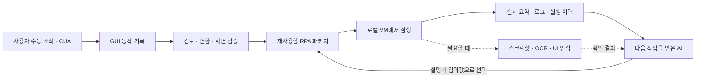

<p align="center">
  
</p>

# VAMP · Virtual Agent Machine Platform

**VM-isolated GUI RPA & Encrypted Vault Execution for AI Agents**

New VM setup uses **HashiCorp Packer**: VAMP downloads the host CLI and official hypervisor plugin, installs the OS and post-install scripts, and manages separate golden images and live VM disks. [Packer setup and storage](#vm-installation-with-hashicorp-packer).

Start in VS Code’s **VAMP** sidebar: **RPA Library** to create/find/export workflows, **Open VM Manager** for VirtualBox/KVM/Hyper-V, and **Browse Credentials** for your encrypted vault. **Create** lets you name and describe a VM recording; **Create with AI** asks questions and proposes searchable metadata. Enable **VAMP RPA Library** MCP so agents can search and reuse reviewed skills before repeating CUA or multimodal analysis.

[User guide — every button and workflow](docs/USER_GUIDE.md) · [UI audit](docs/UI_AUDIT.md)


GUI 작업을 한 번 기록해 두고, 다음에는 AI가 필요한 RPA를 골라 실행하도록 만드는 프로젝트입니다.

[VAMP 0.1.9](https://github.com/wayfarer6/vamp-mcp/releases/tag/v0.1.9) · [Vault 0.1.6](https://github.com/wayfarer6/vamp-mcp/releases/tag/v0.1.9) · [다운로드](https://github.com/wayfarer6/vamp-mcp/releases) · [VS Code 확장](https://marketplace.visualstudio.com/items?itemName=wayfarer6.vamp-mcp-tools) · [문서](docs/README.md) · [실행 영상](docs/DEMOS.md) · [Script Hub](https://wayfarer6.github.io/vamp-script-hub/) · [로드맵](docs/ROADMAP.md)

## 만든 이유

네이버 로그인 페이지를 여는 일만 해도 브라우저 실행, 주소 입력, 화면 확인이 반복됩니다. 이 과정을 매번 AI가 화면을 보며 판단하고 코드를 다시 읽게 하면 토큰을 계속 쓰게 됩니다.

사용자가 직접 조작하거나 CUA(화면을 보고 컴퓨터를 조작하는 AI)가 수행한 GUI 작업을 기록하고, 검토한 기록을 Robot Framework·Python RPA로 묶어 두려 합니다. 이후에는 AI가 작업 설명과 입력값만 보고 패키지를 골라 실행하고, 결과 요약을 받으면 됩니다. 좌표나 입력 순서 같은 세부 구현은 로컬 코드에 두고, 필요할 때만 로그와 화면을 확인하는 방식으로 토큰 비용을 줄이는 것이 목적입니다.

정상 재실행은 로컬 검증 후 상태와 증거 경로만 반환하고, 실패할 때 필요한 OCR·YOLO·화면만 확인합니다. 인식 결과 전문이나 이미지를 LLM에 계속 보내면 토큰이 발생하므로 [짧은 결과 반환 원칙](docs/LOW_TOKEN_AUTOMATION.md)을 스킬과 MCP 안내문에 포함했습니다.

하루 동안 Codex와 바이브 코딩으로 만들었습니다. 아직 거친 부분과 빠진 기능이 많습니다. 현재 시험한 환경은 KVM/VNC·SPICE와 VirtualBox이며, 토큰 절감량을 측정한 상태는 아닙니다.

### 왜 컨테이너(Docker)가 아닌 가상머신(VM)인가?

많은 에이전트 프로젝트가 가벼운 Docker 컨테이너를 먼저 시도하지만, VAMP는 의도적으로 하이퍼바이저 기반 가상머신(VirtualBox, KVM, Hyper-V)을 선택했습니다:

1. **진짜 Windows GUI 및 엔드포인트 소프트웨어 지원**: 사내 ERP, 공공 행정 포털, 레거시 데스크톱 업무 소프트웨어 및 드라이버는 호스트 커널을 공유하는 리눅스 컨테이너 안에서는 동작하지 않습니다. 완전한 Windows 데스크톱 OS 환경이 필수적입니다.
2. **게스트 장치 기반 입력**: 호스트 마우스를 움직이는 대신 하이퍼바이저의 키보드·USB Tablet API로 게스트에 입력합니다. 실제 앱의 입력 반응과 업무 성공 여부는 게스트에서 검증합니다.
3. **가상 스토리지 및 Removable USB 에뮬레이션**: 외부 하드웨어 보안 토큰이나 암호화 키스토어를 게스트 시스템에 '이동식 USB 드라이브'로 인식시키거나 VeraCrypt VHD 볼륨을 보조 블록 장치로 패스스루하려면 하이퍼바이저 레벨의 하드웨어 스토리지 컨트롤러 에뮬레이션이 필요합니다.
4. **하드웨어 가상화(VT-x) 레벨의 격리**: 에이전트의 오동작이나 악의적인 스크립트로부터 사용자 호스트 환경을 원천 차단하기 위해, 컨테이너 네임스페이스보다 격리 신뢰도가 높은 하드웨어 샌드박스를 사용합니다.

## 기록한 작업을 다시 쓰는 흐름



현재 지원하는 기록 변환은 PyAutoGUI 코드에서 SPICE용 RPA를 만드는 경로입니다. 임의의 CUA 기록을 모두 자동 변환하거나, 같은 기록을 VirtualBox에서 바로 재생하는 부분은 아직 연결하지 못했습니다. [예시와 현재 범위](docs/WORKFLOWS.md)

## 주요 기능

| 기능 | 할 수 있는 일 |
| --- | --- |
| GUI 작업 기록·재사용 | 클릭과 키 입력을 저장하고, 검토한 작업을 Robot/Python 패키지로 실행 |
| 로컬 화면 제어 | VM 화면 캡처, 키보드·마우스 입력, 선택적 OCR·UI 영역 인식 |
| 기록·로그 확인 | 녹화 소스, 실행 요약, Robot 로그·보고서와 SQLite 실행 이력 확인 |
| 필요한 화면만 보기 | 현재 화면이나 저장한 스크린샷을 확인하고, 켜 둔 실행 영상은 로컬에서 재생 |
| VS Code 실시간 VM 뷰어 | QEMU VNC 화면을 WebSocket으로 스트리밍하고, 보기 전용 탭과 외부 VNC 접속 정보 표 제공 |
| KVM MCP | VM 생성·기동·전원·스냅샷 관리, 화면·입력, Robot 시나리오 실행 |
| VirtualBox MCP | VS Code에서 VM 조회·기동, ISO 설치 시작, 해상도·공유폴더·스냅샷 도구 사용 |
| 원격 SSH MCP | SSH로 연결한 다른 컴퓨터의 VM을 조회·기동·정지하고 화면은 스크린샷으로 확인 (실시간 화면 없음) |
| VAMP Vault MCP | KeePassXC·VeraCrypt 기반 자격증명/인증서 격리 보관 및 사이드바 GUI |

OCR·UI 인식은 저장소에서 별도로 설치합니다. VSIX에는 VirtualBox MCP와 실시간 VNC 뷰어가 들어 있습니다. KVM MCP는 로컬 저장소의 Python 환경을 연결하며, VM 디스크·ISO·YOLO·PaddleOCR 모델은 VSIX에 포함하지 않습니다. [구성도](docs/MCP_ARCHITECTURE.md) · [로그·스크린샷 조회](docs/EXECUTION_HISTORY.md)

## VAMP Script Hub — 커뮤니티 RPA 스크립트 카탈로그

[VAMP Script Hub](https://wayfarer6.github.io/vamp-script-hub/)는 VAMP 사용자가 검토한 RPA 스크립트를 모아 둔 정적 사이트입니다. 스크립트마다 PyAutoGUI 소스, 입력 계약, 검증 기준, `rpa_run_saved` 호출 예시가 함께 공개되고, VirtualBox·KVM과 Windows 11·Debian/Ubuntu 조합으로 걸러 볼 수 있습니다. 저장소 안의 사본은 [`docs/hub/`](docs/hub/)에 있습니다.

멀티모달 CUA는 같은 로그인 화면이나 목록 화면을 실행할 때마다 다시 읽고 판단합니다. 허브의 스크립트는 그 판단을 이미 기록으로 남긴 것이라, 에이전트는 `rpa_search`로 맞는 항목을 찾고 `rpa_run_saved`에 입력값만 넘겨 재생하면 됩니다. 화면 인식과 코드 생성에 쓰던 토큰을 아끼는 것이 목적이며, 절감량을 비교 측정한 수치는 아직 없습니다.

### Before sharing an RPA / RPA 업로드 전 주의

> **Warning:** Before uploading an RPA script or exported ZIP, **you must personally inspect every file** for IDs, passwords, tokens, certificates, private URLs, comments, metadata, filenames and image assets. Replace private recorded values with declared inputs such as `${username}` and `${password}`. Do not upload real credentials. AI review can miss secrets and does not guarantee that an archive is safe to publish.
>
> **경고:** RPA 스크립트나 ZIP을 업로드하기 전에 **사용자가 모든 파일을 직접 확인해야 합니다.** ID·비밀번호·토큰·인증서·개인 URL·주석·메타데이터·파일명·이미지에 민감정보가 없는지 확인하세요. 실제 값은 `${username}`, `${password}` 같은 입력 매개변수로 바꾸세요. AI 검토는 누락 가능성이 있으며 개인정보가 없다는 보증이 아닙니다.

VAMP Export ZIP requires local screening, an AI review of a structural report, an AI warning, and explicit user confirmation. Detected private values block export; original source, keystrokes, filenames and metadata values are not sent to AI. If AI review is unavailable or files change after review, export is blocked. Creating a ZIP does not upload it anywhere. Direct GitHub/Script Hub uploads must also be reviewed by the user before publication.

VAMP의 Export ZIP은 로컬 검사 → 원본을 제외한 구조 요약의 AI 검토 → AI 경고 → 사용자 확인을 거칩니다. 민감정보가 발견되거나 AI 검토가 불가능하면 내보내기를 중단하며, 검토 후 파일이 바뀌면 다시 검토해야 합니다. ZIP 생성은 자동 업로드가 아닙니다. GitHub·Script Hub에 직접 올릴 때도 사용자가 업로드 전에 확인해야 합니다.

## 스크립트 공유와 연동

1. 게스트에서 작업 하나를 기록하고, 비밀번호·PIN·토큰 입력 전에 멈춥니다.
2. VS Code **RPA Library → Create**에서 이름, 설명, 사용 조건, 입력 이름, 기대 결과를 채우고 검토한 뒤 **Export ZIP**을 누릅니다. ZIP에는 파일별 SHA-256 체크섬이 담긴 `VAMP_EXPORT.json`이 들어 있으며 `.git` 이력은 포함되지 않습니다.
3. 내보낸 폴더를 `vamp-script-hub` 저장소의 `scripts/<id>/`에 넣어 풀 리퀘스트를 열거나, 사이트의 **Submit a script**에서 이슈로 제출합니다. 생성기는 VAMP와 같은 규칙으로 입력 이름과 `${name}` 자리표시자를 검사합니다.
4. 사용하는 쪽은 VS Code에서 **VAMP RPA Library** MCP를 켜고 `rpa_search` → `rpa_details` → `rpa_run_saved` 순서로 호출합니다. 정확한 VM UUID, 선언된 모든 입력, `confirmed:true`가 필요합니다.
5. `completed_unverified`는 동작 완료일 뿐 업무 성공이 아닙니다. 기대 결과를 스크린샷·OCR·파일 확인처럼 가장 저렴한 방법으로 따로 검증합니다.

기본 카탈로그는 6개 스크립트로 시작합니다: 네이버 로그인 폼 검증, 구글 검색 결과 추출, 깃허브 스타·릴리즈 확인, 슬랙 상태 설정, 노션 PDF 내보내기, 엔터프라이즈 인증서 선택 헬퍼. 사이트는 영어와 한국어를 모두 제공하며 언어 선택은 브라우저에 기억됩니다.

[허브 사이트](https://wayfarer6.github.io/vamp-script-hub/) · [저장소 안 사본](docs/hub/) · [기여 가이드](https://github.com/wayfarer6/vamp-script-hub/blob/main/CONTRIBUTING.md)


## Install the MCP servers with npm

Use the MCP servers directly from VS Code, Codex, or another stdio MCP client without installing the VS Code extensions. Requires **Node.js 22+**. There are only two packages:

- [`vamp-mcp`](https://www.npmjs.com/package/vamp-mcp): VirtualBox and KVM/libvirt control, plus the reviewed RPA library.
- [`vamp-mcp-vault`](https://www.npmjs.com/package/vamp-mcp-vault): KeePassXC credentials and optional VeraCrypt volumes.

> VAMP 0.1.9 and Vault 0.1.6 are public on npm. Installation from the registry and MCP initialization/tool discovery have been verified. The tested tarball and VSIX are also available in the [0.1.9 release](https://github.com/wayfarer6/vamp-mcp/releases/tag/v0.1.9).

Install both packages:

```bash
npm install -g vamp-mcp@0.2.0 vamp-mcp-vault@0.1.6
```

Register them with Codex:

```bash
codex mcp add vamp -- npx -y vamp-mcp@0.2.0 virtualbox
codex mcp add vamp-vault -- npx -y vamp-mcp-vault@0.1.6
```

For KVM, replace `virtualbox` with `kvm`. For the reviewed RPA library, use `library` and set `VAMP_RPA_REGISTRY` to your catalog directory. In VS Code, use **MCP: Add Server → Command (stdio)** with the matching `npx` command, or copy the configuration examples below.

npm installation does not automatically register every client, install a hypervisor/Python/KeePassXC/VeraCrypt, create a VM, or unlock a vault. Prepare those dependencies separately. Hyper-V is excluded from this npm release. The npm packages do not include the graphical VM manager or live VS Code viewer. VirtualBox VM creation uses the same provisioner as the extension; unattended OS installation requires a compatible ISO. The npm KVM server exposes `remote_vm_create`, using the same lifecycle code as the VS Code manager. Debian automatic installation boots the stock ISO and passes a preseed to the kernel/initrd, so xorriso is not needed; Ubuntu/Windows remain manual. Guest setup scripts are served by a host Python HTTP server on port 8421 and downloaded in the guest with wget/curl (`vm_script_server_start`, `vm_script_server_status`, `vm_script_server_stop`). Serving or building media does not install anything inside a guest.

[VS Code and Codex configuration](npm-package/README.md) · [Vault configuration, unlock and approval](npm-packages/vault/README.md)

## npm으로 MCP 서버 설치

> VAMP 0.1.9와 Vault 0.1.6을 npm에 게시했습니다. 레지스트리에서 직접 설치하고 MCP 초기화·도구 목록 조회까지 검증했습니다. 검증한 tarball과 VSIX는 [0.1.9 릴리스](https://github.com/wayfarer6/vamp-mcp/releases/tag/v0.1.9)에서도 받을 수 있습니다.

VS Code 확장 없이 MCP 서버만 사용하려면 npm으로 설치할 수 있습니다. Node.js 22 이상이 필요합니다. 패키지는 **VAMP와 Vault 두 개**이며, VirtualBox와 KVM은 VAMP 안에서 선택합니다.

```bash
npm install -g vamp-mcp@0.2.0 vamp-mcp-vault@0.1.6
```

전역 설치 없이 실행할 수도 있습니다. 아래 명령은 MCP 클라이언트에 등록해서 사용하며, 단독 실행하면 표준 입력에서 MCP 요청을 기다립니다.

```bash
npx -y vamp-mcp@0.2.0 virtualbox
npx -y vamp-mcp@0.2.0 kvm
npx -y vamp-mcp@0.2.0 library
npx -y vamp-mcp-vault@0.1.6
```

Codex CLI 등록 예시:

```bash
codex mcp add vamp -- npx -y vamp-mcp@0.2.0 virtualbox
codex mcp add vamp-vault -- npx -y vamp-mcp-vault@0.1.6
```

KVM은 첫 명령의 `virtualbox`를 `kvm`으로 바꿉니다. npm 설치가 모든 클라이언트에 자동 등록해 주지는 않습니다. VirtualBox·KVM/libvirt·Python·KeePassXC·VeraCrypt와 사용할 VM은 별도로 준비해야 합니다. Vault는 DB 경로와 로컬 잠금 해제 수단을 설정해야 하며, npm 설치만으로 VS Code의 승인창이나 비밀 저장소에 자동 연결되지 않습니다. Hyper-V는 이번 npm 배포에서 제외합니다. VirtualBox VM 생성은 확장과 같은 설치기를 사용하며 호환 ISO만 무인 설치합니다. npm KVM 서버의 `remote_vm_create`는 확장과 같은 생성 코드를 사용합니다. Debian 자동 설치도 순정 ISO를 그대로 부팅하고 preseed를 커널/initrd로 전달하므로 xorriso가 필요 없습니다. 게스트 설정 스크립트는 호스트 파이썬 HTTP 서버(포트 8421)가 제공하고 게스트가 wget/curl로 내려받습니다. ISO 리마스터링이나 설치 미디어 생성은 게스트 내부 설치 완료를 뜻하지 않습니다.

[VS Code·Codex 설정과 Python 준비](npm-package/README.md) · [Vault 설정·잠금 해제·승인 방식](npm-packages/vault/README.md)

## Automatic installation / 자동 설치 범위

| Backend | OS installation / OS 설치 | Guest tools / 게스트 도구 |
| --- | --- | --- |
| KVM | Debian amd64: automatic from the stock ISO with an injected preseed; Ubuntu/Windows: manual / Debian 자동(순정 ISO+preseed 주입), 나머지 수동 | Guest setup is downloaded over HTTP (port 8421); verify completion / 게스트 설정은 HTTP(8421)로 내려받으며 완료는 별도 확인 |
| VirtualBox | Supported ISOs: native unattended; others: manual stock installer / 호환 ISO 무인 설치, 그 외 순정 ISO 수동 설치 | Post-install hook downloads setup from the host HTTP server; verify completion / 후처리 훅이 HTTP에서 설정을 받으며 완료는 별도 확인 |
| Hyper-V | VM/ISO preparation; manual OS installation in VMConnect / VM 생성·ISO 연결 후 OS 수동 설치 | Separate scripts / 별도 스크립트 |

## Guest setup over HTTP (port 8421) / 게스트 설정 HTTP 배포

VAMP no longer rewrites ISO images with `xorriso`. The recorder, vault helpers and setup scripts live in `guest_setup/` and are served by a Python standard-library HTTP server on the fixed port **8421** (a non-well-known port chosen to avoid 80/8800-style collisions). Every platform downloads the same files, so there is no per-OS media to build.

```bash
python3 scripts/script_server.py start     # stage guest_setup/ and serve it on 0.0.0.0:8421
python3 scripts/script_server.py status
python3 scripts/script_server.py stop
```

In the guest, the host is `10.0.2.2` under VirtualBox NAT and QEMU user networking, and `192.168.122.1` on libvirt's default NAT network:

```bash
# Debian / Ubuntu
wget -qO- http://10.0.2.2:8421/setup.sh | sh
curl -fsSL http://10.0.2.2:8421/setup.sh | sh
```

```powershell
# Windows
powershell -ExecutionPolicy Bypass -Command "irm http://10.0.2.2:8421/setup.ps1 | iex"
```

`setup.sh` / `setup.ps1` download `vamp-guest-setup.tar.gz` / `.zip` into a temporary folder and run the recorder setup. Add `--all` on Linux (`... | sh -s -- --all`) or use `setup-all.sh` / `setup-all.ps1` to include the Vault helpers. MCP tools: `vm_script_server_start`, `vm_script_server_status`, `vm_script_server_stop`; `vm_guest_bootstrap` starts the server and types the wget/`irm` command. The server serves only the staged folder (no listings), stops after 30 minutes by default, and does not install anything by itself — check the guest screen or setup log.

한국어: `guest_setup/` 폴더를 파이썬 표준 라이브러리 HTTP 서버로 8421 포트에 열고, 게스트가 wget/curl로 같은 스크립트를 내려받습니다. 80·8800처럼 잘 쓰는 포트를 피하려고 8421을 고정 사용합니다. ISO를 xorriso로 리마스터링하지 않으므로 플랫폼별 설치 미디어가 필요 없습니다. MCP는 `vm_script_server_start/status/stop`을 제공하고, `vm_guest_bootstrap`은 서버를 먼저 띄운 뒤 게스트에 wget/`irm` 명령을 입력합니다. 서버는 준비된 폴더만 제공하며(디렉터리 목록 없음) 기본 30분 후 스스로 중지합니다. 스크립트 전달은 설치 완료를 뜻하지 않으므로 게스트 화면이나 설정 로그로 확인해야 합니다.

## 시작하기

1. 호스트에 VirtualBox 7.x와 Python 3.11+를 설치합니다. 3.11부터 3.15+까지 그대로 쓰며, 버전 검사는 인터프리터의 `sys.version_info`로 하므로 새 버전이 나와도 스크립트를 고칠 필요가 없습니다. 터미널에서 한 번에 준비하려면 리눅스 `scripts/remote_host_setup.sh`, 윈도우 `scripts/windows/setup-host.ps1`, 맥 `scripts/macos/setup-host.sh`를 실행합니다.
2. [Marketplace](https://marketplace.visualstudio.com/items?itemName=wayfarer6.vamp-mcp-tools) 또는 [Release의 VSIX](https://github.com/wayfarer6/vamp-mcp/releases)로 확장을 설치합니다.
3. 명령 팔레트에서 **VAMP: Set Up Python Environment**를 실행합니다.
4. MCP 서버 목록에서 **VAMP VirtualBox**를 시작하고 기존 VM을 조회합니다.

새 VM을 만들 때는 **VAMP: Create VM From ISO**를 사용합니다. Windows 11 설치 ISO와 유효한 라이선스는 사용자가 직접 준비하고, 정품 인증도 직접 진행해야 합니다. VAMP에는 Windows ISO·정품 인증 키·라이선스가 포함되지 않습니다. 자동 설치의 공개 설치용 키는 에디션 선택용이며 Windows를 정품 인증하지 않습니다. **`vboxuser` / `password123!`는 MCP 서버가 VM 무인 설치 과정에서 지정하는 기본 테스트 계정 정보입니다. 운영체제가 원래 제공하는 계정이 아니며, 공개된 값입니다.** 설치 시작 응답은 설치 완료를 뜻하지 않습니다.

[확장 사용법](vscode-extension/README.md) · [VirtualBox MCP 직접 연결](backends/virtualbox/README.md) · [SPICE 설치](docs/INSTALL.md) · [VM 준비사항](docs/GUEST_AUTOMATION.md)

## VS Code에서 VM 화면 보기

KVM VM의 화면은 스크린샷을 반복 조회하는 대신 **VNC(RFB) → 로컬 WebSocket 중계 → noVNC**로 실시간 표시합니다. VM의 VNC 서버는 QEMU가 제공하고, 확장은 뷰어와 중계를 담당합니다.

1. 확장 설정 `vamp.kvmRepositoryPath`에 이 저장소 경로를 지정합니다.
2. `vamp.kvmPythonExecutable`과 `vamp.kvmConfigPath`에 사용할 Python 및 VM 프로필을 지정합니다. 생략하면 저장소의 `.venv`와 `config/vm-mcp.json`을 사용합니다.
3. MCP 서버 목록에서 **VAMP KVM (VNC)**를 시작합니다.
4. **VAMP: Open KVM Viewer (Live VNC)** 명령으로 실행 중인 VM을 선택합니다.

뷰어는 기본적으로 보기 전용이며, RPA와 사용자가 같은 화면을 함께 볼 수 있습니다. 창 크기에 맞춘 화면 표시와 재연결 버튼을 제공합니다. 화면 아래에는 외부 VNC 뷰어를 위한 다음 정보와 주소 복사 버튼이 표시됩니다.

| VM 이름 | 호스트 | VNC 포트 | 접속 주소 |
| --- | --- | --- | --- |
| 선택한 VM 이름 | `127.0.0.1` | VM에서 조회한 실제 포트 | 예: `127.0.0.1:5900` |

포트는 실행 시 조회하므로 고정값을 가정하지 않습니다. VM은 한 번에 한 대씩 검증하며, 시나리오는 Robot Framework의 보고서·타임라인·MP4로 남깁니다. [KVM MCP와 재현 절차](docs/VM_MCP.md)

## 원격 호스트의 VM (SSH)

데스크톱이 다른 컴퓨터(홈 서버, 랩 장비, 클라우드 VM)에 있고 지금 쓰는 노트북이나 원격 에이전트에서 제어해야 할 때는 **VAMP Remote (SSH)** 를 사용합니다. VM을 소유한 호스트에서 원격 서버가 돌고, MCP 통신은 SSH 채널 안으로만 오갑니다. 하이퍼바이저 포트를 열지 않으며 게스트 디스크·자격증명·Vault는 원격 호스트를 떠나지 않습니다.

이 모드의 화면은 **스크린샷**입니다. 요청할 때마다 PNG 한 장을 받아 보여 주고, 실시간 스트리밍은 하지 않습니다. VM 기동·정지, 목록·상태 조회, 조합키·텍스트 입력, KVM 절대 좌표 클릭, SDK를 갖춘 VirtualBox의 클릭·이동, 검토한 RPA 재생까지 원격에서 동작합니다.

Vault도 같은 방식의 원격 기능을 가집니다. **VAMP Vault: Set Up Remote Vault (SSH)** 로 원격 호스트에 볼트 서버를 올리면 그 호스트는 `~/.vamp/vault/vault.kdbx` 라는 **자기 볼트**를 따로 가집니다. 로컬 볼트와 원격 볼트는 서버·마스터 암호·세션 캐시를 공유하지 않고, 원격 서버 A와 B도 서로 공유하지 않습니다. 에이전트에게는 **VAMP Vault (Remote) · user@host** 라는 별도 MCP 서버로 보이며, 읽기 승인과 마스터 암호는 이 컴퓨터에 남고 명령은 SSH 표준 입력으로만 전달됩니다. [원격 볼트 안내](vscode-vault-extension/README.md#remote-vaults-ssh)

1. 확장 설정에서 `vamp.remote.enabled`를 켜고 `vamp.remote.host`, `vamp.remote.username`을 지정합니다. 키는 SSH 에이전트나 `~/.ssh/config`를 그대로 씁니다.
2. **VAMP: Remote · Prepare Environment on the Remote Host** 를 실행합니다. 서버 업로드, Python venv, libvirt/QEMU 설치(비밀번호 없는 sudo가 가능할 때), `libvirtd` 기동, `libvirt` 그룹 추가를 순서대로 시도하고 안 되는 항목은 실행할 명령을 알려 줍니다.
3. VM Manager의 **Remote server · SSH** 화면에서 데스크톱을 조회·기동하고 스크린샷을 엽니다.

```bash
# 원격 호스트에서 직접 준비할 때
scripts/remote_host_setup.sh --backend kvm --repo ~/vamp-mcp --dry-run
```

[원격 설정 안내](docs/REMOTE_SETUP.md) · [원격 서버 README](backends/remote_ssh/README.md)

## 실행 영상과 문서

### 원격 제어와 Windows PDF 출력

두 VM 화면은 **FHD 1920×1080 고정**, Robot Framework 녹화 파일은 **QHD 2560×1440·2fps**입니다. 원본을 확대하지 않고 여백을 추가했으며 전체 디코딩을 검사했습니다.

[](docs/media/windows-remote-fhd-qhd.mp4)

[Windows 호스트 원격 키보드·SDK 마우스 영상](docs/media/windows-remote-fhd-qhd.mp4): Ubuntu/KVM → Windows 11 호스트(1소켓·8코어·8GiB) → VirtualBox/Debian에서 실제 버튼 클릭 전후 문구를 OCR로 검증했습니다. 물리 Windows 장비 시험은 아닙니다.

[](docs/media/remote-windows-print-pdf.mp4)

[Ubuntu 호스트에서 Windows PDF 출력 영상](docs/media/remote-windows-print-pdf.mp4): SSH MCP로 송장을 열고 Windows의 **Microsoft Print to PDF**로 저장한 뒤, 실제 PDF 제작자·송장 번호·합계와 해시를 검증합니다. [재실행 영상](docs/media/remote-windows-print-pdf-replay.mp4) · [결과 PDF](docs/media/vamp-invoice-example.pdf) · [검증 JSON](docs/media/remote-windows-print-pdf-verification.json)

[재현 방법과 범위](docs/REMOTE_PDF_VALIDATION.md) · [PDF RPA](rpas/windows_print_pdf/README.md) · [원격 입력 RPA](rpas/remote_host_validation/README.md) · [GeekNews 소개글 초안](docs/GEEKNEWS_DRAFT.md)

### 기존 시나리오

[](docs/media/keyboard-ocr.mp4)

[키보드·OCR](docs/media/keyboard-ocr.mp4) · [녹화 공유](docs/media/recorder-share.mp4) · [Windows 호스트 MCP](docs/media/windows-host-mcp.mp4) · [중첩 VM](docs/media/nested-windows-host.mp4) · [데모 시연 가이드](docs/DEMO_SCENARIOS.md)

실제 FHD 화면을 약 2 fps로 캡처한 뒤 여백을 더한 QHD 영상입니다. [재현 방법](docs/DEMOS.md)

| 자격증명·보안 키스토어 격리와 패스키 | [VAMP Vault 확장](vscode-vault-extension/README.md) · [게스트 볼트 설정](docs/GUEST_VAULT_SETUP.md) |
| 알아볼 내용 | 문서 |
| --- | --- |
| 작업을 기록하고 AI가 다시 실행하는 방법 | [워크플로 재사용](docs/WORKFLOWS.md) |
| RPA 작성과 녹화 변환 | [패키지 규격](rpas/README.md) · [변환 가이드](docs/RECORDING_CONVERSION.md) |
| 실행 결과·로그·영상·스크린샷 | [실행 이력](docs/EXECUTION_HISTORY.md) |
| 설치와 백엔드 구성 | [문서 목차](docs/README.md) · [아키텍처](docs/MCP_ARCHITECTURE.md) |
| 시험한 기능과 남은 문제 | [검증 기록](docs/VALIDATION.md) |
| 원격 호스트의 VM을 SSH로 제어 (스크린샷 전용) | [원격 설정 안내](docs/REMOTE_SETUP.md) |
| 원격 하이퍼바이저·클라우드 에이전트 연동 로드맵 | [아키텍처 로드맵](docs/ROADMAP.md) |

KVM MCP의 VM 생성·화면 제어·RPA 실행은 [`vm_mcp_server.py`](vm_mcp_server.py)에서 제공하며, 프로필로 VNC와 SPICE 연결을 구분합니다.

## 책임 한계와 안전한 사용 (Responsible Use)

VAMP 및 VAMP Vault는 사용자의 로컬 환경에서 자원을 절감하고 안전한 자동화를 연구하기 위한 범용 가상화 인프라 오픈소스입니다. 완전 자율 금전 거래(송금, 결제, 금융 자산 이동 등)에 사용하는 것을 권장하지 않으며, 민감한 작업은 반드시 사용자의 직접 검토와 승인(Human-in-the-loop)을 거쳐야 합니다. 본 소프트웨어를 활용하여 수행한 모든 자동화 작업, 외부 서비스 이용, 자격증명 승인 및 그에 따른 결과와 손해에 대한 최종 책임은 전적으로 사용자 본인에게 있으며, 개발자는 어떠한 금전적·법적 손실에 대해서도 책임을 지지 않습니다.

직접 작성한 코드와 문서는 [MIT](LICENSE)입니다. 게스트 레코더의 GPL-3.0 등 외부 라이선스는 [별도 고지](THIRD_PARTY_NOTICES.md)를 확인하세요.

Linux VM startup: KVM and VirtualBox may compete for hardware virtualization. Shut down one before starting the other. 자동 설치의 공개 테스트 계정은 `vboxuser` / `password123!`이며, VM 기동·OS 설치·게스트 녹화기/Vault 설정 완료는 서로 다른 단계입니다.


## VM installation with HashiCorp Packer

VAMP uses **HashiCorp Packer** to automate new VM installation and post-install setup. Prepare Environment downloads the pinned Packer CLI for Windows x64, Linux x64/ARM64 or macOS Intel/Apple Silicon, verifies its SHA-256, and installs the selected official plugin with `packer init`: VirtualBox, Hyper-V or QEMU (KVM). The hypervisor itself remains a host prerequisite. Windows ARM64 has no pinned native Packer binary; current guest templates require an x64 host and Debian amd64 or Windows 11 x64 media. macOS hosts use VirtualBox; an Apple Hypervisor adapter is not implemented.

The shared installer flow boots your original ISO with the backend's Packer builder, configures the OS, reboots and waits **60 seconds** before desktop post-install setup. Debian GNOME automatically logs into the public sandbox account `vboxuser` / `password123!`; Windows uses the same public sandbox account for first-login setup and still requires your own valid license. Use these defaults only for an authorized sandbox. The guest reports successful post-install setup to a per-build token endpoint before shutting down for golden-image export. No persistent SSH/WinRM communicator is installed by Packer. Resolution still requires fresh framebuffer verification.

VirtualBox is the reference profile. Hyper-V changes generation/switch/TPM settings; KVM changes QEMU acceleration, disk, firmware and network settings. These profiles share installation and post-install scripts. A successful `packer validate` is not proof of a complete guest installation. Check each image's build status and `packer.log`; failed partial builds are preserved. Hyper-V requires Windows permissions and the Default Switch; KVM requires Linux, QEMU/libvirt, virt-install and OVMF, plus swtpm for Windows. Windows answer media is generated automatically by an isolated, pinned pycdlib helper (installed on first use); no ADK/xorriso installation is needed. VAMP creates a separate answer-media ISO; your installation ISO is not rewritten. Allow guest access to the setup server on TCP 8421 and the per-build Packer HTTP/completion ports.

VSIX and MCP use the same Packer runner. VM creation returns a queued build, not a completed VM. The live VM is deployed after OS installation, post-install confirmation and export succeed. In VM Manager, **Golden images** shows build status, absolute folder and image-file paths, byte sizes, and logs. Use **Open folder** or **Delete golden image**. Deletion asks for confirmation and is disabled while a build is active.

Storage defaults to `~/.vamp` (`%USERPROFILE%\.vamp` on Windows), overridable with `VAMP_HOME`:

- `tools/packer/`: downloaded CLI, official plugins and cache.
- `golden/<image-id>/artifact/`: golden OVA/QCOW2/Hyper-V export; builds can consume many GB.
- `golden/<image-id>/packer.log` and `image.json`: build evidence and status.
- `vms/<backend>/<name>/`: separately deployed live VM disks. Deleting a golden image does not delete these disks.

MCP exposes `vm_packer_prepare`, `vm_create`, `vm_golden_images` and `vm_golden_image_delete`; the remote host server exposes corresponding `remote_*` tools. Inspect the image ID, path and size before explicitly confirming deletion. Remote paths are on the host running that MCP server.

Manual preparation (Python 3.11+):

```sh
python backends/packer/runner.py prepare --backend virtualbox
python backends/packer/runner.py images
```

Packer and its plugins are downloaded separately under their own licenses; they are not bundled as VAMP code. Official documentation: [Packer installation](https://developer.hashicorp.com/packer/install), [plugin initialization](https://developer.hashicorp.com/packer/docs/commands/init), [VirtualBox](https://developer.hashicorp.com/packer/integrations/hashicorp/virtualbox), [Hyper-V](https://developer.hashicorp.com/packer/integrations/hashicorp/hyperv), [QEMU](https://developer.hashicorp.com/packer/integrations/hashicorp/qemu).

Guest resolution reset shortcuts are installed during setup: **Windows Desktop:** double-click `Set-Resolution-1920x1080.cmd` (companion `Set-Resolution-1920x1080.ps1`); **Debian home:** run `~/set-resolution-1920x1080.sh` in the guest terminal. All usage text is in English. These shortcuts apply Full HD to the guest and report failure if the display driver cannot provide it.

Windows guest setup and display-reset scripts request administrator PowerShell when needed. Approve the UAC prompt. The elevated process runs `Set-ExecutionPolicy -Scope Process -ExecutionPolicy Unrestricted -Force` before the script. MCP and VSIX share the same Ctrl+Shift+Enter / UAC Left+Enter bootstrap. Script execution policy changes apply to that process.

Windows guest setup now installs **VirtualBox Guest Additions** from matching vendor media, or downloads the official **virtio-win** ISO for KVM and installs the signed guest driver packages (and QEMU guest agent when provided). A privileged scheduled task resumes setup after the driver reboot, waits 60 seconds and applies Full HD before reporting completion. Packer does not treat the initial OS install or a requested reboot as completed setup. Driver media is stored in the managed tool cache; binaries retain their vendor licenses and are downloaded separately.

Ubuntu KVM profiles read the host's osinfo-db XML, then use `virt-install --dry-run --print-xml` to resolve virt-manager hardware defaults. Install `osinfo-db`, `libosinfo-bin`, `virtinst`, `qemu-system-x86`, `qemu-utils`, `ovmf` and `swtpm`. The generated `osinfo-profile.json` and `virt-manager-profile.xml` are preserved beside each Packer build. Builds use QEMU user NAT; deployed guests use user networking for `qemu:///session` or the existing `default` network/storage pool for `qemu:///system`. KVM and Hyper-V hardware testing is left to the user for this release.

Windows setup finishes with an elevated direct registry update to 1920x1080 (`PrimSurfSize.cx/cy` and `ActiveSize.cx/cy`) for the guest display configurations, on VirtualBox, KVM and Hyper-V. The Desktop reset script performs the same update before applying the display mode. Previous registry values are backed up under `%ProgramData%\VAMP\display-registry\backups`. A compatible guest display driver is still required.

Debian setup pins the connected DRM output to `1920x1080@60D` using a managed GRUB drop-in and `update-grub`. After automatic GNOME login, it persistently selects Full HD at scale 1 and distributes `monitors.xml` to the desktop users, GDM/GDM3, `/etc/xdg` and `/etc/skel`. Boot services restore these settings. GDM automatically logs in as `vboxuser`; system dconf policy disables idle blanking, dimming, automatic lock and idle sleep, while systemd sleep targets are masked. The first desktop finalization waits 60 seconds.
