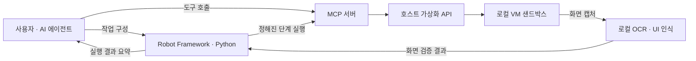
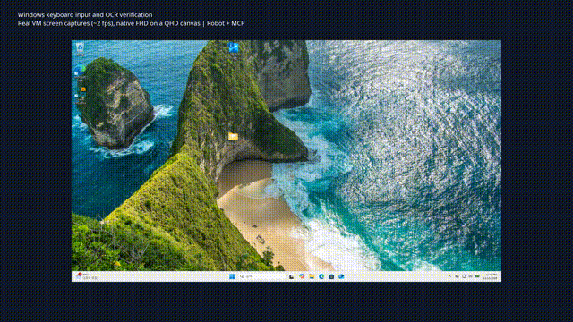

# VAMP — Virtual Agent Machine Platform

**로컬 VM 샌드박스에서 반복적인 GUI 작업을 자동화하는 MCP·RPA 프로젝트입니다.**

[다운로드](https://github.com/wayfarer6/vamp-mcp/releases) · [VS Code 확장](https://marketplace.visualstudio.com/items?itemName=wayfarer6.vamp-mcp) · [전체 문서](docs/README.md) · [데모](docs/DEMOS.md)

## 왜 만들었나요?

로컬 샌드박스에 **OCR과 UI 인식**을 연결하고, 반복적인 GUI 작업을 **Robot Framework·Python RPA**로 실행해 **AI 에이전트의 토큰 비용을 줄이는 것**이 목적입니다. 에이전트가 작업을 구성하고, 정해진 순서와 화면 검증은 로컬 코드가 맡는 방향으로 만들고 있습니다.

> **하루 동안 사용자와 AI 에이전트(Codex)가 바이브 코딩으로 만든 초기 프리뷰입니다.** 기능 완성도·안정성·예외 처리·문서에 아직 부족한 점이 많습니다. 현재 시험한 가상화 환경은 **KVM/SPICE와 VirtualBox 정도**이며, 다른 환경까지 검증한 제품은 아닙니다.

## 어떻게 동작하나요?

주요 배포 경로는 **VirtualBox MCP + VS Code 확장**입니다. SPICE/KVM은 별도의 Python·Robot 엔진으로 실행하며, SPICE MCP 래퍼는 [`feat/vm-mcp-server`](https://github.com/wayfarer6/vamp-mcp/tree/feat/vm-mcp-server) 브랜치에 있습니다. OCR·UI 인식은 저장소의 선택적 구성으로, VSIX에 포함되지 않습니다.

[구조와 구성 요소](docs/MCP_ARCHITECTURE.md)

## 주요 기능

- **화면과 입력:** VM 화면 캡처, 키보드·마우스 제어, OCR·UI 영역 인식.
- **RPA 실행:** Robot/Python 작업 패키지와 수동 녹화 코드의 검토·변환.
- **기록과 조회:** 선택적 GUI 레코더, 공유 소스 가져오기, 실행 영상·스크린샷·이력 조회.
- **VirtualBox 도구:** VM 조회·기동, ISO 무인 설치 시작, 해상도 설정과 명시적 스냅샷 작업.

## 빠른 시작 — VS Code

1. 호스트에 **VirtualBox 7.x**와 **Python 3.11+**를 설치합니다.
2. [Marketplace](https://marketplace.visualstudio.com/items?itemName=wayfarer6.vamp-mcp) 또는 [Release의 VSIX](https://github.com/wayfarer6/vamp-mcp/releases)로 확장을 설치합니다.
3. 명령 팔레트에서 **VAMP: Set Up Python Environment**를 실행합니다.
4. MCP 서버 목록에서 **VAMP VirtualBox**를 시작하고 기존 VM을 조회합니다.

새 VM은 **VAMP: Create VM From ISO**로 준비할 수 있습니다. 공개 테스트 계정은 `vboxuser` / `password123!`이며, Windows 라이선스는 사용자가 준비합니다. 설치 시작 응답은 OS 설치 완료를 뜻하지 않습니다.

[확장 사용법](vscode-extension/README.md) · [VirtualBox MCP 직접 연결](backends/virtualbox/README.md) · [SPICE 설치](docs/INSTALL.md)

## 실제 실행 영상

[키보드·OCR](docs/media/keyboard-ocr.mp4) · [녹화 공유](docs/media/recorder-share.mp4) · [Windows 호스트 MCP](docs/media/windows-host-mcp.mp4) · [중첩 VM](docs/media/nested-windows-host.mp4)

실제 FHD 화면을 약 2 fps로 캡처하고 여백을 더한 QHD 영상입니다. [검증 근거·재현 방법](docs/DEMOS.md)

## 문서와 현재 범위

| 알아볼 내용 | 문서 |
| --- | --- |
| MCP 구조·백엔드별 역할 | [아키텍처](docs/MCP_ARCHITECTURE.md) |
| 설치·의존성·실행 | [문서 목차](docs/README.md) · [SPICE 실행](docs/SPICE_GUIDE.md) |
| Robot/Python 작업 작성·녹화 변환 | [RPA 패키지](rpas/README.md) · [녹화 변환](docs/RECORDING_CONVERSION.md) |
| 실제 시험 결과와 미검증 기능 | [검증 기록](docs/VALIDATION.md) |

**KVM/SPICE·VirtualBox 시험 경험을 바탕으로 개발 중입니다.** 새 OS 무인 설치 완료, 스냅샷 복원과 다양한 호스트·가속기 조합은 추가 검증이 필요합니다. [Hyper-V](backends/hyperv/README.md)는 실험적 기동 코드이며 실제 동작은 검증하지 않았습니다.

직접 작성한 코드와 문서는 [MIT](LICENSE)입니다. 게스트 레코더의 GPL-3.0 등 외부 라이선스는 [별도 고지](THIRD_PARTY_NOTICES.md)를 확인하세요.
