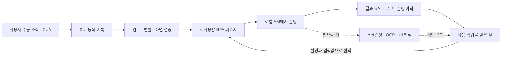

  

# VAMP · Virtual Agent Machine Platform

GUI 작업을 한 번 기록해 두고, 다음에는 AI가 필요한 RPA를 골라 실행하도록 만드는 프로젝트입니다.

[다운로드](https://github.com/wayfarer6/vamp-mcp/releases) · [VS Code 확장](https://marketplace.visualstudio.com/items?itemName=wayfarer6.vamp-mcp) · [문서](docs/README.md) · [실행 영상](docs/DEMOS.md)

## 만든 이유

네이버 로그인 페이지를 여는 일만 해도 브라우저 실행, 주소 입력, 화면 확인이 반복됩니다. 이 과정을 매번 AI가 화면을 보며 판단하고 코드를 다시 읽게 하면 토큰을 계속 쓰게 됩니다.

사용자가 직접 조작하거나 CUA(화면을 보고 컴퓨터를 조작하는 AI)가 수행한 GUI 작업을 기록하고, 검토한 기록을 Robot Framework·Python RPA로 묶어 두려 합니다. 이후에는 AI가 작업 설명과 입력값만 보고 패키지를 골라 실행하고, 결과 요약을 받으면 됩니다. 좌표나 입력 순서 같은 세부 구현은 로컬 코드에 두고, 필요할 때만 로그와 화면을 확인하는 방식으로 토큰 비용을 줄이는 것이 목적입니다.

하루 동안 Codex와 바이브 코딩으로 만들었습니다. 아직 거친 부분과 빠진 기능이 많습니다. 현재 시험한 환경은 KVM/SPICE와 VirtualBox 정도이며, 토큰 절감량을 측정한 상태는 아닙니다.

## 기록한 작업을 다시 쓰는 흐름

현재 지원하는 기록 변환은 PyAutoGUI 코드에서 SPICE용 RPA를 만드는 경로입니다. 임의의 CUA 기록을 모두 자동 변환하거나, 같은 기록을 VirtualBox에서 바로 재생하는 부분은 아직 연결하지 못했습니다. [예시와 현재 범위](docs/WORKFLOWS.md)

## 주요 기능

| 기능 | 할 수 있는 일 |
| --- | --- |
| GUI 작업 기록·재사용 | 클릭과 키 입력을 저장하고, 검토한 작업을 Robot/Python 패키지로 실행 |
| 로컬 화면 제어 | VM 화면 캡처, 키보드·마우스 입력, 선택적 OCR·UI 영역 인식 |
| 기록·로그 확인 | 녹화 소스, 실행 요약, Robot 로그·보고서와 SQLite 실행 이력 확인 |
| 필요한 화면만 보기 | 현재 화면이나 저장한 스크린샷을 확인하고, 켜 둔 실행 영상은 로컬에서 재생 |
| VirtualBox MCP | VS Code에서 VM 조회·기동, ISO 설치 시작, 해상도·공유폴더·스냅샷 도구 사용 |

OCR·UI 인식은 저장소에서 별도로 설치합니다. VSIX에는 VirtualBox MCP가 들어 있으며, SPICE·YOLO·PaddleOCR 전체가 포함되지는 않습니다. [구성도](docs/MCP_ARCHITECTURE.md) · [로그·스크린샷 조회](docs/EXECUTION_HISTORY.md)

## 시작하기

1. 호스트에 VirtualBox 7.x와 Python 3.11+를 설치합니다.
2. [Marketplace](https://marketplace.visualstudio.com/items?itemName=wayfarer6.vamp-mcp) 또는 [Release의 VSIX](https://github.com/wayfarer6/vamp-mcp/releases)로 확장을 설치합니다.
3. 명령 팔레트에서 **VAMP: Set Up Python Environment**를 실행합니다.
4. MCP 서버 목록에서 **VAMP VirtualBox**를 시작하고 기존 VM을 조회합니다.

새 VM을 만들 때는 **VAMP: Create VM From ISO**를 사용합니다. Windows 11 설치 ISO와 유효한 라이선스는 사용자가 직접 준비하고, 정품 인증도 직접 진행해야 합니다. VAMP에는 Windows ISO·제품 키·라이선스가 포함되지 않습니다. 기본 계정 `vboxuser` / `password123!`는 공개 테스트용입니다. 설치 시작 응답은 설치 완료를 뜻하지 않습니다.

[확장 사용법](vscode-extension/README.md) · [VirtualBox MCP 직접 연결](backends/virtualbox/README.md) · [SPICE 설치](docs/INSTALL.md) · [VM 준비사항](docs/GUEST_AUTOMATION.md)

## 실행 영상과 문서

[키보드·OCR](docs/media/keyboard-ocr.mp4) · [녹화 공유](docs/media/recorder-share.mp4) · [Windows 호스트 MCP](docs/media/windows-host-mcp.mp4) · [중첩 VM](docs/media/nested-windows-host.mp4)

실제 FHD 화면을 약 2 fps로 캡처한 뒤 여백을 더한 QHD 영상입니다. [재현 방법](docs/DEMOS.md)

| 알아볼 내용 | 문서 |
| --- | --- |
| 작업을 기록하고 AI가 다시 실행하는 방법 | [워크플로 재사용](docs/WORKFLOWS.md) |
| RPA 작성과 녹화 변환 | [패키지 규격](rpas/README.md) · [변환 가이드](docs/RECORDING_CONVERSION.md) |
| 실행 결과·로그·영상·스크린샷 | [실행 이력](docs/EXECUTION_HISTORY.md) |
| 설치와 백엔드 구성 | [문서 목차](docs/README.md) · [아키텍처](docs/MCP_ARCHITECTURE.md) |
| 시험한 기능과 남은 문제 | [검증 기록](docs/VALIDATION.md) |

새 OS 무인 설치 완료와 스냅샷 복원은 미검증입니다. Hyper-V는 실험적 기동 코드만 있으며 실제 동작을 시험하지 않았습니다. SPICE MCP 래퍼는 [`feat/vm-mcp-server`](https://github.com/wayfarer6/vamp-mcp/tree/feat/vm-mcp-server) 브랜치에 있습니다.

직접 작성한 코드와 문서는 [MIT](LICENSE)입니다. 게스트 레코더의 GPL-3.0 등 외부 라이선스는 [별도 고지](THIRD_PARTY_NOTICES.md)를 확인하세요.
