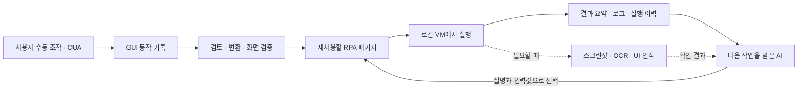

  

# VAMP · Virtual Agent Machine Platform

**VM-isolated GUI RPA & Encrypted Vault Execution for AI Agents**

GUI 작업을 한 번 기록해 두고, 다음에는 AI가 필요한 RPA를 골라 실행하도록 만드는 프로젝트입니다.

[다운로드](https://github.com/wayfarer6/vamp-mcp/releases) · [VS Code 확장](https://marketplace.visualstudio.com/items?itemName=wayfarer6.vamp-mcp) · [문서](docs/README.md) · [실행 영상](docs/DEMOS.md)

## 만든 이유

네이버 로그인 페이지를 여는 일만 해도 브라우저 실행, 주소 입력, 화면 확인이 반복됩니다. 이 과정을 매번 AI가 화면을 보며 판단하고 코드를 다시 읽게 하면 토큰을 계속 쓰게 됩니다.

사용자가 직접 조작하거나 CUA(화면을 보고 컴퓨터를 조작하는 AI)가 수행한 GUI 작업을 기록하고, 검토한 기록을 Robot Framework·Python RPA로 묶어 두려 합니다. 이후에는 AI가 작업 설명과 입력값만 보고 패키지를 골라 실행하고, 결과 요약을 받으면 됩니다. 좌표나 입력 순서 같은 세부 구현은 로컬 코드에 두고, 필요할 때만 로그와 화면을 확인하는 방식으로 토큰 비용을 줄이는 것이 목적입니다.

하루 동안 Codex와 바이브 코딩으로 만들었습니다. 아직 거친 부분과 빠진 기능이 많습니다. 현재 시험한 환경은 KVM/VNC·SPICE와 VirtualBox이며, 토큰 절감량을 측정한 상태는 아닙니다.

### 왜 컨테이너(Docker)가 아닌 가상머신(VM)인가?

많은 에이전트 프로젝트가 가벼운 Docker 컨테이너를 먼저 시도하지만, VAMP는 의도적으로 하이퍼바이저 기반 가상머신(VirtualBox, KVM, Hyper-V)을 선택했습니다:

1. **진짜 Windows GUI 및 엔드포인트 소프트웨어 지원**: 사내 ERP, 공공 행정 포털, 레거시 데스크톱 업무 소프트웨어 및 드라이버는 호스트 커널을 공유하는 리눅스 컨테이너 안에서는 동작하지 않습니다. 완전한 Windows 데스크톱 OS 환경이 필수적입니다.
2. **가상 하드웨어 인터럽트 입력**: 컨테이너의 X11 합성기나 OS 레벨 가상 입력 주입은 안티 매크로/안티 후킹 모듈에 즉시 탐지되어 차단됩니다. 반면 가상머신은 USB Tablet/키보드 가상 하드웨어 인터럽트 레벨에서 신호를 발생시키므로 게스트 보안 모듈이 물리 장치 입력과 구분하지 못합니다.
3. **가상 스토리지 및 Removable USB 에뮬레이션**: 외부 하드웨어 보안 토큰이나 암호화 키스토어를 게스트 시스템에 '이동식 USB 드라이브'로 인식시키거나 VeraCrypt VHD 볼륨을 보조 블록 장치로 패스스루하려면 하이퍼바이저 레벨의 하드웨어 스토리지 컨트롤러 에뮬레이션이 필요합니다.
4. **하드웨어 가상화(VT-x) 레벨의 격리**: 에이전트의 오동작이나 악의적인 스크립트로부터 사용자 호스트 환경을 원천 차단하기 위해, 컨테이너 네임스페이스보다 격리 신뢰도가 높은 하드웨어 샌드박스를 사용합니다.

## 기록한 작업을 다시 쓰는 흐름

현재 지원하는 기록 변환은 PyAutoGUI 코드에서 SPICE용 RPA를 만드는 경로입니다. 임의의 CUA 기록을 모두 자동 변환하거나, 같은 기록을 VirtualBox에서 바로 재생하는 부분은 아직 연결하지 못했습니다. [예시와 현재 범위](docs/WORKFLOWS.md)

## 주요 기능

| 기능 | 할 수 있는 일 |
| --- | --- |
| GUI 작업 기록·재사용 | 클릭과 키 입력을 저장하고, 검토한 작업을 Robot/Python 패키지로 실행 |
| 로컬 화면 제어 | VM 화면 캡처, 키보드·마우스 입력, 선택적 OCR·UI 영역 인식 |
| 기록·로그 확인 | 녹화 소스, 실행 요약, Robot 로그·보고서와 SQLite 실행 이력 확인 |
| 필요한 화면만 보기 | 현재 화면이나 저장한 스크린샷을 확인하고, 켜 둔 실행 영상은 로컬에서 재생 |
| VS Code 실시간 VM 뷰어 | QEMU VNC 화면을 WebSocket으로 스트리밍하고, 보기 전용 탭과 외부 VNC 접속 정보 표 제공 |
| KVM MCP | VM 생성·기동·전원·스냅샷 관리, 화면·입력, Robot 시나리오 실행 |
| VirtualBox MCP | VS Code에서 VM 조회·기동, ISO 설치 시작, 해상도·공유폴더·스냅샷 도구 사용 |
| VAMP Vault MCP | KeePassXC·VeraCrypt 기반 자격증명/인증서 격리 보관 및 사이드바 GUI |

OCR·UI 인식은 저장소에서 별도로 설치합니다. VSIX에는 VirtualBox MCP와 실시간 VNC 뷰어가 들어 있습니다. KVM MCP는 로컬 저장소의 Python 환경을 연결하며, VM 디스크·ISO·YOLO·PaddleOCR 모델은 VSIX에 포함하지 않습니다. [구성도](docs/MCP_ARCHITECTURE.md) · [로그·스크린샷 조회](docs/EXECUTION_HISTORY.md)

## 시작하기

1. 호스트에 VirtualBox 7.x와 Python 3.11+를 설치합니다.
2. [Marketplace](https://marketplace.visualstudio.com/items?itemName=wayfarer6.vamp-mcp) 또는 [Release의 VSIX](https://github.com/wayfarer6/vamp-mcp/releases)로 확장을 설치합니다.
3. 명령 팔레트에서 **VAMP: Set Up Python Environment**를 실행합니다.
4. MCP 서버 목록에서 **VAMP VirtualBox**를 시작하고 기존 VM을 조회합니다.

새 VM을 만들 때는 **VAMP: Create VM From ISO**를 사용합니다. Windows 11 설치 ISO와 유효한 라이선스는 사용자가 직접 준비하고, 정품 인증도 직접 진행해야 합니다. VAMP에는 Windows ISO·정품 인증 키·라이선스가 포함되지 않습니다. 자동 설치의 공개 설치용 키는 에디션 선택용이며 Windows를 정품 인증하지 않습니다. **`vboxuser` / `password123!`는 MCP 서버가 VM 무인 설치 과정에서 지정하는 기본 테스트 계정 정보입니다. 운영체제가 원래 제공하는 계정이 아니며, 공개된 값입니다.** 설치 시작 응답은 설치 완료를 뜻하지 않습니다.

[확장 사용법](vscode-extension/README.md) · [VirtualBox MCP 직접 연결](backends/virtualbox/README.md) · [SPICE 설치](docs/INSTALL.md) · [VM 준비사항](docs/GUEST_AUTOMATION.md)

## VS Code에서 VM 화면 보기

KVM VM의 화면은 스크린샷을 반복 조회하는 대신 **VNC(RFB) → 로컬 WebSocket 중계 → noVNC**로 실시간 표시합니다. VM의 VNC 서버는 QEMU가 제공하고, 확장은 뷰어와 중계를 담당합니다.

1. 확장 설정 `vamp.kvmRepositoryPath`에 이 저장소 경로를 지정합니다.
2. `vamp.kvmPythonExecutable`과 `vamp.kvmConfigPath`에 사용할 Python 및 VM 프로필을 지정합니다. 생략하면 저장소의 `.venv`와 `config/vm-mcp.json`을 사용합니다.
3. MCP 서버 목록에서 **VAMP KVM (VNC)**를 시작합니다.
4. **VAMP: Open KVM Viewer (Live VNC)** 명령으로 실행 중인 VM을 선택합니다.

뷰어는 기본적으로 보기 전용이며, RPA와 사용자가 같은 화면을 함께 볼 수 있습니다. 창 크기에 맞춘 화면 표시와 재연결 버튼을 제공합니다. 화면 아래에는 외부 VNC 뷰어를 위한 다음 정보와 주소 복사 버튼이 표시됩니다.

| VM 이름 | 호스트 | VNC 포트 | 접속 주소 |
| --- | --- | --- | --- |
| 선택한 VM 이름 | `127.0.0.1` | VM에서 조회한 실제 포트 | 예: `127.0.0.1:5900` |

포트는 실행 시 조회하므로 고정값을 가정하지 않습니다. VM은 한 번에 한 대씩 검증하며, 시나리오는 Robot Framework의 보고서·타임라인·MP4로 남깁니다. [KVM MCP와 재현 절차](docs/VM_MCP.md)

## 실행 영상과 문서

[키보드·OCR](docs/media/keyboard-ocr.mp4) · [녹화 공유](docs/media/recorder-share.mp4) · [Windows 호스트 MCP](docs/media/windows-host-mcp.mp4) · [중첩 VM](docs/media/nested-windows-host.mp4) · [데모 시연 가이드](docs/DEMO_SCENARIOS.md)

실제 FHD 화면을 약 2 fps로 캡처한 뒤 여백을 더한 QHD 영상입니다. [재현 방법](docs/DEMOS.md)

| 자격증명·보안 키스토어 격리와 패스키 | [VAMP Vault 확장](vscode-vault-extension/README.md) · [게스트 볼트 설정](docs/GUEST_VAULT_SETUP.md) |
| 알아볼 내용 | 문서 |
| --- | --- |
| 작업을 기록하고 AI가 다시 실행하는 방법 | [워크플로 재사용](docs/WORKFLOWS.md) |
| RPA 작성과 녹화 변환 | [패키지 규격](rpas/README.md) · [변환 가이드](docs/RECORDING_CONVERSION.md) |
| 실행 결과·로그·영상·스크린샷 | [실행 이력](docs/EXECUTION_HISTORY.md) |
| 설치와 백엔드 구성 | [문서 목차](docs/README.md) · [아키텍처](docs/MCP_ARCHITECTURE.md) |
| 시험한 기능과 남은 문제 | [검증 기록](docs/VALIDATION.md) |

KVM MCP의 VM 생성·화면 제어·RPA 실행은 [`vm_mcp_server.py`](vm_mcp_server.py)에서 제공하며, 프로필로 VNC와 SPICE 연결을 구분합니다.

## 책임 한계와 안전한 사용 (Responsible Use)

VAMP 및 VAMP Vault는 사용자의 로컬 환경에서 자원을 절감하고 안전한 자동화를 연구하기 위한 범용 가상화 인프라 오픈소스입니다. 완전 자율 금전 거래(송금, 결제, 금융 자산 이동 등)에 사용하는 것을 권장하지 않으며, 민감한 작업은 반드시 사용자의 직접 검토와 승인(Human-in-the-loop)을 거쳐야 합니다. 본 소프트웨어를 활용하여 수행한 모든 자동화 작업, 외부 서비스 이용, 자격증명 승인 및 그에 따른 결과와 손해에 대한 최종 책임은 전적으로 사용자 본인에게 있으며, 개발자는 어떠한 금전적·법적 손실에 대해서도 책임을 지지 않습니다.

직접 작성한 코드와 문서는 [MIT](LICENSE)입니다. 게스트 레코더의 GPL-3.0 등 외부 라이선스는 [별도 고지](THIRD_PARTY_NOTICES.md)를 확인하세요.
