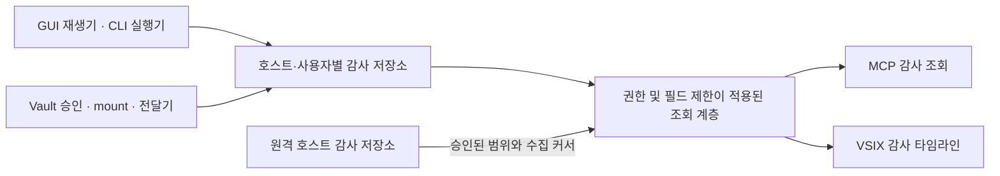

# VAMP 실행·Vault 감사 설계안

**어떤 워크플로 버전이 어느 VM에서 실행됐고, 그 실행에 자격 증명이 실제로 어디까지 전달됐는가?** 운영자는 VSIX에서 한 실행의 타임라인을 보고, 권한을 받은 MCP 클라이언트는 같은 이벤트 ID로 같은 사실을 조회한다. 이 문서는 구현 제안이다.

## 현재 확인할 수 있는 사실

| 경로 | 현재 증거 | 설계에서 보완할 점 |
| --- | --- | --- |
| 저장된 GUI RPA | 일반 재생과 Vault 연동 재생이 나뉜다. UAC 대기에는 별도 기록이 있고 화면 조작 완료는 `completed_unverified`일 수 있다. | 진입 시 시도 ID를 부여하고, 작업자가 실제 읽은 버전과 최종 검증 상태를 연결한다. [Library MCP](../backends/library/server.mjs) · [재생기](../backends/library/replay.py) · [Vault 브리지](../backends/library/vault-replay.mjs) |
| CLI 워크플로 | VSIX와 MCP가 공유하는 실행기에 버전·작업공간·실행 ID·검사 결과가 있다. 동일 요청 재전송은 기존 실행을 반환한다. | 요청 접수, 전송 시도, 게스트 응답, 검증을 구분한다. 연결이 끊긴 경우 게스트 결과를 미확인으로 남긴다. [CLI 실행기](../backends/library/cli-runs.cjs) |
| Vault mount | 볼륨 명령 종료, 마운트 목록 재조회, VM 디스크 연결·해제는 서로 다른 사건이다. | host·WSL·guest 범위와 확인 방법을 남긴다. 실제 마운트 상태를 재조회한 시각을 표시한다. [Vault 백엔드](../vscode-vault-extension/backends/vault) |
| 자격 증명 사용 | 일부 경로는 값을 조회한 뒤 실제 전달 전에 `credential_resolved`를 쓴다. 조회, 복사, 거절, 전달 영수증을 모두 포괄하는 공통 이력은 없다. | 사용자 승인·캐시 조회·공개·전달·수신 확인을 계측한다. 예전 기록은 ‘조회 확인’까지만 표시한다. [Vault VSIX](../vscode-vault-extension/extension.js) · [전달기](../vscode-vault-extension/src/credential_delivery.mjs) |

## 수집 구조



GUI와 CLI는 각각 실제 작업을 수행하는 공통 실행기에 기록한다. VSIX 버튼이나 MCP 요청 핸들러가 같은 성공을 다시 기록하지 않는다. 독립 설치된 Vault는 자체 범위의 기록을 제공한다. 원격 호스트는 자체 저장소를 소유하고, 조회 계층은 승인된 호스트별 수집 범위와 마지막 확인 시각을 전달한다.

### 어떤 사건을 남기는가

| 종류 | 기록 단계 | 성공을 판단할 수 있는 범위 |
| --- | --- | --- |
| GUI RPA | 미리보기, 접수, 실제 읽은 커밋, 실행 시작, 사용자 확인 대기·재개, 작업 종료, 결과 검사 | 클릭 전달, 프로세스 종료, 애플리케이션 결과 확인을 각각 표시한다. |
| CLI | 미리보기, 접수, 게스트 전송 시도, 게스트 결과 수신, 검증 결과, 시간 초과·중단 | 파일 검사 통과 수와 실패 수를 남긴다. 같은 요청의 재전송은 최초 실행으로 연결한다. |
| Vault mount | 마운트 요청·거절, 명령 종료, 마운트 목록 확인, 해제 요청·확인 | host·WSL·guest 볼륨 및 VM 디스크 연결·해제를 구별한다. 마지막 관찰 시각은 현재 상태 조회와 별도로 표시한다. |
| 자격 증명 | 요청, 승인·거절, 필드 조회, 화면 표시, 클립보드 복사, 모델 응답 공개, 전달 시도, 수신기 영수증 | 값 조회, 대상 수신, 계정 로그인은 각각 별개의 사실이다. 애플리케이션 검사가 있는 경우에만 로그인 결과를 연결한다. |

`origin`은 VSIX·MCP·원격 등 관측한 진입점이다. `approval_basis`는 운영자 대화상자, 세션 정책, 호출자의 확인 주장 등 근거를 구분한다. 클라이언트가 제출한 모델명으로 사용자나 실제 모델 신원을 인증하지 않는다.

### 이벤트, 연결 및 보존

- **식별** — 원천이 발급한 `event_id`, 호스트별 증가 순번 `seq`, `occurred_at`과 수집 시각 `observed_at`(UTC), 스키마 버전, 호스트·프로필 범위, 종류, 행위, 관찰 결과, 증거 종류를 저장한다. 워크플로에는 확인한 UUID·정확한 revision·backend·VM 참조를 선택적으로 붙인다.
- **연결** — 실행 승인 전의 시도에는 `operation_id`, 실제 접수된 워크플로에는 `run_id`를 발급한다. GUI Vault 브리지는 서버가 발급한 상관 ID를 내부 호출에 전달한다. 범용 MCP 입력으로 기존 실행에 임의 연결할 수 없게 한다. 독립적인 수동 복사에는 `run_id`가 없다. 기존 CLI에는 Vault 전달 경로가 없으므로 VM이나 시간 일치만으로 연결하지 않는다.
- **중복과 장애** — 한 원천의 전이마다 안정적인 사건 키를 사용한다. CLI는 요청 선점에 성공했을 때 한 번 접수한다. 실행기 소유의 상태 전이와 감사 발행 대기를 같은 트랜잭션에 저장하거나, 영속 상태에서 멱등하게 재구성한다. Vault는 비밀 전달 전에 의도를 저장한다. 기록 실패로 전달을 시작할 수 없으면 그 사실을 사용자에게 알린다. 이미 전달한 뒤 완료 기록이 실패하면 결과 미확정으로 남기고 영수증을 대조한다. 감사 복구가 업무 재실행을 유발해서는 안 된다.
- **저장·접근** — 사용자별 로컬 SQLite와 WAL을 기본으로 제안한다. DB·WAL·백업에 동일한 계정 ACL을 적용한다. 기본 조회 범위는 현재 사용자·프로필이며, Vault 메타데이터와 원격 호스트의 조회 권한은 별도로 부여한다. OS 관리자 권한만으로 여러 프로필을 자동 병합하지 않는다. 로컬 관리자에 의한 변경까지 탐지하는 변조 방지 원장이 필요하면 별도의 독립 저장소를 설계해야 한다.
- **개인정보** — 이벤트마다 허용된 필드와 열거형만 기록한다. 자격 값과 그 해시, 실제 Vault 항목명·경로, mount 원본과 드라이브 경로, 파일명, 입력값, 자유 텍스트 검사명·오류, 명령줄, 클립보드, 스크린샷은 수집하지 않는다. 자격·목적지에 설치별 무작위 참조를 발급한다. MCP·웹뷰·복사·내보내기도 같은 투영을 사용한다. 감사 조회를 위해 Vault를 잠금 해제하지 않는다.
- **기간** — 로컬 기본 보존 30일을 제안한다. 운영자는 기간과 디스크 상한을 조정한다. 만료·삭제 경계, 수집 시작 시각, 원격 지연을 조회 결과에 포함한다. 기존 JSONL을 가져올 때는 필드 허용 목록을 적용하고 출처를 `legacy`로 표시한다. 계측 전 기간과 VAMP 밖에서 실행한 프로그램은 관측 범위 밖이다.

## MCP 조회 계약 초안

| 도구 | 입력 | 응답 |
| --- | --- | --- |
| `audit_search` | 시작·끝 시각, 종류, 행위, 관찰 결과, backend, 허용된 workspace·workflow·run 참조, 커서. 기본 최근 24시간·50건, 최대 100건/쪽. | 요약 이벤트, 수집 범위, 다음 커서. |
| `audit_run_details` | 실행 ID, 커서, 제한 건수 | 실행 버전과 대상, 워크플로 결과, 인과관계가 확인된 Vault 사건, 다음 커서. |
| `audit_coverage` | 허용된 호스트 또는 현재 범위 | 관측을 시작한 시각, 보존 시작 경계, 수집기 상태, 마지막 반영 시각. |

세 도구는 읽기 전용이다. 서버가 호출자의 허용 범위를 먼저 적용하고 요청 필터로 좁힌다. 첫 조회에서 호스트별 마지막 순번을 고정하고, 후속 커서는 권한 범위·필터·순번을 묶어 동일 시각의 이벤트도 안정적으로 넘긴다. 범위 밖 실행 ID와 존재하지 않는 실행 ID는 같은 응답을 준다. 검색 결과 0건, 부분 수집, 일시 중단은 별도 상태다.

아래는 수신기 전달이 확인된 **합성 이벤트**다. 실행 상세 화면에는 이 사건과 GUI의 최종 검증 결과가 각각 한 줄씩 나타난다.

```json
{
  "event_id": "evt-demo-17",
  "run_id": "run-demo-4",
  "occurred_at": "2026-11-21T03:00:02Z",
  "category": "credential",
  "action": "delivery",
  "outcome": "acknowledged",
  "evidence": "receiver_receipt",
  "credential_ref": "cred-demo-8",
  "destination_ref": "dst-demo-2"
}
```

## VSIX 화면

**VAMP: Open Audit Log** 명령은 최근 24시간을 연다. Library 실행 이력에서 열면 실행 ID가 적용되고, Vault Browser에서 열면 해당 설치의 항목 참조 또는 mount 종류로 좁혀진다. Vault 단독 설치에서도 Vault가 기록한 범위를 조회할 수 있다.

아래는 합성 사건을 선택한 데스크톱 화면의 배치다. 좁은 창에서는 목록과 상세를 한 화면씩 보여준다.

```text
감사 기록                                  최근 반영 12:00:05 KST
[최근 24시간 ▾] [종류 전체 ▾] [작업공간 ▾] [백엔드 ▾] [결과 ▾]

시간       종류       행위          결과        │ 실행 run-demo-4
12:00:04   GUI RPA    실행 종료     결과 미검증  │ GUI · VirtualBox · 검토 버전
12:00:02   자격 증명  대상에 전달   수신 확인  ◀│ 12:00:00  실행 시작
12:00:01   자격 증명  사용 요청     사용자 승인  │ 12:00:01  사용 승인
12:00:00   GUI RPA    실행 시작     시작 확인   │ 12:00:02  수신기 영수증
                                              │ 12:00:04  화면 결과 미검증
```

| 화면 영역 | 조작과 표시 |
| --- | --- |
| 기간·범위 | 로컬 시간대와 기간, 종류 4개, workspace, backend, 결과, 출처 필터. 헤더에 원격 연결 상태와 마지막 반영 시각을 표시한다. |
| 이벤트 목록 | 시각, 행위, 대상 참조, 관찰 결과. 키보드로 행을 선택하고 Enter로 상세를 연다. 새 사건 도착 시 현재 행과 포커스를 유지한다. |
| 실행 상세 | 버전·대상 VM·결과 검사 요약과 시간순 사건. 수동 사건에는 연결 정보 없음을 표시한다. Esc로 원래 행에 복귀한다. |
| 수집 상태 | ‘이 기간에 0건’, ‘수집 시작 전’, ‘원격 호스트 미연결’, ‘권한 필요’, ‘저장 오류’를 구별한다. 텍스트와 아이콘을 함께 사용한다. |

**타임라인 예시** — GUI 실행 시작 → 자격 증명 사용 승인 → 수신기 전달 확인 → GUI 실행 완료·화면 결과 미검증. CLI의 주문 내보내기 예시는 실행 버전과 CSV 검사 3건의 결과를 표시한다. 감사 화면의 열람·복사 권한을 별도로 적용한다.

## 구현 순서와 인수 기준

1. **저장소와 실행기** — GUI·CLI의 기존 결과를 유지하면서 기록한다. 같은 CLI 요청을 동시에 제출해 한 번 실행되고 접수·완료가 각각 한 번만 남는지 확인한다. 미리보기, UAC 대기, 검증 누락, 실패, timeout, 연결 단절, 프로세스 재시작을 구분한다.
2. **Vault** — 마운트 실패, 명령 종료 후 실상태 미확인, 해제 확인을 따로 시험한다. 거절 시 값 조회가 0회인지, 수신 실패 시 영수증이 0건인지, 수동 복사에 실행 ID가 붙지 않는지 검사한다. 전달 전후의 저장 장애에서 중복 전달이 없어야 한다.
3. **MCP·VSIX** — 동일 필터의 이벤트 ID가 일치해야 한다. 서로 다른 사용자·프로필·원격 호스트의 자료가 섞이지 않아야 한다. 보존 만료, 수집 지연, 동시 쓰기와 페이지 이동, 키보드 탐색과 포커스 복원을 검증한다.
4. **비밀값 미노출** — 합성 표식 값을 자격 필드·별칭·경로·워크플로 입력·오류·검사명에 넣는다. 신규 DB와 WAL, MCP 응답, 웹뷰 메시지·DOM, 복사·내보내기, 오류 로그에서 표식이 0건인지 확인한다.
5. **플랫폼** — CLI는 VirtualBox·KVM·Hyper‑V Linux 게스트에서 실제 실행으로 검증한다. GUI는 기존 재생기가 지원하는 백엔드에서 검증하고, Hyper‑V GUI 재생의 현재 지원 범위를 그대로 표시한다. 각 환경의 Vault 수집 범위도 별도로 기록한다.
