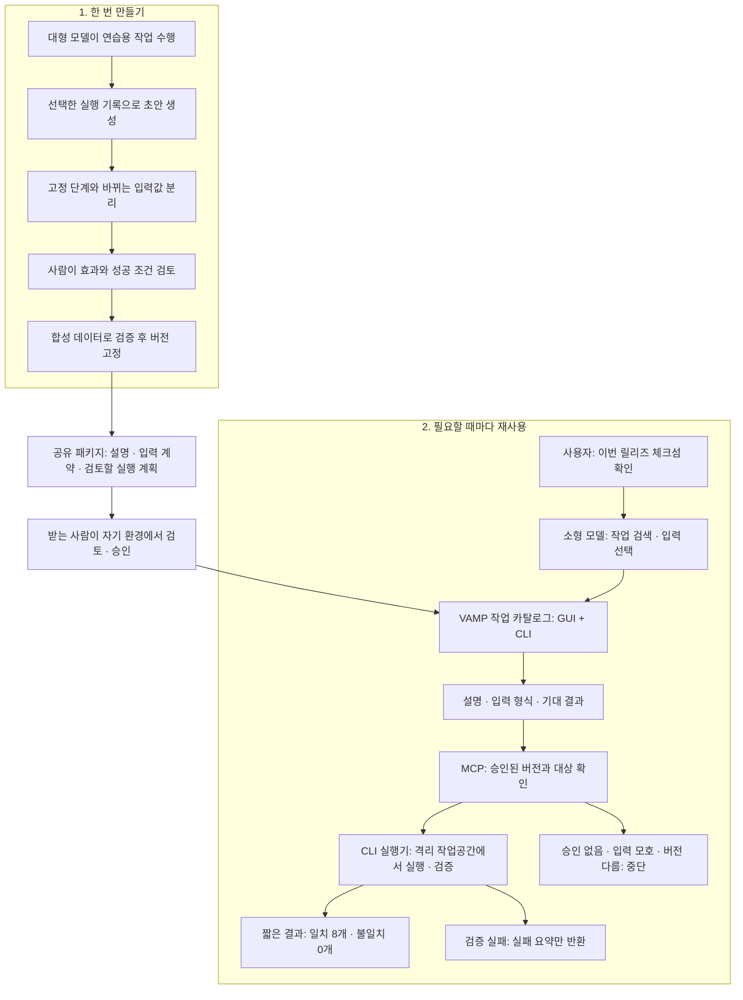

# VAMP CLI 워크플로 재사용 설계

상태: 제안. 실행 코드, 배포, 벤치마크 결과는 포함하지 않습니다.

목표는 대형 모델이 한 번 해결한 CLI 작업을, 다른 사람의 소형 모델이 구현을 다시 읽거나 작성하지 않고 실행하는 것입니다. CLI와 GUI는 검색 경험을 공유하되 실행 방식과 권한은 분리합니다. 기존 GUI 경로는 [GUI 작업을 기록하고 다시 실행하기](WORKFLOWS.md)를 참고하세요.

## 전체 구조

## 작성: 기록을 워크플로로 바꾸기

1. 작성자는 성공한 작업의 **선택된 실행 기록이나 명시적으로 지정한 명령 단계**만 제공한다. 터미널 전체 기록을 자동 수집하지 않는다.
2. 대형 모델은 초안으로 **설명, 언제 쓸지, 바뀌는 값, 고정 단계, 성공 조건**을 제안한다. 예를 들어 릴리즈 디렉터리와 매니페스트 이름은 입력으로, SHA-256 검증 방법은 고정으로 둔다. 실환경 경로, 토큰, 환경변수, CI 키는 공유본에 넣지 않는다.
3. MVP의 ‘스크립트화’ 결과물은 임의의 Bash·PowerShell 파일이 아니라, 구현자가 준비한 **검토 가능한 고정 작업**을 연결한 선언적 실행 계획이다. 지원하지 않는 명령은 초안에서 명시적으로 제외한다. 모델 제안은 검토 전엔 실행할 수 없다.
4. 사람이 각 입력의 타입·범위, 읽는 파일과 바뀌는 파일, 기대 결과를 검토한다. 합성 데이터로 성공·실패를 확인한 뒤 패키지 내용을 해시로 고정한다.

## 공유와 실행

| 부분 | 맡는 일 |
| --- | --- |
| 패키지 | 이름, 제목, 설명, 한·영 태그, 입력 스키마, 성공 조건, 작업 계획, 버전 및 해시. 실제 기록·파일·로그·비밀값은 제외 |
| 받는 사람 | 패키지를 비활성 상태로 가져와 실행 계획과 자기 환경의 영향 범위를 검토. 제작자 검토는 받는 사람의 승인을 대신하지 않음 |
| 카탈로그 / MCP | 기존 검색·상세 계약을 확장해 `kind: gui` 또는 `kind: cli`로 구분. 검색에는 설명과 입력 계약만 반환. GUI 도구는 그대로 두고 CLI 실행 도구는 별도로 둠 |
| CLI 실행기 | 승인한 버전과 실행 대상, 입력 검증 후 등록된 작업만 실행. 첫 버전은 격리된 읽기 전용 워크스페이스와 로컬 검증 작업 한 종류로 제한 |
| 결과 | `verified`, `verification_failed`, `blocked`를 구분. 요약 수치만 기본 반환. 상세 로컬 기록은 필요한 부분만 별도 조회 |

실행 시에는 셸 문자열, 임의 실행 파일, UAC/sudo, 자격 증명, 외부 네트워크, 호스트 전체 파일 접근을 지원하지 않는다. 입력이 애매하거나 작업 폴더를 벗어나거나 승인된 내용이 변경되면 실행하지 않는다. 첫 버전에는 원격 대상, 자동 복구, 커뮤니티 패키지 자동 실행도 포함하지 않는다. 실행 결과와 로그는 데이터로만 취급한다.

## 첫 데모: 한 모델이 만들고 두 사람이 재사용

- **PC A, 대형 모델:** 합성 릴리즈 묶음에서 체크섬 검사 작업을 해결한다. 디렉터리와 매니페스트 이름을 바꿀 수 있게 만든 초안을 사람이 검토하고, 정상·변조 파일로 검사한다.
- **PC B, 소형 모델:** 승인한 패키지를 불러온 뒤 새 채팅에서 “이번 릴리즈 파일 검증해줘”라고 요청한다. 모델은 작업 설명과 입력 두 개만 보고 호출한다. 소스와 긴 로그는 보지 않는다.
- **PC C, 소형 모델:** 같은 버전을 다른 합성 릴리즈 폴더에서 재실행한다. 잘못된 해시가 있으면 일치/불일치 수와 실패를 반환한다. 작은 모델이 소스나 절차를 다시 생성할 필요가 없는지 호출 기록으로 확인한다.
- **실측:** 새 세션의 직접 처리와 공유 워크플로 실행에서 동일한 모델·입력·성공 조건으로 비교한다. 직접 처리 경로가 실패하면 비용만 비교하지 말고 결과도 함께 표시한다. 대형 모델의 최초 제작 비용은 별도로 기록하고, 반복 실행은 검색·도구 스키마·응답을 포함한 전체 토큰과 시간으로 잰다. 추론 서비스 비용은 입력·출력 단가로, 로컬 모델은 토큰·실행 시간으로 구분한다. 아직 절감률이나 손익분기점을 단정하지 않는다.

### 완료 기준

- 두 독립 작업공간에서 같은 패키지를 승인 후 실행하고, 폴더 입력만 바꿔 검증 결과가 맞는다.
- 미승인 패키지, 수정된 버전, 작업공간 밖 경로는 실행 전에 막힌다. 변조된 시험 파일은 성공으로 보고되지 않는다.
- 정상 재사용 기록에 스크립트 본문, 전체 로그, 추가 모델 호출이 없다. 단, 모델이 작업을 고르고 호출 결과를 읽는 토큰은 별도로 집계한다.
