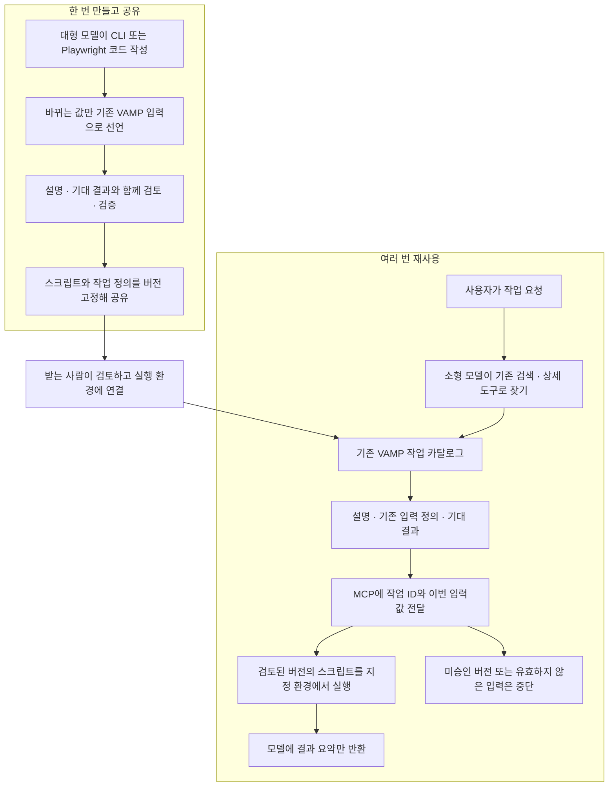

# VAMP 워크플로 재사용: CLI와 Playwright

상태: 설계 제안. 실행 코드와 벤치마크 결과는 포함하지 않습니다.

**AI가 이미 만든 코드를 다시 만들지 않고, 기존 VAMP 입력값만 바꿔 실행하는 기능**입니다. 대형 모델이 만든 Playwright·Python 스크립트 자체를 검토해 공유하고, 받는 쪽의 소형 모델은 구현을 읽지 않고 카탈로그에서 해당 작업을 찾아 호출합니다. 새 스크립트 언어나 변수 시스템을 만드는 것이 아닙니다. [기존 GUI RPA 흐름](WORKFLOWS.md)과 같은 작업 정의를 활용합니다.

## 전체 구조



## 있는 것과 추가할 것

| 재사용할 것 | 새로 연결할 것 |
| --- | --- |
| 기존 작업 이름·설명·태그·기대 결과·`inputs`·검토 상태 | 저장된 코드의 실행기 종류, 진입점, 의존성 버전, 실행 환경과 코드 해시 |
| `rpa_search`와 `rpa_details`에서 메타데이터로 고르는 패턴 | 기존 GUI 항목을 깨지 않고 스크립트형 항목도 검색 가능하게 확장 |
| 승인 후 ID와 선언된 값으로 실행하는 패턴 | GUI 좌표 재생기 대신 승인된 스크립트 진입점으로 넘기는 별도 실행 어댑터 |

작성할 때 AI는 코드에서 실행마다 달라질 후보를 **기존 `inputs` 항목으로 제안**합니다. 사용자가 확인한 뒤에는 변수 선언을 새로 생성하거나 해석하지 않습니다. 받는 모델은 기존 선언에 들어갈 이번 요청의 값만 채웁니다. 별도 터미널 녹화기, 명령 DSL, 새 입력 스키마는 필요 없습니다.

실행할 때는 승인된 코드 버전과 지정된 작업공간을 확인한 뒤, 값을 기존 입력 계약에 맞춰 스크립트로 전달합니다. 모델이 호출 시에 명령이나 코드를 바꿀 수 없도록 합니다. 첫 데모는 합성 데이터와 로컬 테스트 앱만 대상으로 하고, 공유본에는 자격 증명이나 원본 기록을 넣지 않습니다. 공유받은 작업은 자동으로 실행하지 않으며 새 버전은 다시 검토합니다.

## 첫 데모: 큰 모델이 만든 코드를 작은 모델이 그대로 실행

1. **작성:** 대형 모델이 로컬 Demo ERP의 합성 주문을 CSV로 내보내는 Playwright 스크립트를 한 번 만든다. 예를 들어 주문 번호와 출력 파일 이름만 기존 `inputs`로 선언하고, 파일에 해당 주문이 있는지 확인하는 검증 코드를 포함한다.
2. **공유:** 코드·기존 작업 정의·검토할 버전을 다른 작업공간에 전달한다. 받는 쪽은 자기 테스트 앱 환경을 지정하고 승인한다.
3. **재사용:** 새 채팅에서 소형 모델에 각기 다른 샘플 주문을 요청한다. 모델은 작업 설명과 입력 정의만 보고 호출하며 원본 코드나 긴 로그를 읽지 않는다. 성공·실패는 CSV 내용으로 판정한다.
4. **측정:** 대형 모델의 최초 작성 비용과 소형 모델의 반복 호출 비용을 분리한다. 직접 작성 경로와 재사용 경로에서 결과 정확도, 전체 입력·출력 토큰, 실행 시간을 함께 기록한다. 실행 자체의 추가 LLM 호출 여부와, 작업 검색·호출·응답에 쓰인 토큰은 따로 본다. 사전에 절감률을 가정하지 않는다.

성공 기준: **두 독립 작업공간에서 같은 코드와 작업 정의를 바꾸지 않고, 입력값만 바꿔 다른 CSV를 검증한다.** 잘못된 입력과 미승인 코드 버전은 실행 전에 막힌다.

## RPA Library에서 CLI 작업을 다루는 방식

[화면 시안 열기](cli-library-preview.html) · 파일을 내려받아 브라우저로 열면 합성 주문으로 검토, 입력, 실행 결과를 눌러 볼 수 있다. 시안의 결과는 브라우저 메모리에서 계산한 예시다.

검토 기준은 `main@6e90a7b`와 `design/cli-workflow-reuse@c0ff971`이다. 두 브랜치의 Library·Podman 백엔드와 Library 웹뷰 구현은 같고, 설계 브랜치에 이 제안서가 추가되어 있다.

| 현재 코드에서 확인한 점 | 제안하는 변경 |
| --- | --- |
| [웹뷰](../vscode-extension/rpa-library.js)는 왼쪽 목록과 상세 화면, Create, Create with AI, 폴더 추가, 소스 검토를 제공한다. 등록 핸들러는 녹화 Python 파일을 선택한다. | 같은 Library의 생성 폼 입구에서 **화면 녹화 / CLI 스크립트**를 고른다. 저장 여부를 나타내는 기존 `kind`와 실행 방식을 나타내는 `execution_kind`를 구분한다. 목록에 방식 필터 **전체 / GUI / CLI**를 추가한다. |
| [Library 저장소](../vscode-extension/src/library-store.cjs)의 UI 항목 ID는 경로에서 계산한다. [MCP](../backends/library/server.mjs)는 레지스트리의 manifest UUID를 사용한다. | 웹뷰 메시지는 UI ID를 보내고 확장 호스트가 등록 항목을 찾아 manifest UUID로 변환한다. MCP 예시 복사와 실행 이력에는 그 UUID를 쓴다. VSIX와 단독 MCP가 같은 `VAMP_RPA_REGISTRY`를 사용해야 한다. |
| [등록](../backends/library/registry.py)은 GUI 녹화의 화면 크기와 텍스트 자리표시자를 검사한다. [재생](../backends/library/replay.py)은 선언한 이름과 실제 문자열 값의 키가 정확히 일치하는지 확인한다. | 이름·값 검사를 공통 함수로 분리한다. GUI 검사와 해상도는 기존 경로에서 유지한다. CLI에는 원본 코드, 상대 진입점, 잠긴 의존성, 결과 검증 정의를 한 버전으로 묶는다. Python과 Playwright는 같은 입력 봉투를 받는다. |

### 사용자가 보게 되는 화면

| 화면 | 사용자의 조작 | 화면에 보이는 결과 |
| --- | --- | --- |
| 목록·상세 | 예를 들어 ‘주문’으로 검색하고 CLI 항목 선택 | 제목, 사용 시점, 실행 방식, 버전, 이 작업공간의 검토 상태. 상세에 **입력 / 코드·변경 내용 / 검증·이력**을 둔다. GUI를 선택하면 기존 상세가 열린다. |
| 만들기·가져오기 | Create → CLI 스크립트 → Python 또는 Playwright 패키지 선택 → 작업 이름, 입력 이름, 기대 결과와 검증 방법 입력 | 초안과 변경 파일 목록. Create with AI는 설명과 입력 후보를 제안하고 사용자가 확정한다. 공유 패키지를 열면 받는 쪽의 검토 및 환경 연결 화면으로 이동한다. |
| 검토 | 변경 파일, 진입점, 의존성, 접근할 데이터와 출력 위치를 검토하고 해당 버전을 승인 | 승인한 버전과 대상 작업공간을 표시한다. 코드나 잠금 파일이 바뀌면 변경 내용과 **다시 검토**가 보인다. 다른 작업공간에서 가져오면 현지 연결과 승인이 다시 필요하다. |
| 실행 | 작업공간 선택 → 선언된 입력값 입력 → 미리보기 → 실행 확인 | 같은 화면에서 실행 ID, 진행 상태, 결과 검사와 산출물을 본다. 소스·전체 로그는 로컬 상세에서만 연다. 키보드로 조작할 수 있고 오류는 해당 필드에 연결한다. |

## MCP 계약 제안

[통합 서버](../backends/unified/server.mjs)의 기존 `registerLibraryTools`에 연결한다. 첫 배포의 실행 대상은 사용자가 등록한 로컬 격리 작업공간으로 제안한다. 화면 시안은 합성 주문 CSV를 사용한다. 일반 Python CLI는 작업공간의 파일을 처리하고, Playwright는 같은 작업공간에서 운영자가 지정한 로컬 테스트 앱을 사용한다.

| 도구 | 입력과 결과 |
| --- | --- |
| `rpa_search` 확장 | 선택 인자 `execution_kind: gui_recording 또는 cli_based`. 생략한 기존 호출은 GUI 결과를 유지한다. 새 클라이언트는 원하는 방식을 명시한다. CLI 결과에는 UUID, 이름, 입력 이름, 검토 상태, 방식이 들어간다. 기존 `backend`는 GUI 필터로 유지한다. CLI 방식과 GUI 전용 필터를 함께 보내면 입력 오류를 반환한다. |
| `rpa_details` 확장 | 같은 UUID로 조회한다. CLI 응답은 `execution_kind`, `runner`, `revision`, `inputs`, 기대 결과와 검증 방법, 허용된 작업공간 요약을 제공한다. 기존 GUI의 해상도·동작 수 필드는 GUI 응답에 유지한다. |
| `cli_based_run_saved` 제안 | 필수 항목은 `id`, `expected_revision`, `workspace_id`, `inputs`다. 기본 `mode=preview`는 코드 실행 없이 변경 범위와 예상 산출물을 돌려준다. `mode=run`에는 사용자 동의를 반영한 `confirmed=true`와 호출자가 만든 `request_id`가 추가로 필요하다. 접수하면 `run_id`를 돌려준다. |
| `cli_based_run_status` 제안 | `run_id`로 해당 작업공간의 실행 상태와 결과를 조회한다. 응답은 단계, 종료 코드, 검증별 결과, 승인된 산출물 참조로 제한한다. 원본 입력·코드·전체 로그는 기본 응답에서 제외한다. |

예를 들어 소형 모델은 `rpa_search({"query":"주문 CSV","execution_kind":"cli_based"})`로 찾은 UUID를 `rpa_details`에 전달한다. 아래는 조회한 버전에 대해 사용자가 미리보기를 확인한 뒤의 **제안 호출**이다.

```json
{
  "name": "cli_based_run_saved",
  "arguments": {
    "id": "f47ac10b-58cc-4372-a567-0e02b2c3d479",
    "expected_revision": "731234567890abcdef1234567890abcdef123456",
    "workspace_id": "erp-demo",
    "inputs": {"order_id": "ORD-1042", "output_name": "order-1042.csv"},
    "mode": "run",
    "confirmed": true,
    "request_id": "d129ee3b-82c9-4a17-b750-0b95e49f44c1"
  }
}
```

접수 응답과, 같은 실행을 `cli_based_run_status`로 조회했을 때의 결과 예시는 다음과 같다. 산출물 참조는 해당 작업공간의 실행 이력에서 연다.

```json
{"run_id":"aab78e19-cead-4107-8dc5-0d24cb0e155e","status":"queued"}
```

```json
{
  "run_id":"aab78e19-cead-4107-8dc5-0d24cb0e155e",
  "status":"verified",
  "exit_code":0,
  "checks":[{"name":"csv_header","passed":true},{"name":"requested_order","passed":true},{"name":"row_count","passed":true}],
  "artifacts":[{"name":"order-1042.csv","ref":"outputs/order-1042.csv"}]
}
```

### 실행과 저장 경계

1. CLI 정의는 같은 레지스트리에서 별도 포맷 `vamp-cli-workflow`로 식별한다. 이름, UUID, 설명, 태그, 기대 결과와 `inputs: string[]`를 공유한다. 기존 GUI 정의의 실행 방식 필드가 비어 있으면 GUI로 읽는다. 검색·상세가 두 포맷을 처리해도 `rpa_run_saved`와 GUI 전용 `rpa_revision`은 GUI 포맷만 받는다.
2. 편집기에서 저장한 소스와 검증기, 진입점, 의존성 잠금 파일을 커밋하고 패키지 다이제스트를 계산한다. 검토 영수증과 작업공간 바인딩은 로컬에 별도로 보관한다. 공유본의 `reviewed`만으로 승인하지 않는다. 실행은 검토한 불변 스냅샷을 사용한다.
3. 어댑터는 실제 실행 직전에 작업 종류·버전·패키지 해시·로컬 승인·작업공간 소유권·입력을 재검사한다. 기존 입력 한도인 이름 20개, 값당 문자열 10,000자를 적용한다. 추가·누락 키를 거절한다. 출력 파일 이름은 대상 폴더 아래의 허용 파일로 해석하고 경로 이탈과 심볼릭 링크를 거절한다.
4. 운영자가 사전에 준비한 런타임·의존성·작업공간을 사용한다. 검토된 진입점을 고정 인자로 호출하고 입력 맵은 표준 입력의 JSON으로 전달한다. MCP 인자로 셸 명령, 실행 파일, 임의 호스트 경로를 받지 않는다. Windows 관리자 MCP 프로세스가 작업 스크립트를 직접 실행하지 않는다. 작업공간 어댑터는 제한 시간과 전용 출력 디렉터리를 적용한다.
5. 같은 작업공간의 동일 `request_id`와 동일 요청은 기존 실행 ID를 반환한다. 같은 키의 내용이 다르면 `request_conflict`다. 실행 기록을 먼저 확보하고 산출물을 실행별로 격리한다. 재시작 후 상태를 복구할 수 없으면 `interrupted`로 표시하고 자동 재실행하지 않는다.
6. 실행 상태는 `queued → running → verified | completed_unverified | failed | timed_out | interrupted`다. 종료 코드가 0이어도 결과 검사가 없으면 `completed_unverified`다. CSV 예시는 이번 실행에서 생성한 파일을 다시 열어 헤더·요청한 주문 번호·행 수를 검사한다. 불일치는 `failed`와 실패한 검사 이름으로 반환한다. 실행 전의 `needs_review`, `revision_conflict`, `invalid_inputs`, `workspace_unavailable`은 실행 ID를 만들지 않는다.

## 구현 순서와 인수 조건

| 순서 | 검증할 동작 |
| --- | --- |
| 1. 카탈로그·화면 | 기존 GUI 패키지와 CLI 패키지를 함께 열고 방식별 검색, 키보드 선택, 입력 오류, 재검토 표시를 확인한다. 이전 GUI 검색·상세·재생 호출의 결과 형식과 기본 동작을 회귀 검사한다. |
| 2. CLI 어댑터·통합 MCP | 단독 npm MCP와 설치된 VSIX에서 같은 UUID를 찾는다. 미리보기, 잘못된 작업 종류, 잘못된 입력, 변경된 의존성, 다른 작업공간 승인에서 프로세스 생성 횟수가 0인지 검사한다. |
| 3. 결과·복구 | 합성 주문 두 개로 다른 CSV 내용을 확인한다. 0 종료·검증 누락, 내용 불일치, 시간 초과, 중복 호출, 서버 재시작을 각각 유도해 상태와 파일 수를 대조한다. |
| 4. 공유·재사용 | 두 독립 작업공간에서 같은 커밋을 검토한다. Python CLI와 로컬 ERP Playwright 예시를 각각 실행하고, 새 채팅에서 소형 모델이 설명·입력·결과만으로 주문을 바꿔 호출하는지 확인한다. 토큰·시간은 최초 작성과 반복 실행을 나눠 기록한다. |
