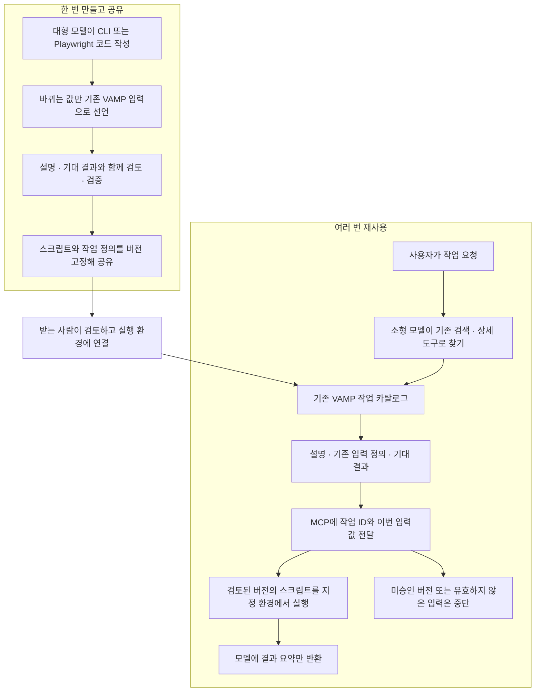

# VAMP 워크플로 재사용: CLI와 Playwright

상태: 설계 제안. 실행 코드와 벤치마크 결과는 포함하지 않습니다.

**AI가 이미 만든 코드를 다시 만들지 않고, 기존 VAMP 입력값만 바꿔 실행하는 기능**입니다. 대형 모델이 만든 Playwright·Python 스크립트 자체를 검토해 공유하고, 받는 쪽의 소형 모델은 구현을 읽지 않고 카탈로그에서 해당 작업을 찾아 호출합니다. 새 스크립트 언어나 변수 시스템을 만드는 것이 아닙니다. [기존 GUI RPA 흐름](WORKFLOWS.md)과 같은 작업 정의를 활용합니다.

## 전체 구조

## 있는 것과 추가할 것

| 재사용할 것 | 새로 연결할 것 |
| --- | --- |
| 기존 작업 이름·설명·태그·기대 결과·`inputs`·검토 상태 | 저장된 코드의 실행기 종류, 진입점, 의존성 버전, 실행 환경과 코드 해시 |
| `rpa_search`와 `rpa_details`에서 메타데이터로 고르는 패턴 | 기존 GUI 항목을 깨지 않고 스크립트형 항목도 검색 가능하게 확장 |
| 승인 후 ID와 선언된 값으로 실행하는 패턴 | GUI 좌표 재생기 대신 승인된 스크립트 진입점으로 넘기는 별도 실행 어댑터 |

작성할 때 AI는 코드에서 실행마다 달라질 후보를 **기존 `inputs` 항목으로 제안**합니다. 사용자가 확인한 뒤에는 변수 선언을 새로 생성하거나 해석하지 않습니다. 받는 모델은 기존 선언에 들어갈 이번 요청의 값만 채웁니다. 별도 터미널 녹화기, 명령 DSL, 새 입력 스키마는 필요 없습니다.

실행할 때는 승인된 코드 버전과 지정된 작업공간을 확인한 뒤, 값을 기존 입력 계약에 맞춰 스크립트로 전달합니다. 모델이 호출 시에 명령이나 코드를 바꿀 수 없도록 합니다. 첫 데모는 합성 데이터와 로컬 테스트 앱만 대상으로 하고, 공유본에는 자격 증명이나 원본 기록을 넣지 않습니다. 공유받은 작업은 자동으로 실행하지 않으며 새 버전은 다시 검토합니다.

## 첫 데모: 큰 모델이 만든 코드를 작은 모델이 그대로 실행

1. **작성:** 대형 모델이 로컬 Demo ERP의 합성 주문을 CSV로 내보내는 Playwright 스크립트를 한 번 만든다. 예를 들어 주문 번호와 출력 파일 이름만 기존 `inputs`로 선언하고, 파일에 해당 주문이 있는지 확인하는 검증 코드를 포함한다.
2. **공유:** 코드·기존 작업 정의·검토할 버전을 다른 작업공간에 전달한다. 받는 쪽은 자기 테스트 앱 환경을 지정하고 승인한다.
3. **재사용:** 새 채팅에서 소형 모델에 각기 다른 샘플 주문을 요청한다. 모델은 작업 설명과 입력 정의만 보고 호출하며 원본 코드나 긴 로그를 읽지 않는다. 성공·실패는 CSV 내용으로 판정한다.
4. **측정:** 대형 모델의 최초 작성 비용과 소형 모델의 반복 호출 비용을 분리한다. 직접 작성 경로와 재사용 경로에서 결과 정확도, 전체 입력·출력 토큰, 실행 시간을 함께 기록한다. 실행 자체의 추가 LLM 호출 여부와, 작업 검색·호출·응답에 쓰인 토큰은 따로 본다. 사전에 절감률을 가정하지 않는다.

성공 기준: **두 독립 작업공간에서 같은 코드와 작업 정의를 바꾸지 않고, 입력값만 바꿔 다른 CSV를 검증한다.** 잘못된 입력과 미승인 코드 버전은 실행 전에 막힌다.
