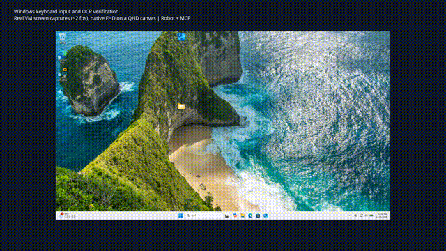
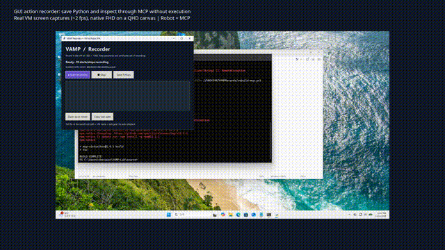
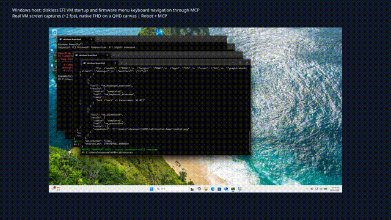
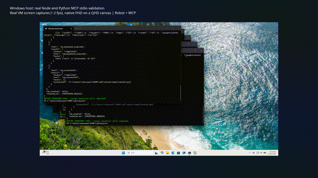

# Robot 데모와 QHD 영상

[아키텍처와 구성 요소](MCP_ARCHITECTURE.md)에서 AI → Node stdio MCP → 호스트 VirtualBox → 게스트 화면·입력의 흐름과 Robot/Python의 역할을 설명합니다. Windows 호스트 설치·검증 스크립트는 [scripts/windows](../scripts/windows)에 있습니다.

아래는 Robot Framework가 실제 Win-RPA 화면을 캡처하며 수행한 짧은 시연입니다. 게스트 원본은 **1920×1080**, MP4는 확대 없이 여백을 더한 **2560×1440 QHD**입니다. 캡처는 약 2 fps이므로 부드러운 실시간 영상과 차이가 있습니다. GIF를 클릭하면 MP4를 열 수 있으며, 옆의 JSON에 검증 결과와 타임스탬프가 있습니다.

| 기능 | 미리보기 / MP4 | 검증 근거 |
| --- | --- | --- |
| 공통 실행기·키보드 입력·OCR | [](media/keyboard-ocr.mp4) | [타임라인](media/keyboard-ocr.json): 메모장에 입력한 문구를 OCR로 확인 |
| 마우스·GUI 녹화·공유 소스 읽기 | [](media/recorder-share.mp4) | [타임라인](media/recorder-share.json): 클릭 (1800, 800)을 기록한 Python을 MCP로 읽고 AST 검사; 실행하지 않음 |
| Windows 호스트의 중첩 VM·화면·키보드 | [](media/nested-windows-host.mp4) | [검증 JSON](media/nested-firmware-verification.json): [입력 전](media/nested-firmware-before.png) → [ESC 입력 후](media/nested-firmware-after.png)의 EFI 메뉴 변화를 OCR 확인 |
| Windows 호스트의 실제 MCP stdio | [](media/windows-host-mcp.mp4) | [타임라인](media/windows-host-mcp.json): Windows 내부 Node/Python으로 목록·설정·SQLite 이력 조회 |

재현 패키지는 [Robot 데모](../backends/virtualbox/rpas/demos)입니다. [`requirements-demos.txt`](../requirements-demos.txt)는 영상 제작용 추가 의존성입니다. 실행 전 Win-RPA를 부팅·로그인하고 화면을 1920×1080으로 맞추세요. `recorder.robot`은 녹화 프로그램이 열린 상태와 `HOST_SHARE` 변수가 필요합니다. `windows_host.robot`은 Windows 내부의 저장소·Node 경로와 `HOST_SHARE` 변수가 필요합니다. Win+R 명령 길이 제한을 피하도록 인자는 공유폴더의 PowerShell 실행 파일에 저장합니다. 시나리오는 VM을 끄지 않습니다. 생성·종료·복원 같은 수명 주기 도구는 위 영상에서 검증했다고 주장하지 않으며, 실제 범위는 [검증 기록](VALIDATION.md)을 따릅니다.

```bash
.venv/bin/python -m pip install -r requirements-demos.txt
.venv/bin/python -m robot --outputdir artifacts/demos/input backends/virtualbox/rpas/demos/input.robot
.venv/bin/python -m robot --variable HOST_SHARE:/absolute/path/to/share --outputdir artifacts/demos/recorder backends/virtualbox/rpas/demos/recorder.robot
.venv/bin/python -m robot --variable HOST_SHARE:/absolute/path/to/share --outputdir artifacts/demos/windows-host backends/virtualbox/rpas/demos/windows_host.robot
```
