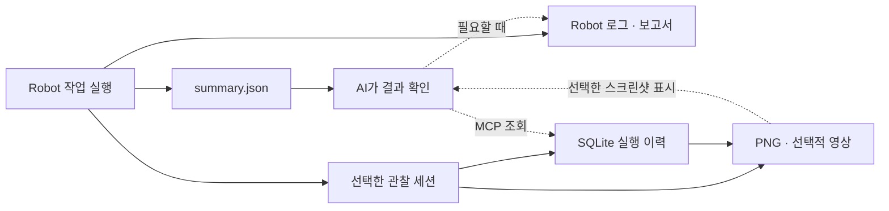

# 실행 기록, 로그와 스크린샷 확인하기

저장한 GUI 동작은 다음 실행에 쓸 재료입니다. 실행 로그와 스크린샷은 그 작업이 실제로 어떻게 진행됐는지 확인할 자료입니다. AI는 결과 요약을 먼저 읽고, 화면 확인이나 실패 분석이 필요할 때 상세 기록을 열 수 있습니다.

## 확인할 수 있는 기록

| 기록 | 확인하는 곳 | 내용 |
| --- | --- | --- |
| 녹화 Python·handoff JSON | `vm_recording_share`의 inspect, 선택적 `vm_import_recording` | 저장한 GUI 동작 소스와 전달 정보; 가져올 때 실행하지 않음 |
| `summary.json` | RPA 출력 폴더 | 업무 상태, 검증 결과와 상세 경로 |
| `log.html`, `report.html`, `output.xml` | Robot 출력 폴더, 호스트 브라우저·편집기 | 키워드별 실행 로그, 오류, 시간과 보고서 |
| SQLite 실행 이력 | `vm_run_history` | 관찰한 실행의 VM·시각·Robot 상태·이벤트·첨부파일 |
| PNG 스크린샷 | `vm_run_artifact` 또는 로컬 파일 | 저장 당시 게스트 화면; 선택한 이미지만 MCP로 표시 |
| 선택적 실행 영상 | 이력의 영상 경로, 호스트 플레이어 | 관찰을 켜 둔 구간의 화면 |
| 현재 VM 화면 | `vm_screenshot` | 지금 상태를 새로 캡처 |

Robot 로그 파일은 호스트에서 열어 봅니다. MCP 이력 도구가 반환하는 것은 실행 상태·최근 이벤트·등록된 첨부파일입니다. 모든 `log.html` 내용을 자동으로 수집하거나 읽는 범용 파일 도구는 아닙니다.



## Robot 실행에 관찰 붙이기

Listener는 VirtualBox의 녹화·캡처 API를 사용합니다. GUI 동작을 Python으로 저장하는 레코더와 별개이며, 호스트용 화면 녹화 프로그램이나 게스트 녹화 프로그램을 추가로 설치할 필요가 없습니다.

```bash
# 영상 OFF, 실행 이력과 스크린샷
.venv/bin/python -m robot \
  --listener backends.virtualbox.recording_listener.RecordingListener:Win-RPA:false \
  --variable VM_NAME:Win-RPA \
  --outputdir artifacts/robot-observed \
  backends/virtualbox/rpas/observe/run.robot

# 영상 ON: 저화질 관전 기록
.venv/bin/python -m robot \
  --listener backends.virtualbox.recording_listener.RecordingListener:Win-RPA:true \
  --variable VM_NAME:Win-RPA \
  --outputdir artifacts/robot-recorded \
  backends/virtualbox/rpas/observe/run.robot
```

VM은 이미 실행 중이어야 합니다. Listener는 VM을 만들거나 시작하지 않습니다. 다른 Robot 작업에도 붙일 수 있으며 시작·종료·작업 결과에 스크린샷과 상태를 연결합니다. 영상은 `true`일 때만 켭니다. 관찰 초기화 실패와 Robot 작업 실패는 따로 확인해야 합니다.

영상은 640×360, 5fps, 최대 180초·20MB, 오디오 없음이 기본값입니다. 먼저 도달한 제한에서 녹화가 끝날 수 있습니다. 게스트 화면은 1920×1080을 유지하며 PNG는 원본 해상도로 저장합니다. 영상·스크린샷에는 화면의 개인정보도 들어갈 수 있습니다.

MCP 입력을 직접 호출한 내역이 모두 자동 저장되는 것은 아닙니다. Listener를 붙였거나 `vm_run_observation`으로 시작한 세션에만 이 기능이 적용됩니다.

## 저장 위치

기본 경로는 호스트의 `~/VAMP`이며 `VAMP_DATA_DIR`로 바꿀 수 있습니다. Robot 로그·보고서는 실행할 때 지정한 `--outputdir`에 남습니다.

```text
~/VAMP/
├── history.sqlite3
├── recordings/                 # GUI 동작을 저장한 Python 파일
└── runs/<run_id>/
    ├── start-*.png
    ├── task-*.png
    ├── end-*.png
    └── screen-screen0.webm
```

SQLite의 `runs`에는 VM·시각·상태·Robot 결과, `events`에는 작업 결과·관찰 오류, `artifacts`에는 이미지·영상 경로와 크기가 들어갑니다. 큰 이미지는 DB에 넣지 않습니다.

`finished`는 관찰 세션이 끝났다는 뜻입니다. Robot의 PASS/FAIL은 `robot_status`, 업무의 성공 조건은 해당 RPA 결과로 확인합니다. 기록은 호스트에 남으므로 VM 스냅샷·복원과는 별개입니다. 자동 보관 기간이나 정리 정책은 아직 없습니다.

## MCP로 조회하기

먼저 `vm_run_history`로 최근 실행을 찾고, 선택한 `run_id`를 다시 조회하면 이벤트와 첨부파일을 볼 수 있습니다. 기본 목록은 20개, 최대 100개이며 상세 이벤트·첨부파일은 각각 최근 30개를 반환합니다. 전체 기록은 호스트 SQLite 파일에서 확인할 수 있습니다.

- `vm_run_observation`: begin/end/capture. `video` 기본값은 false입니다.
- `vm_run_history`: 최근 실행 목록 또는 `run_id` 상세를 반환합니다.
- `vm_run_artifact`: `artifact_id`로 파일 정보를 조회합니다. `show_image:true`를 지정한 스크린샷만 MCP 이미지로 반환하며 영상은 로컬 경로로 엽니다.

다음은 관찰 시작, 추가 캡처, 종료와 이후 조회에 쓰는 인자 예시입니다. 위 도구를 해당 단계에 맞춰 호출합니다.

```json
{"action":"begin","vm":"Win-RPA","video":true}
{"action":"capture","run_id":"<위에서 받은 ID>"}
{"action":"end","run_id":"<같은 ID>","robot_status":"PASS"}
{"run_id":"<같은 ID>"}
{"artifact_id":1,"show_image":true}
```

직접 관찰을 시작했으면 `end`도 호출해야 합니다. 실행이 취소됐을 때는 이력과 VM의 실제 녹화 상태를 확인하세요. MCP 이미지 요청은 파일을 클라이언트에 전달합니다. 모델로 무엇을 보낼지는 사용하는 클라이언트 설정에 따릅니다.

## 실제 시험 결과

Ubuntu 호스트의 Win-RPA에서 Robot observe 작업 PASS, SQLite 기록, PNG와 640×360/5fps WebM 디코딩을 확인했습니다. VirtualBox 7.2.6의 `recording on`과 `recording start`를 구분해 처리합니다. 다른 호스트 OS의 영상 인코더는 별도 시험 전입니다. [전체 검증 기록](VALIDATION.md)

[Robot Framework Listener](https://robotframework.org/robotframework/latest/RobotFrameworkUserGuide.html#listener-interface) · [GUI 작업 재사용](WORKFLOWS.md)
