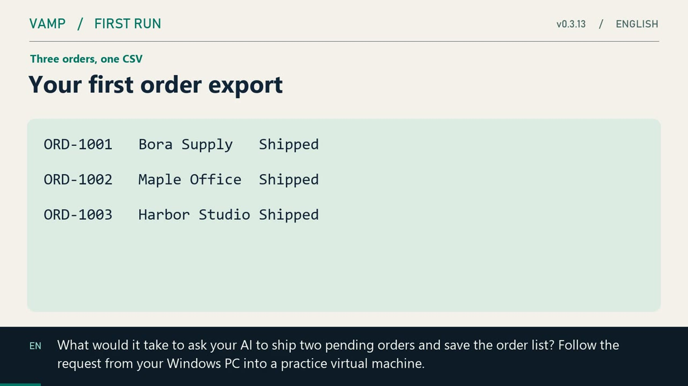
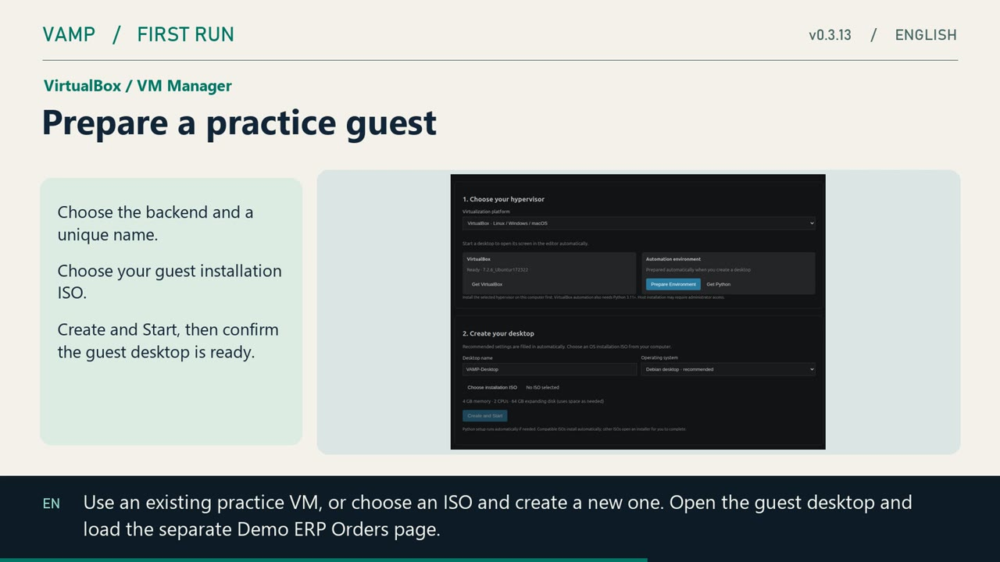
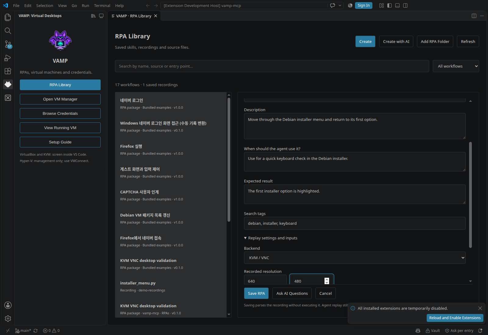
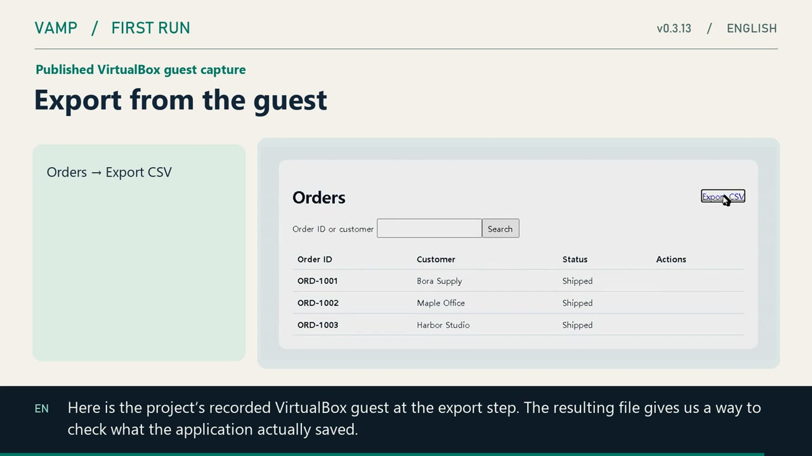

# First run: Ask your AI to set up VAMP MCP

[한국어 가이드](FIRST_RUN.ko.md)

Connect VAMP to Claude Code or Codex on a Windows PC, then try a practice task that exports three orders to a CSV. The English walkthrough is 3:02 with English narration and captions. The commands and filenames below use VAMP v0.3.13 and Windows PowerShell.

[](https://github.com/wayfarer6/vamp-mcp/raw/refs/heads/main/docs/media/vamp-first-run-en.mp4)

[Download the video (MP4)](https://github.com/wayfarer6/vamp-mcp/raw/refs/heads/main/docs/media/vamp-first-run-en.mp4) · [English captions (SRT)](media/vamp-first-run-en.srt) · [Sample output CSV](media/first-run-orders.csv)

## Copy a prompt into your AI client

**If Claude Code or Codex can run commands on your PC**, paste this prompt:

```text
https://github.com/wayfarer6/vamp-mcp
Install VAMP MCP on my Windows PC from this repository's latest official GitHub release.
Verify the installer's SHA-256 against the release checksum list and connect VAMP to this AI client.
Once connected, query my VirtualBox VM inventory and show me the result.
Tell me if Windows opens an administrator approval prompt that I need to approve myself.
```

**If Claude or ChatGPT in your browser cannot access your PC's terminal**, paste this instead:

```text
https://github.com/wayfarer6/vamp-mcp
I want to install VAMP MCP on my Windows PC. First ask which AI client I want to connect.
Give me one PowerShell command at a time. Wait for me to send the result before giving me the next command.
At the end, show me how to verify the connection.
```

| Time | What to follow in the English video |
| --- | --- |
| 0:09 | Ask Claude Code or Codex to install VAMP |
| 0:24 | Ask a web chat for step-by-step instructions |
| 0:45 | Download the release package and verify its SHA-256 |
| 1:23 | Register the server in Codex |
| 1:33 | Approve host UAC and make the first VM inventory query |
| 1:42 | Install the VSIX and open VM Manager |
| 2:00 | Record the guest workflow and save it to the shared folder |
| 2:11 | Review the recording and add it to RPA Library |
| 2:22 | Reset the guest and ask the AI to find the reviewed task |
| 2:34 | Watch the order update, the guest export, and the CSV check |

## Install and connect manually

1. Set up **Node.js 22 or later** and the **Codex CLI** on the Windows host. The local VM exercise uses **VirtualBox 7.x** and a disposable Windows guest. Use a trusted installation ISO and a valid Windows license if creating a new guest.
2. Download `vamp-mcp-0.3.13.tgz` and `RELEASE-SHA256SUMS` from the [v0.3.13 GitHub release assets](https://github.com/wayfarer6/vamp-mcp/releases/tag/v0.3.13) into the same folder. Open PowerShell there and compare the two results:

   ```powershell
   Select-String -SimpleMatch 'vamp-mcp-0.3.13.tgz' -Path .\RELEASE-SHA256SUMS
   (Get-FileHash .\vamp-mcp-0.3.13.tgz -Algorithm SHA256).Hash
   ```

3. Only proceed if all 64 hexadecimal characters match (letter case does not matter). Install from the verified local tarball and check that the version reads `0.3.13`:

   ```powershell
   npm install -g .\vamp-mcp-0.3.13.tgz
   vamp-mcp.cmd --version
   ```

   To enable text and icon recognition in this release, prepare Python 3.12 and the appropriate device driver on the host, then run `vamp-mcp.cmd setup`. See the release notes for supported hardware and configuration. [Security notice](https://github.com/advisories/GHSA-q37r-5xxr-6v4x): the listed npm versions `0.2.3`–`0.2.5` are affected. If you installed or ran one, follow the advisory first. A matching hash confirms file integrity, not a security audit.

4. Register VAMP in Codex on the same host and inspect the registration:

   ```powershell
   codex mcp add vamp -- cmd.exe /d /c vamp-mcp.cmd
   codex mcp get vamp
   ```

5. In a new Codex session, ask: **“Use VAMP’s `vm_list` to show my VirtualBox VM names and UUIDs.”** If Windows shows the expected **host UAC** prompt when starting the server, approve it yourself. An empty VM list still means the query worked. If the client cannot find the command, run `where.exe vamp-mcp.cmd` and reconnect. See [MCP registration and Windows permissions](MCP_REGISTRATION.md).

## Record, review, and reuse the practice task

1. Save your work and close all VS Code windows. Reopen VS Code as administrator for the VM Manager, using only trusted workspaces and extensions. Download `vamp-mcp-tools-0.3.13.vsix` from the [same release](https://github.com/wayfarer6/vamp-mcp/releases/tag/v0.3.13), verify its SHA-256 against its entry in `RELEASE-SHA256SUMS`, and use **Extensions: Install from VSIX** in the Command Palette. Reload VS Code. If using VS Code chat, enable the extension's **VAMP MCP**.
2. Open **VAMP → Open VM Manager** and select VirtualBox. Open an existing practice VM, or choose a name and ISO and select **Create and Start**. Sign in to the guest and open the **Orders** screen of the separate [Demo ERP](https://github.com/wayfarer6/vamp-demo-erp) app.

   

   *Walkthrough frame at 1:56. This is an earlier development build; use the [current backend guide](VM_MCP.md) for supported hosts and features.*

3. In the guest, open **RPA-Recorder → Start-Recorder.cmd → Start recording**. In the demo ERP, use **Update Status** on the two `Pending` orders and then choose **Export CSV**. Select **Stop → Save Python** and save the recording to the **VAMPRecords** shared folder mounted by VirtualBox Guest Additions. See [guest recorder setup](GUEST_RECORDER.md).
4. In **RPA Library → Create**, choose the recording and add its name, when to use it, expected result, backend, and recording resolution. Review the actions, select **I reviewed this recording and allow agent reuse**, and choose **Save RPA**. If using a separate CLI server, point its `VAMP_RPA_REGISTRY` at the extension's `rpa-catalog` folder and reconnect. See the [recording and reuse guide](USER_GUIDE.md).

   

   *This separate KVM/Debian example shows the review form. Select VirtualBox for the Windows guest in this exercise.*

5. Reset the practice app to its starting state and reopen **Orders** at the same guest resolution used for recording. Ask the AI:

   ```text
   Find the reviewed RPA for marking orders as shipped and exporting the CSV.
   Show me the target VM and the expected result, then wait for my approval.
   After I approve, run the task and verify the three order IDs and shipping statuses in the new CSV.
   ```



*Walkthrough frame at 2:45, from the published VirtualBox guest validation footage.*

**Success criterion:** The newly exported CSV contains exactly one row each for `ORD-1001`, `ORD-1002`, and `ORD-1003`, all marked `Shipped`. Two start as pending; the third is already shipped. Compare the new export with the [sample CSV exported in the walkthrough](media/first-run-orders.csv), rather than relying on the on-screen update alone.

## Next video: How VAMP MCP is wired

[Download the English architecture video (MP4, 1:53)](https://github.com/wayfarer6/vamp-mcp/raw/refs/heads/main/docs/media/vamp-architecture-en.mp4) · [English captions](media/vamp-architecture-en.srt)

| Time | What the video shows |
| --- | --- |
| 0:10 | AI client → MCP server on the host → guest; optional SSH remote host and separate Vault server |
| 0:29 | VirtualBox inventory, recorded Windows guest, and native VirtualBox window for manual input |
| 0:47 | Linux KVM/QEMU and libvirt; user and system inventories and the local VNC viewer |
| 1:05 | Windows Hyper-V VM Manager, external VMConnect console, separate Python VM MCP server |
| 1:29 | Replay a reviewed task on VirtualBox or KVM and verify a fresh output |
| 1:41 | Choose the path for your actual host |

The video covers v0.3.13. The VirtualBox segment uses [published guest footage in English](https://github.com/wayfarer6/vamp-mcp/releases/download/v0.3.10/05-VirtualBox-ERP-Replay-QHD-en.mp4). The KVM segment uses the repository's [VS Code viewer screenshot](media/vscode-vm-screen-kvm.png). The Hyper-V segment shows an architecture diagram and refers to [nested Windows lab file-transfer and inventory validation](VALIDATION.md), not a recorded Hyper-V RPA execution. Hyper-V desktop RPA replay is not supported in v0.3.13. See [MCP registration](MCP_REGISTRATION.md), [VM viewing by backend](USER_GUIDE.md), and [Python server tools for Hyper-V](VM_MCP.md).

## What the demo verifies

The close-up of the shipping status update comes from a local browser running Demo ERP for this guide. The subsequent VirtualBox guest footage comes from a separate published validation run. Installation and Codex registration were checked with release files in another Windows environment. The AI chat prompts are examples to try, not a capture of one end-to-end AI session.

- [Original VirtualBox guest replay (English)](https://github.com/wayfarer6/vamp-mcp/releases/download/v0.3.10/05-VirtualBox-ERP-Replay-QHD-en.mp4)
- [Robot Framework evidence and sample CSVs](https://github.com/wayfarer6/vamp-mcp/releases/download/v0.3.11/vamp-erp-codex-scratch-evidence.zip)
- [Run Demo ERP and check an exported CSV](https://github.com/wayfarer6/vamp-demo-erp)
