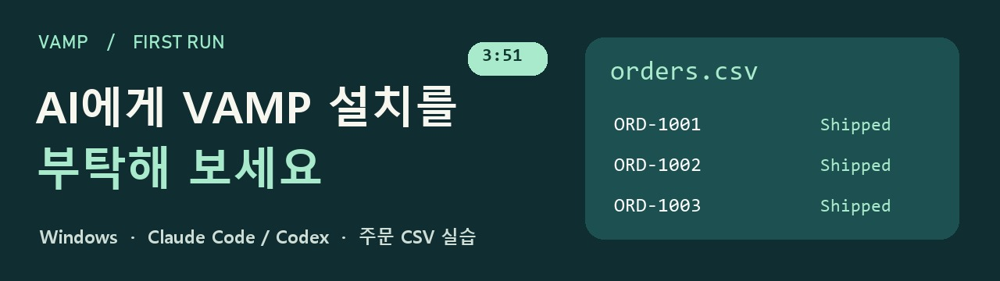

# AI에게 VAMP MCP 설치를 부탁해 보세요

[English guide](FIRST_RUN.en.md)

Windows PC에서 Claude Code 또는 Codex에 VAMP를 연결하고, 연습용 주문 세 건을 CSV로 받는 예제입니다. 영상은 한국어 음성·자막이 있는 3분 51초 MP4입니다. 명령 예시는 v0.3.13과 Windows PowerShell을 기준으로 합니다.

[](https://github.com/wayfarer6/vamp-mcp/raw/refs/heads/main/docs/media/vamp-first-run-ko.mp4)

[영상 내려받기 (MP4)](https://github.com/wayfarer6/vamp-mcp/raw/refs/heads/main/docs/media/vamp-first-run-ko.mp4) · [한국어 자막 (SRT)](media/vamp-first-run-ko.srt) · [실습 결과 CSV](media/first-run-orders.csv)

영어판 · [설치 가이드 MP4](https://github.com/wayfarer6/vamp-mcp/raw/refs/heads/main/docs/media/vamp-first-run-en.mp4) · [영어 자막](media/vamp-first-run-en.srt) · [구조 소개 MP4](https://github.com/wayfarer6/vamp-mcp/raw/refs/heads/main/docs/media/vamp-architecture-en.mp4) · [영어 자막](media/vamp-architecture-en.srt)

## 이 문장을 AI에 붙여 넣으세요

**내 PC에서 실행하는 Claude Code나 Codex에는** 아래 문장을 그대로 보내세요.

```text
https://github.com/wayfarer6/vamp-mcp
내 Windows PC에 이 저장소의 최신 공식 릴리스로 VAMP MCP를 설치해 줘.
설치 파일의 SHA-256을 릴리스 목록과 대조하고, 지금 쓰는 AI에 연결해 줘.
끝나면 VirtualBox 가상머신 목록을 조회해서 연결됐는지 보여 줘.
내가 직접 눌러야 하는 관리자 승인 창이 뜨면 알려 줘.
```

**Claude나 ChatGPT 웹 채팅에서 내 PC의 터미널을 사용할 수 없다면** 다음처럼 요청하세요.

```text
https://github.com/wayfarer6/vamp-mcp
내 Windows PC에 VAMP MCP를 설치하고 싶어. 연결할 AI 앱을 먼저 물어봐 줘.
내가 PowerShell에서 실행할 명령을 한 번에 하나씩 알려 줘.
내가 결과를 보내면 다음 단계를 안내하고, 마지막에는 연결을 확인하는 방법도 알려 줘.
```

| 시간 | 따라 할 일 |
| --- | --- |
| 0:09 | Claude Code 또는 Codex에 설치 부탁하기 |
| 0:22 | 웹 채팅에서 설치 안내 받기 |
| 0:48 | 직접 설치할 때 받을 파일과 해시 확인 |
| 1:36 | Codex에 MCP 등록하기 |
| 1:49 | AI 채팅에서 첫 VM 목록 조회 |
| 2:03 | VS Code에서 연습용 VM 만들기 |
| 2:33 | 동작을 녹화하고 RPA Library에 등록하기 |
| 2:59 | 검토된 작업을 찾아 실행하도록 요청하기 |
| 3:14 | 배송 처리, 게스트 원본 녹화, 결과 CSV 확인 |

## 직접 설치하고 연결하려면

1. Windows 호스트에 Node.js 22 이상과 Codex CLI를 준비하세요. 로컬 VM 실습에는 VirtualBox 7.x와 연습용 게스트가 필요합니다. 새 Windows 게스트를 만들 때는 본인의 설치 ISO와 라이선스를 준비하세요.
2. [영상과 같은 릴리스의 Assets](https://github.com/wayfarer6/vamp-mcp/releases/tag/v0.3.13)에서 `vamp-mcp-0.3.13.tgz`와 `RELEASE-SHA256SUMS`를 같은 폴더에 받으세요. 그 폴더에서 PowerShell을 열고 두 값을 확인하세요.

   ```powershell
   Select-String -SimpleMatch 'vamp-mcp-0.3.13.tgz' -Path .\RELEASE-SHA256SUMS
   (Get-FileHash .\vamp-mcp-0.3.13.tgz -Algorithm SHA256).Hash
   ```

3. 64자리 해시가 일치하면 설치하세요. 버전 확인 결과는 `0.3.13`입니다. 화면 글자와 아이콘 인식을 준비하려면 호스트에 Python 3.12와 장치 드라이버를 설치한 뒤 `vamp-mcp.cmd setup`을 실행하세요.

   ```powershell
   npm install -g .\vamp-mcp-0.3.13.tgz
   vamp-mcp.cmd --version
   ```

4. 같은 호스트의 Codex CLI에 등록하고 등록 내용을 확인하세요.

   ```powershell
   codex mcp add vamp -- cmd.exe /d /c vamp-mcp.cmd
   codex mcp get vamp
   ```

5. 새 Codex 세션에서 **“VAMP의 vm_list로 VirtualBox 가상머신 이름과 UUID를 보여 줘”**라고 요청하세요. 서버 시작 시 뜨는 Windows 호스트 UAC 창을 승인하세요. 도구가 빈 목록을 반환해도 조회는 성공한 것입니다. 연결 오류가 나면 `where.exe vamp-mcp.cmd`로 실행 파일 위치를 확인하고 서버를 다시 연결하세요. [MCP 등록과 Windows 권한](MCP_REGISTRATION.md)

## 내 작업을 한 번 기록하고 다시 쓰기

1. VM을 화면으로 만들거나 녹화를 관리하려면 관리자 권한으로 VS Code를 여세요. 같은 릴리스의 `vamp-mcp-tools-0.3.13.vsix`를 받아 해시를 확인하고, 명령 팔레트에서 **Extensions: Install from VSIX**로 설치한 뒤 다시 로드하세요. VS Code 채팅에서는 확장이 제공하는 **VAMP MCP**를 활성화하세요.
2. **VAMP → Open VM Manager**에서 VirtualBox를 선택하세요. 기존 연습용 VM을 열거나, 이름과 ISO를 선택하고 **Create and Start**를 누르세요. 게스트 바탕화면에 로그인한 뒤 게스트 안에서 [Demo ERP](https://github.com/wayfarer6/vamp-demo-erp)의 **Orders** 화면을 여세요. 연습 앱은 별도로 실행합니다.
3. 게스트의 **RPA-Recorder → Start-Recorder.cmd → Start recording**으로 녹화를 시작하세요. 데모에서는 `Pending` 두 건의 **Update Status**를 누른 뒤 **Export CSV**를 선택합니다. **Stop → Save Python**으로 Guest Additions가 마운트한 **VAMPRecords** 공유 폴더에 저장하세요. [게스트 녹화기 설치](GUEST_RECORDER.md)
4. **RPA Library → Create**에서 녹화 파일을 선택하고 작업 이름, 사용 시점, 기대 결과, 백엔드와 녹화 해상도를 입력하세요. 동작을 검토하고 **I reviewed this recording and allow agent reuse → Save RPA**를 선택하세요. 별도 CLI가 이 작업을 찾으려면 서버의 `VAMP_RPA_REGISTRY`를 확장이 사용한 `rpa-catalog` 폴더로 지정하고 다시 연결하세요. [녹화와 재사용 가이드](USER_GUIDE.md)
5. 연습 앱을 초기 상태로 되돌리고 녹화할 때와 같은 해상도로 **Orders** 화면을 다시 여세요. AI에 다음과 같이 요청하세요.

   ```text
   검토된 ‘주문 배송 처리와 CSV 내보내기’ RPA를 찾아 줘.
   대상 VM과 기대 결과를 보여 주고 내 승인을 기다려.
   승인하면 실행하고 새 CSV의 주문 번호 세 개와 배송 상태를 확인해 줘.
   ```

**성공 기준**은 새 CSV에 `ORD-1001`, `ORD-1002`, `ORD-1003`가 각각 한 번씩 있고 세 상태가 모두 `Shipped`인 것입니다. [영상에서 브라우저로 직접 내보낸 CSV](media/first-run-orders.csv)

## 다음 영상 · VAMP MCP의 구조

[한국어 구조 소개 영상 내려받기 (3분 04초)](https://github.com/wayfarer6/vamp-mcp/raw/refs/heads/main/docs/media/vamp-architecture-ko.mp4) · [한국어 자막](media/vamp-architecture-ko.srt)

| 시간 | 영상 속 경로 |
| --- | --- |
| 0:15 | AI 클라이언트 → 호스트의 MCP 서버 → 게스트. 설정한 원격 SSH 연결과 별도 Vault 서버 |
| 0:42 | VirtualBox의 VM 목록, Windows 게스트 주문 화면, 직접 입력할 때 여는 기본 창 |
| 1:11 | Linux KVM/QEMU와 libvirt, 사용자·시스템 VM 목록, 로컬 VNC 화면 |
| 1:44 | Windows Hyper-V의 VM Manager, VMConnect, 별도 Python VM MCP 서버 |
| 2:20 | 검토된 RPA 재생과 새 결과 파일 검증 |
| 2:44 | 세 환경의 관리 도구와 화면 경로 비교 |

영상은 v0.3.13을 기준으로 합니다. VirtualBox 장면은 [게스트 원본 녹화](https://github.com/wayfarer6/vamp-mcp/releases/download/v0.3.10/05-VirtualBox-ERP-Replay-QHD-ko.mp4)에서 가져왔고, KVM 장면은 [프로젝트의 VS Code 뷰어 캡처](media/vscode-vm-screen-kvm.png)입니다. Hyper-V 부분은 VMConnect 경로를 그린 구조도와 [중첩 Windows 랩의 파일 전송·인벤토리 검증 기록](VALIDATION.md)을 바탕으로 설명합니다. v0.3.13의 Hyper-V 데스크톱 RPA 재생은 미지원입니다. [MCP 등록 경로](MCP_REGISTRATION.md) · [백엔드별 VM 화면](USER_GUIDE.md) · [Python 서버의 Hyper-V 도구](VM_MCP.md)

## 시연 자료

배송 상태를 바꾸는 확대 화면은 이번 가이드를 위해 로컬 브라우저에서 실행한 Demo ERP입니다. 이어서 보이는 **VirtualBox 게스트** 장면은 프로젝트의 기존 게스트 검증 녹화에서 발췌했습니다. 설치와 Codex 등록은 별도 Windows 환경에서 릴리스 파일로 확인했습니다. 영상의 AI 채팅 문구는 따라 입력할 예시입니다.

- [VirtualBox 게스트 재생 원본 영상 (한국어)](https://github.com/wayfarer6/vamp-mcp/releases/download/v0.3.10/05-VirtualBox-ERP-Replay-QHD-ko.mp4)
- [Robot Framework 검증 자료와 예제 CSV](https://github.com/wayfarer6/vamp-mcp/releases/download/v0.3.11/vamp-erp-codex-scratch-evidence.zip)
- [Demo ERP 실행 절차와 CSV 검사 도구](https://github.com/wayfarer6/vamp-demo-erp)
