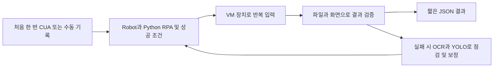

# VAMP MCP로 VM GUI 작업을 만들고 RPA로 재사용하기

Windows나 Linux VM의 GUI를 MCP로 제어하고, 한 번 만든 작업을 Robot Framework RPA로 다시 실행하는 VAMP를 만들고 있습니다. Codex나 Claude Code 같은 MCP 클라이언트를 연결해 ERP 화면 입력, 문서 출력, 사무 작업을 자동화하는 용도입니다.

GUI 에이전트가 매 단계 화면을 보고 판단하면 같은 작업을 반복할 때도 이미지 입력과 모델 호출이 이어집니다. VAMP에서는 처음에 CUA로 작업을 만들거나 사용자가 Recorder로 동작을 기록합니다. 그 결과를 검토하고 성공 조건을 붙여 RPA로 저장하면, 다음 실행부터는 정해진 입력과 GUI 동작을 재사용합니다. UI가 유지되는 동안 반복 구간의 멀티모달 호출을 줄이려는 접근입니다.

## 작업을 만들 때와 반복할 때

처음에는 화면을 보고 프로그램 실행, 입력 위치와 대기 조건을 정합니다. 수동 기록도 가져올 수 있으며, 기록한 Python 소스는 AST로 해석해 지원하는 동작만 변환합니다. 기록 파일 자체를 호스트에서 실행하지 않습니다.

반복 실행에서는 Robot이 순서와 검증을 맡고 Python이 VM 키보드·마우스 입력을 보냅니다. 정상 동작은 짧은 결과 JSON으로 확인하고, 실패하거나 화면이 바뀌었을 때 OCR·YOLO·필요한 스크린샷을 확인합니다. 해상도, 배율, 로그인 상태나 프로그램 버전이 달라지면 기존 좌표와 대기 조건도 점검해야 합니다.

## 화면 검증도 로컬 모델로

지원되는 Linux Python MCP 서버는 시작할 때 YOLO와 PaddleOCR 워커를 백그라운드에서 미리 띄웁니다. 워커는 MCP 세션 종료 뒤에도 남아 다음 작업에서 재사용합니다. 원격 Node 서버는 제어·캡처를 담당하며, 이번 구성의 Windows 화면 분석도 Ubuntu 컨트롤러의 워커가 처리합니다.

OCR은 텍스트를 읽고 YOLO는 UI 영역 후보를 찾습니다. 탐지 결과만으로 업무 성공을 판정하지는 않습니다. 예를 들어 PDF 출력이라면 실제 파일이 생성됐는지와 문서 내용을 함께 검사합니다. OCR·YOLO도 로컬 연산 시간과 메모리를 사용하므로 전체 자동화 비용이 0이 된다는 뜻은 아닙니다. RPA 내부에 LLM 호출이 없는 재실행 구간을 늘리는 구조이며, MCP 클라이언트가 작업을 계획하고 도구 결과를 읽는 토큰은 별도로 듭니다. 유료 CUA 대비 절감률은 별도 비교 측정이 필요합니다.

## 원격 호스트와 VM

원격 제어는 SSH stdio 안에서 MCP 메시지를 주고받는 방식입니다. 호스트의 하이퍼바이저가 게스트 화면을 캡처하고 게스트 장치로 입력합니다. 하이퍼바이저 제어 포트를 외부로 공개할 필요가 없습니다. 원격 경로는 요청별 스크린샷 방식입니다.

호스트 OS에 따라 백엔드는 다릅니다. Ubuntu에서는 KVM, Windows에서는 VirtualBox를 사용해 검증합니다. Hyper-V의 VMConnect 창을 여는 기능과 완성된 GUI 입력 자동화는 별도 범위입니다. 같은 RPA를 모든 OS에 그대로 재생하는 방식이 아니라, 호스트 제어와 게스트별 작업을 분리해 재사용합니다.

소스: https://github.com/wayfarer6/vamp-mcp

## 실제로 확인한 환경

Ubuntu/KVM 위에 1소켓·8코어·RAM 8GiB의 Windows 11 호스트를 올리고 중첩 VirtualBox에서 Debian을 설치했습니다. SSH stdio MCP로 Debian의 Firefox를 열고 SDK 마우스 클릭 전후의 페이지 문구를 OCR로 확인하는 Robot 시나리오가 통과했습니다. 물리 Windows 장비에서 시험한 결과는 아닙니다.

VM 화면은 FHD 1920×1080으로 고정하고, Robot 실행 영상은 화면 확대 없이 여백을 더한 QHD 2560×1440으로 남깁니다. [Windows 호스트 원격 입력 영상](media/windows-remote-fhd-qhd.mp4)과 [재현 구성](REMOTE_PDF_VALIDATION.md)을 함께 공개합니다.

Ubuntu 호스트에서는 Windows 송장을 열어 Windows 기본 `Microsoft Print to PDF`로 출력했습니다. 생성된 파일의 제작자, 송장 번호와 합계 KRW 192,500을 확인하고 SHA-256을 남깁니다. 이번 출력은 텍스트 계층이 없어 PDF를 렌더링한 뒤 로컬 OCR로 내용을 검증했습니다. [PDF 출력 영상](media/remote-windows-print-pdf.mp4) · [생성된 PDF](media/vamp-invoice-example.pdf)

예제는 실제 ERP 대신 로컬 송장 페이지와 입력 검증 페이지를 사용합니다. 업무 시스템에 적용할 때는 해당 프로그램의 초기 설정과 실제 완료 조건을 별도로 붙여야 합니다.

같은 PDF RPA의 재실행도 새 파일명으로 통과했습니다. 재실행에서는 초기 화면 OCR·YOLO 검사를 생략하고 프린터 확인과 실제 PDF의 로컬 검증을 유지했습니다. [재실행 영상](media/remote-windows-print-pdf-replay.mp4)에서 이 흐름을 확인할 수 있습니다. 실행 코드는 LLM API를 호출하지 않지만, 이 결과가 에이전트 전체 토큰이 0이라는 뜻은 아닙니다.
