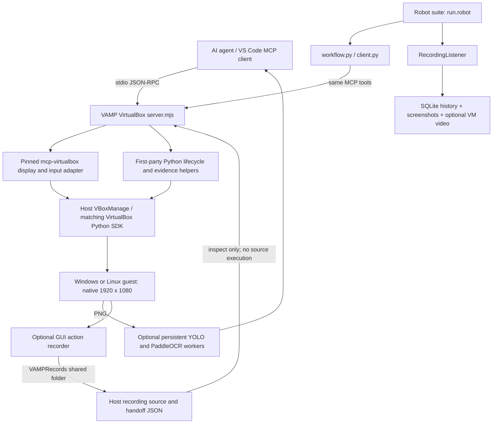

# VAMP MCP architecture

Prototype motivation: use a local VM sandbox, OCR/UI recognition and reusable Robot/Python workflows to reduce AI token use on repetitive GUI work. Built in one day with user-directed vibe coding; completeness, reliability and documentation remain limited. Only KVM/SPICE and VirtualBox have been tried so far; Hyper-V is experimental and untested.

VAMP exposes host-side VM tools to an AI agent through MCP over stdio. Robot Framework controls scenario order and assertions; Python implements VM operations and optional vision. Guest input is delivered through the hypervisor rather than a guest RPA agent.



## Components and boundaries

| Component | Location | Responsibility |
| --- | --- | --- |
| VirtualBox MCP | `backends/virtualbox/server.mjs` | 19 tools; VM inventory, lifecycle, display/input, recording imports and evidence |
| Robot client | `backends/virtualbox/client.py` | Starts a lightweight Node MCP server and saves image payloads locally |
| RPA package | `backends/virtualbox/rpas/<id>/` | `.robot`, Python workflow and manifest per task |
| Guest preparation | `guest_setup/recorder/` | Optional recorder, login display hooks and Debian mirrors |
| Execution evidence | `history.py`, `recording_listener.py` | Host SQLite, PNGs and opt-in low quality video |
| VS Code distribution | `vscode-extension/` | Bundled Node server, host Python environment setup and onboarding |
| Other backends | SPICE main code / Hyper-V folder | Separate transports; Hyper-V console launch remains experimental |

Ordinary screenshots, keyboard and mouse operations do not need Guest Additions commands. Shared folders, recorder installation and explicitly selected guest-file imports do use Guest Additions. Mouse injection needs the matching **host** VirtualBox SDK, and on Windows its COM Python support. Installing Python alone does not install hypervisor drivers or the SDK.

The guest GUI recorder captures user actions into Python. Execution video records what a Robot scenario did. They are separate features. Imported Python is parsed and reviewed before conversion; the import tool does not execute it.

The SPICE FastMCP server lives on `feat/vm-mcp-server`; the VirtualBox entrypoint above is available on `main`. The extension bundles the VirtualBox tools, not the entire SPICE/YOLO/PaddleOCR environment.

## Windows host validation

The current lab uses Ubuntu → Win-RPA (Windows 11 with nested virtualization) → an inner VirtualBox test VM. The VAMP Node and Python processes must execute **inside Win-RPA** to validate Windows host behavior. Inventory/setup/history checks have passed there. A diskless EFI VM is used for nested transport checks; this is not an installed Windows/Linux guest workload. Controlling Win-RPA from Ubuntu alone would only verify Linux host behavior.

From a Windows PowerShell in the repository:

```powershell
powershell -ExecutionPolicy Bypass -File scripts/windows/setup-host.ps1
$env:VBOXMANAGE_PATH = 'C:\Program Files\Oracle\VirtualBox\VBoxManage.exe'
.venv-virtualbox\Scripts\python.exe scripts/windows/host-smoke.py --vm 'EXISTING-RUNNING-VM'
```

The smoke script never creates or shuts down a VM. Without `--vm`, only inventory, setup information and SQLite history are checked. With `--vm`, it also checks information, native screen size and real screenshot capture. These checks do not prove keyboard, mouse or application success; those require scenario-specific assertions and a running installed guest. See [validation results](VALIDATION.md) for actual outcomes.

Nested virtualization is a lab arrangement, not a requirement for normal users. A normal Windows host runs VirtualBox directly. macOS hardware validation is separate.

## Reproducing the lab recordings

The source suites are in `backends/virtualbox/rpas/demos`. `windows_host.robot` and `nested.robot` write a short PowerShell launcher to the prepared `VAMPRecords` host share. This avoids the Win+R command length limit; long repository paths and arguments stay in the launcher file. The Windows setup script must first be installed inside the lab VM. Source scripts and output files are separate from guest input transport.

For the nested menu demo, use an existing **diskless EFI lab VM** at the firmware main menu with **Boot Manager selected**. The scenario presses Enter to open Boot Manager, captures it, presses ESC, then captures the firmware main menu. OCR must find both distinct menus. `nested-smoke.py --create` is a separate explicit creation option; Robot never creates another VM. Do not point this firmware scenario at a VM with installed applications.

```bash
.venv/bin/python -m robot \
  --variable INNER_VM:VAMP-Nested-Smoke-20261115-235230 \
  --variable HOST_OUTPUT:/absolute/path/to/VAMPRecords/nested-demo \
  --outputdir artifacts/demos/nested \
  backends/virtualbox/rpas/demos/nested.robot
```

`HOST_OUTPUT` is the Linux-side shared directory; the defaults in the suite describe this lab's Windows paths and can be overridden. A fresh Windows JSON report and before/after screenshots are required. A transport response alone does not count as visual success. Failed/interrupted runs remain under `artifacts/demos`; only passing runs export MP4/GIF files to `docs/media`.

The repo-only demo code and its optional image/video dependencies are excluded from the VSIX runtime.

Before running the suites, copy the repository's `scripts/windows/*.py` and `*.ps1` files into the corresponding `scripts/windows` directory of the Windows-side checkout. `setup-host.ps1` installs the runtime dependencies there. The shared launchers call that checkout; copying the launcher alone does not deploy updated source scripts.
