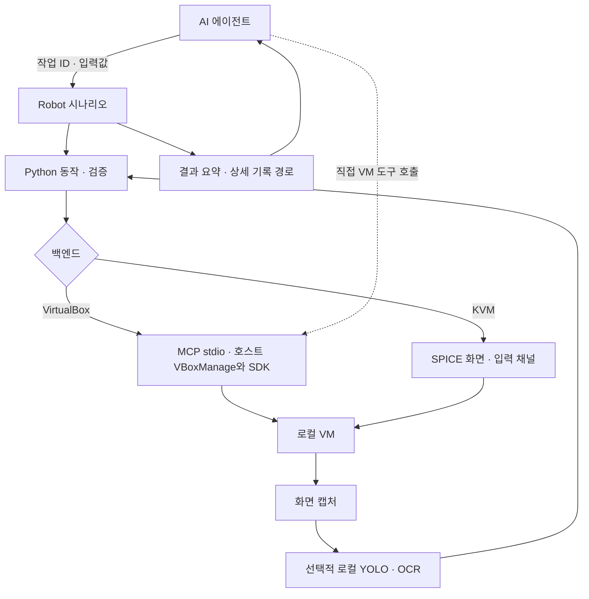

# VAMP 구성과 실행 경로

VAMP는 한 번 검토한 GUI 작업을 로컬 RPA로 보관하고, AI가 다음 요청에서 그 작업을 다시 실행하도록 만드는 프로젝트입니다. [워크플로 예시](WORKFLOWS.md)에서 기록·검토·재사용 과정을 설명합니다.

## AI가 선택하는 부분과 로컬에서 실행하는 부분

AI는 작업의 설명·입력값·성공 조건을 보고 실행할 패키지를 고릅니다. Robot과 Python이 VM 입력과 화면 검증을 맡고, 결과 요약과 상세 파일 경로를 돌려줍니다. 새 작업을 만들거나 실패 원인을 고칠 때는 코드와 화면을 더 살펴볼 수 있습니다.



VirtualBox MCP는 `main`, SPICE MCP 래퍼는 `feat/vm-mcp-server` 브랜치에 있습니다. SPICE Robot 작업은 MCP 없이도 SPICE 엔진을 직접 사용합니다. Hyper-V는 실험적 VMConnect 기동 코드이며 이 경로의 실제 검증 대상에는 포함되지 않습니다.

## 구성 요소

| 구성 | 위치 | 역할 |
| --- | --- | --- |
| VirtualBox MCP | `backends/virtualbox/server.mjs` | 화면·입력·VM 관리·녹화 소스·실행 이력 도구 19개 |
| Robot 클라이언트 | `backends/virtualbox/client.py` | Node MCP 서버 호출과 이미지 파일 저장 |
| 작업 패키지 | `rpas/<id>/`, `backends/virtualbox/rpas/<id>/` | Robot 순서, Python 구현, manifest와 작업 설명 |
| 화면 인식 | `vision.py`, `model_daemon.py` | 선택적으로 설치하는 YOLO·PaddleOCR 프로세스 |
| 게스트 준비 | `guest_setup/recorder/` | 레코더, 로그인 시 해상도 설정과 Debian 미러 설정 |
| 실행 기록 | `history.py`, `recording_listener.py` | SQLite 이력, 스크린샷과 선택적 영상 |
| VS Code 확장 | `vscode-extension/` | VirtualBox MCP 번들, 호스트 Python 환경 준비와 명령 |

## 녹화와 실행 기록

동작 레코더는 클릭·키 입력을 Python 소스로 저장합니다. 저장한 코드를 가져와 검토하고 변환해야 재생 가능한 RPA가 됩니다. 가져오기 도구는 소스를 실행하지 않습니다. 현재 자동 변환 런타임은 SPICE용이며 VirtualBox용 재생 연결은 별도로 작성해야 합니다.

실행 이력은 RPA를 돌렸을 때의 결과입니다. Robot 로그·보고서, 관찰 세션의 SQLite 이벤트, PNG와 선택적 영상이 남습니다. AI는 먼저 요약을 읽고 필요할 때 로그나 스크린샷을 확인할 수 있습니다. [기록 종류와 조회 방법](EXECUTION_HISTORY.md)

## 호스트와 게스트에 필요한 것

일반 화면 캡처와 키보드 입력은 호스트 VirtualBox를 사용합니다. 마우스 입력에는 VirtualBox 버전에 맞는 호스트 Python SDK가 필요하고, Windows 호스트는 COM Python 지원도 필요합니다. 공유폴더·게스트 파일 가져오기는 Guest Additions 지원을 사용합니다.

VSIX에는 VirtualBox MCP가 들어 있습니다. SPICE, YOLO와 PaddleOCR는 저장소에서 따로 설치합니다. Windows 11 게스트의 ISO와 유효한 라이선스는 사용자가 준비하고 정품 인증도 직접 진행합니다. VAMP는 Windows 이미지나 제품 키를 제공하지 않습니다.

하루 동안 Codex와 바이브 코딩으로 만든 초기 버전입니다. 시험한 환경은 KVM/SPICE와 VirtualBox 정도입니다. 토큰 비용을 줄이려는 설계이며 실제 절감량은 측정하지 않았습니다.

## Windows host validation

The current lab uses Ubuntu → Win-RPA (Windows 11 with nested virtualization) → an inner VirtualBox test VM. The VAMP Node and Python processes must execute **inside Win-RPA** to validate Windows host behavior. Inventory/setup/history checks have passed there. A diskless EFI VM is used for nested transport checks; this is not an installed Windows/Linux guest workload. Controlling Win-RPA from Ubuntu alone would only verify Linux host behavior.

From a Windows PowerShell in the repository:

```powershell
powershell -ExecutionPolicy Bypass -File scripts/windows/setup-host.ps1
$env:VBOXMANAGE_PATH = 'C:\Program Files\Oracle\VirtualBox\VBoxManage.exe'
.venv-virtualbox\Scripts\python.exe scripts/windows/host-smoke.py --vm 'EXISTING-RUNNING-VM'
```

The smoke script never creates or shuts down a VM. Without `--vm`, only inventory, setup information and SQLite history are checked. With `--vm`, it also checks information, native screen size and real screenshot capture. These checks do not prove keyboard, mouse or application success; those require scenario-specific assertions and a running installed guest. See [validation results](VALIDATION.md) for actual outcomes.

Nested virtualization is a lab arrangement, not a requirement for normal users. A normal Windows host runs VirtualBox directly. macOS hardware validation is separate.

## Reproducing the lab recordings

The source suites are in `backends/virtualbox/rpas/demos`. `windows_host.robot` and `nested.robot` write a short PowerShell launcher to the prepared `VAMPRecords` host share. This avoids the Win+R command length limit; long repository paths and arguments stay in the launcher file. The Windows setup script must first be installed inside the lab VM. Source scripts and output files are separate from guest input transport.

For the nested menu demo, use an existing **diskless EFI lab VM** at the firmware main menu with **Boot Manager selected**. The scenario presses Enter to open Boot Manager, captures it, presses ESC, then captures the firmware main menu. OCR must find both distinct menus. `nested-smoke.py --create` is a separate explicit creation option; Robot never creates another VM. Do not point this firmware scenario at a VM with installed applications.

```bash
.venv/bin/python -m robot \
  --variable INNER_VM:VAMP-Nested-Smoke-20261115-235230 \
  --variable HOST_OUTPUT:/absolute/path/to/VAMPRecords/nested-demo \
  --outputdir artifacts/demos/nested \
  backends/virtualbox/rpas/demos/nested.robot
```

`HOST_OUTPUT` is the Linux-side shared directory; the defaults in the suite describe this lab's Windows paths and can be overridden. A fresh Windows JSON report and before/after screenshots are required. A transport response alone does not count as visual success. Failed/interrupted runs remain under `artifacts/demos`; only passing runs export MP4/GIF files to `docs/media`.

The repo-only demo code and its optional image/video dependencies are excluded from the VSIX runtime.

Before running the suites, copy the repository's `scripts/windows/*.py` and `*.ps1` files into the corresponding `scripts/windows` directory of the Windows-side checkout. `setup-host.ps1` installs the runtime dependencies there. The shared launchers call that checkout; copying the launcher alone does not deploy updated source scripts.
