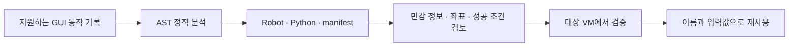

# GUI 기록을 Robot/SPICE 작업으로 바꾸기

사용자나 CUA가 수행한 GUI 작업을 지원하는 Python 기록으로 남기고, 검토한 기록을 RPA로 바꾸는 단계입니다. 다음 실행에서는 AI가 클릭 순서를 다시 해석하는 대신 작업 ID와 입력값으로 패키지를 호출하도록 만드는 것이 목적입니다. [전체 사용 흐름](WORKFLOWS.md)

현재 변환기는 지원하는 PyAutoGUI Python 구문을 정적으로 읽어 SPICE용 Robot/Python 패키지를 만듭니다. 임의의 CUA 로그나 동영상은 자동 변환하지 않습니다. VirtualBox 재생은 해당 백엔드의 입력 코드에 맞게 따로 연결해야 합니다. 아래 CLI는 AI 없이도 실행할 수 있으며 명령은 저장소 루트의 호스트 터미널에서 실행합니다.



## A. 직접 RPA 폴더 만들기

```bash
.venv/bin/python scripts/new_rpa.py my_windows_task --guest-os windows11
# Debian GNOME용
.venv/bin/python scripts/new_rpa.py my_debian_task --guest-os debian
```

`rpas/<id>/`에 다음 파일이 생성됩니다. 기존 폴더는 덮어쓰지 않습니다.

| 파일 | 수정할 내용 |
| --- | --- |
| `manifest.json` | 이름·버전·진입점·의존성 |
| `run.robot` | 작업 순서·분기·성공 검증 |
| `workflow.py` | 프로그램 기동, 좌표, SPICE 입력, OCR·YOLO 처리 |
| `README.md` | 개별 RPA 사용법 |

초기 상태는 `not_configured` + SKIP이며 VM에 연결하지 않습니다. Robot 파일의 안내에 따라 `Spice.Connect Spice`, 전용 Python 키워드와 긍정적인 성공 검증을 추가하세요. Python의 `Launch Program` 키워드는 이미 공통 실행기를 사용하도록 작성되어 있습니다.

**Windows는 Win+R → 실행 명령, Debian GNOME은 Alt+F2 → 실행 명령을 우선 사용하세요.** 바탕화면 아이콘은 사용자별로 다르므로 프로그램 시작 좌표로 쓰지 않습니다. 프로그램을 여는 동작과 실제로 열렸는지 확인하는 동작은 구분해야 합니다.

```bash
.venv/bin/python scripts/run_rpa.py my_windows_task --dryrun
.venv/bin/python scripts/run_rpa.py my_windows_task --var SPICE_URI:spice://127.0.0.1:5900
```

두 번째 명령도 템플릿을 수정하기 전에는 SKIP입니다. `SPICE_URI`는 실제 대상 VM 주소로 바꾸세요.

## B. 게스트 안에서 기록한 PyAutoGUI 코드 변환

Windows VM 안에서 Recorder를 실행하고 프로그램을 Win+R로 여는 것부터 기록하세요. 기록 당시 게스트 해상도, Windows 배율, 브라우저 확대율을 메모하고 재생 시에도 유지합니다. 기록 파일을 호스트로 복사합니다. 확장자가 없어도 Python 코드이면 읽습니다.

아래 예제는 Windows 실행 창에서 메모장을 여는 기록입니다. `notepad_recording.py`로 저장합니다. 변환 단계에서는 PyAutoGUI 설치나 VM 연결이 필요하지 않습니다.

```python
import pyautogui

pyautogui.hotkey("win", "r")
pyautogui.sleep(1)
pyautogui.write("notepad")
pyautogui.press("enter")
pyautogui.sleep(2)
```

```bash
python recording_converter.py notepad_recording.py \
  --id windows_notepad_recorded \
  --guest-os windows11 --coordinate-space guest --width 1920 --height 1080
```

출력의 `generated_needs_review` 상태와 `action_count: 5`를 확인합니다. 다시 변환할 때는 새 ID를 사용하세요. 원본과 기존 패키지는 그대로 보존됩니다.

### 생성 결과

```text
rpas/windows_notepad_recorded/
├── manifest.json
├── run.robot                  # Robot 순서·반복·정리·성공 확인
├── workflow.py                # Python 실행/검증 어댑터
├── conversion.json            # 원본 해시·통계·주의 사항; 원문 문자열 없음
├── recording.local.json       # 좌표·키 이벤트·대기; 로컬 전용, Git 제외
└── README.md
```

변환기는 AST와 리터럴 인자만 해석합니다. 키 이름을 정규화하고, 기록에 남아 있는 키 입력은 Robot 정리 단계에서 해제합니다. 게스트 좌표는 원본 픽셀을 유지합니다.

지원: `keyDown`, `keyUp`, `press`, `hotkey`, ASCII `write`/`typewrite`, 명시적 x/y의 클릭·더블/오른쪽/가운데 클릭, `moveTo`, `scroll`, `time.sleep`/`pyautogui.sleep`. 모듈 별칭과 단순 `__main__` 가드도 지원합니다. 동적 인자·임의 Python문·루프·함수 호출·드래그·시간을 지정한 마우스 이동 등은 현재 자동 변환하지 않고 중단합니다. 지원하지 않는 동작을 조용히 버리지 않습니다.

### 먼저 확인하고 재생하기

```bash
.venv/bin/python scripts/run_rpa.py windows_notepad_recorded --dryrun
# 기본 실행: needs_review + SKIP, VM에 연결하지 않음
.venv/bin/python scripts/run_rpa.py windows_notepad_recorded

# 실제 주소 확인: VM이 실행 중이어야 함
virsh -c qemu:///system domdisplay windows-RPA

# 내용을 검토한 뒤 명시적으로 활성화. 아래 포트는 실제 조회 결과로 대체
.venv/bin/python scripts/run_rpa.py windows_notepad_recorded \
  --var ALLOW_REPLAY:True --var SPICE_URI:spice://127.0.0.1:5900 --var EXPECTED_TEXT:Notepad
```

해상도가 기록과 다르거나 절대 좌표를 보낼 CLIENT 모드가 아니면 입력 전에 중단합니다. 해상도 일치만으로 Windows/Debian 구분이나 배율 일치를 보장하지 않으므로 VM 주소와 화면 상태도 확인하세요. 재생 중에는 VM을 직접 조작하지 마세요.

일반 변환 패키지는 입력만 끝나면 `replayed_unverified`를 반환합니다. `EXPECTED_TEXT`를 지정하면 임시 화면의 OCR로 기본 확인을 할 수 있지만, 한 단어가 보이는 것만으로 모든 업무 성공을 보장하지는 않습니다.

예제의 `Notepad`는 영문 Windows에서 기대하는 OCR 문자열입니다. 게스트 언어에 맞게 기대 문자열과 OCR 언어를 설정하세요. 업무용 RPA는 결과 파일이나 화면 상태처럼 작업에 맞는 성공 조건을 추가합니다.

### 조금 손볼 곳

1. `conversion.json`의 경고를 확인하고 현재 VM의 해상도·배율과 맞춥니다.
2. 기록의 클릭 위치를 `recording.local.json`에서 조정하거나 Python의 OCR·YOLO 대상 찾기로 교체합니다. 고정 대기는 가능한 경우 예상 화면을 기다리는 조건으로 바꿉니다.
3. 프로그램 기동이 바탕화면 클릭이면 Win+R/Alt+F2로 바꿉니다. 기록에 이미 공통 실행기가 있으면 그대로 유지합니다.
4. 계정·비밀번호를 입력한 구간은 키 이벤트까지 포함해 제거하고 전용 자격 증명 루틴으로 바꿉니다. 런타임의 `{"op":"write_env","env":"NAVER_PASSWORD"}` 형식도 사용할 수 있지만 입력란 검증과 제출·인계 절차는 별도로 유지해야 합니다.
5. 마지막에 실제 목표 화면의 긍정적인 검증을 추가합니다. `executed`나 `replayed_unverified`를 그냥 `succeeded`로 바꾸지 않습니다.

Robot은 현재 데이터 파일의 이벤트 개수를 읽어 순서대로 호출하므로, 데이터에서 이벤트를 추가·삭제해도 고정 인덱스 목록을 다시 만들 필요는 없습니다. 더 높은 수준의 작업으로 정리하려면 이벤트 반복을 프로그램 기동·페이지 이동·폼 확인 같은 Python 키워드 호출로 나누면 됩니다.

### 기록 데이터와 공유

키를 하나씩 누른 기록도 비밀번호를 재구성할 수 있습니다. 원본·실제 입력 데이터는 자동으로 Git에 추가하지 않습니다. `recording.local.json`은 권한 0600으로 만들고 `.gitignore`에서 제외합니다. 다른 사람이 Git만 clone하면 이 로컬 데이터는 없으므로 자신의 기록에서 재생성하거나, 민감 내용을 제거한 공유용 동작을 직접 작성해야 합니다. 이 단계의 자동 생성 결과는 **로컬에서 검토할 초안**입니다.

## C. 호스트 뷰어 위에서 기록했다면

뷰어 창 전체가 아닌 **실제 게스트 영상 영역**의 `LEFT TOP WIDTH HEIGHT`가 필요합니다. 타이틀바·도구모음·검은 여백을 제외하고 Recorder와 같은 좌표 단위로 측정하세요.

```bash
.venv/bin/python scripts/convert_recording.py ~/host_recording.py \
  --id my_host_recording --guest-os windows11 --coordinate-space host \
  --viewport 100 80 1280 720 --width 1920 --height 1080
```

이 수치는 예시이며 실제 영역으로 바꿔야 합니다. 변환식은 `guest_x = (host_x - LEFT) × guest_width / WIDTH`이고 y도 같습니다. 영역 밖 클릭은 거부합니다. DPI/논리 픽셀이 섞여 있거나 녹화 중 창이 움직인 경우에는 이 단일 변환으로 복원할 수 없으므로 다시 기록하거나 구간별로 보정해야 합니다.

## AI에게 맡길 때

`$spice-recording-convert` 스킬을 사용합니다.

> 홈 폴더의 naver_login_rpa를 실행하지 말고 정적 분석해서 Windows용 Robot/SPICE 패키지로 변환해줘. Windows는 Win+R을 사용하고, 좌표·대기·성공 검증을 검토해줘.

실패한 좌표를 이후 보정할 때는 `$spice-rpa-repair`로 최신 OCR·YOLO 근거를 확인합니다. 변환기 자체는 AI API를 호출하지 않습니다. GUI 레코더는 별도 프로그램이며, 변환기는 저장된 Python 동작 코드를 읽습니다. 처음 검토와 화면 검증을 마친 패키지는 작업 설명·실행 변수·결과 요약을 이용해 다시 호출할 수 있습니다.
