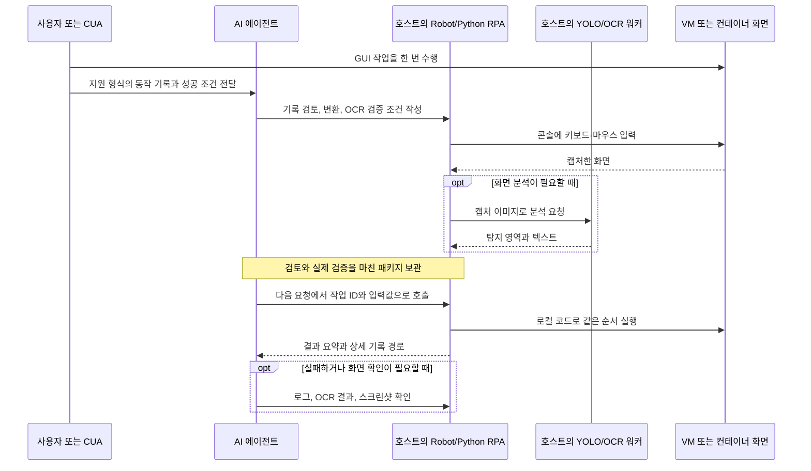

# GUI 작업을 기록하고 다시 실행하기

VAMP의 목적은 반복하는 GUI 작업을 로컬 RPA로 남겨 두는 것입니다. 예를 들어 네이버 로그인 페이지를 한 번 열어 보고 그 과정을 검토해 패키지로 만들면, 다음에는 AI가 같은 작업의 클릭 순서와 Python 구현을 매번 다시 읽지 않고 패키지 이름과 입력값으로 실행할 수 있습니다.

이 구조로 반복적인 화면 판단과 코드 생성을 줄여 토큰 비용을 아끼려 합니다. 절감량을 비교 측정한 결과는 아직 없습니다.

## 처음 만드는 작업과 다시 쓰는 작업



여기서 CUA는 화면을 보며 컴퓨터를 조작하는 AI를 뜻합니다. 사용자의 수동 조작과 CUA 작업을 재사용 가능한 RPA로 남기는 것이 목표입니다. 현재 변환기는 지원하는 PyAutoGUI Python 구문만 읽습니다. 임의의 CUA 이벤트 형식이나 동영상에서 작업을 자동 추출하는 기능은 없습니다.

## 예시: 네이버 로그인 페이지 열기

`windows_naver_recorded`는 Windows KVM 게스트에서 수행한 수동 기록을 변환한 예시입니다. 80개 동작을 재생한 뒤 YOLO·OCR로 `nid.naver.com`과 ID·비밀번호·로그인 영역을 확인했습니다. 성공 조건은 로그인 페이지 도달이며, 계정을 입력하거나 로그인 제출을 하지는 않습니다.

기존 기록을 새로 검토할 때는 좌표·배율·VM 주소를 확인하고, 비밀번호 같은 개인 입력을 제거합니다. 첫 검증을 마친 뒤에는 작업 설명, 실행 방법, 성공 조건과 결과 형식을 이용해 다시 호출하면 됩니다. 화면이 달라져 실패하면 해당 실행의 기록을 보고 필요한 부분을 고칩니다.

```bash
# VM을 조작하지 않고 패키지 목록과 Robot 문법 확인
.venv/bin/python scripts/run_rpa.py --list
.venv/bin/python scripts/run_rpa.py windows_naver_recorded --dryrun
```

실제 재생 명령은 [변환 가이드](RECORDING_CONVERSION.md)에 있습니다. 녹화 원본과 `recording.local.json`은 개인 키 입력이 들어갈 수 있어 Git에서 제외합니다. 다른 PC에서는 자신의 기록으로 다시 만들거나 민감 정보를 제거한 동작 데이터를 준비해야 합니다.

## AI가 먼저 볼 정보

저장된 RPA를 수정할 때는 `rpa_revision`의 `read-source`로 원본과 현재 커밋을 확인합니다. `validate`에 수정한 `source`와 `expected_commit`을 보내면 변환 가능한 동작인지, 기존 입력 계약이 유지되는지 검사합니다. 이 단계에서는 게스트를 실행하거나 저장소를 수정하지 않습니다. 검증을 통과한 뒤에도 별도의 게스트 결과 확인과 사용자 검토가 필요합니다.

| 정보 | 용도 |
| --- | --- |
| 작업 ID와 설명 | 요청에 맞는 패키지 선택 |
| 실행 진입점과 입력값 | 대상 VM, 주소, OS와 화면 조건 지정 |
| 성공 조건 | 입력 완료와 실제 업무 성공 구분 |
| 결과 요약 | 상태와 필요한 상세 기록 경로 확인 |
| 로그·OCR·스크린샷 | 실패 원인을 살피거나 화면을 확인할 때 사용 |

`manifest.json`에는 ID·진입점·출력 경로 등이 들어 있고, OS·배율·성공 조건 같은 사용 전제는 패키지 README와 실행 변수에 적습니다. 상세 클릭 코드와 원본 녹화를 매 요청마다 AI의 문맥에 넣을 필요를 줄이는 방식입니다. 작업 선택부터 복구까지 알아서 처리하는 별도 자동 에이전트가 구현돼 있는 것은 아닙니다.

## 남는 기록

동작 녹화는 다시 실행할 재료이고, 실행 로그와 영상은 무슨 일이 있었는지 확인할 자료입니다.

- 녹화 Python과 handoff JSON: 사용자가 저장한 동작과 전달 정보.
- `summary.json`: RPA 상태와 검증 결과, 상세 파일 경로.
- `log.html`, `report.html`, `output.xml`: Robot 키워드별 로그와 보고서.
- SQLite 이력: 관찰을 켠 VirtualBox 실행의 VM·시각·상태·이벤트와 첨부파일 목록.
- PNG와 선택적 영상: 실행 당시의 화면. 저장된 스크린샷은 요청한 것만 MCP 이미지로 꺼낼 수 있습니다.

Robot 파일은 호스트에서 열어 봅니다. MCP의 이력 도구는 실행 상태·이벤트·등록된 첨부파일을 조회하며, 모든 Robot 로그 파일의 내용을 읽는 범용 파일 도구는 아닙니다. [저장 위치와 조회 방법](EXECUTION_HISTORY.md)

## 지금 연결된 범위

| 경로 | 현재 상태 |
| --- | --- |
| 수동 PyAutoGUI 기록 → Robot/SPICE 패키지 | 정적 분석·변환과 네이버 로그인 화면 도달 예시 검증 |
| VirtualBox 녹화 소스 가져오기 | 공유폴더 저장, 목록·선택 소스 읽기와 AST 검사 |
| 같은 기록을 VirtualBox에서 바로 재생 | 변환 런타임 연결이 필요함; VirtualBox Robot 작업은 별도 작성 |
| 임의 CUA 기록 가져오기 | 공통 자동 변환기 없음; 지원 구문이나 작업 코드로 정리해야 함 |
| 토큰 비용 절감 | 설계 목적이며 비교 수치는 아직 없음 |

Windows VM을 쓴다면 설치 ISO·라이선스·정품 인증은 사용자가 준비합니다. [VM 준비사항](GUEST_AUTOMATION.md) · [RPA 규격](../rpas/README.md) · [녹화 변환](RECORDING_CONVERSION.md)

## 커뮤니티 스크립트에서 시작하기

직접 기록하기 전에 같은 작업이 이미 있는지 [VAMP Script Hub](https://wayfarer6.github.io/vamp-script-hub/)에서 먼저 찾습니다. 스크립트마다 PyAutoGUI 소스, 입력 계약, 검증 기준, `rpa_run_saved` 호출 예시가 함께 있어, 맞는 항목이면 좌표와 검증 조건을 다시 만들 필요가 없습니다. 내보낸 폴더는 VS Code **RPA Library → Add RPA Folder**로 가져오고, 내 기록은 **Export ZIP**으로 제출합니다. 자세한 절차는 [사용 안내의 커뮤니티 스크립트 절](USER_GUIDE.md#커뮤니티-스크립트-vamp-script-hub)과 [기여 가이드](https://github.com/wayfarer6/vamp-script-hub/blob/main/CONTRIBUTING.md)에 있습니다. 사본은 [`docs/hub/`](hub/)에 보관합니다.
