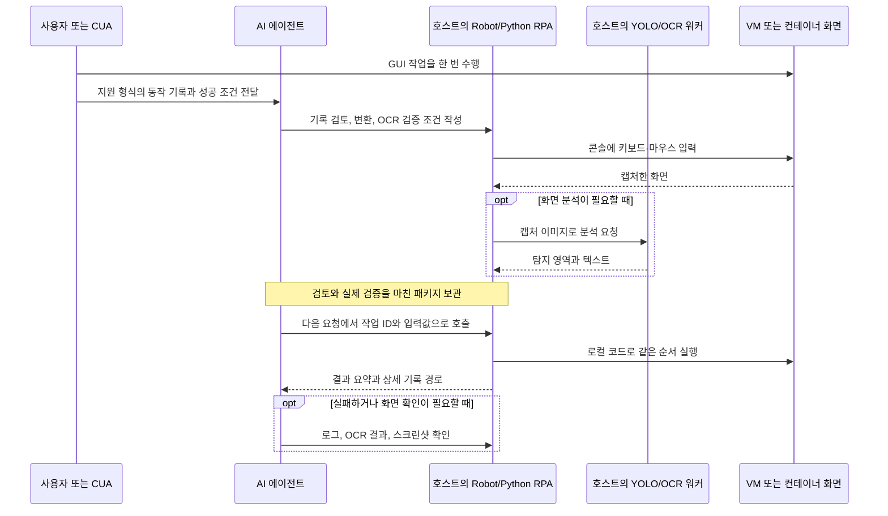

# GUI 작업을 기록하고 다시 실행하기

VAMP의 목적은 반복하는 GUI 작업을 로컬 RPA로 남겨 두는 것입니다. 예를 들어 네이버 로그인 페이지를 한 번 열어 보고 그 과정을 검토해 패키지로 만들면, 다음에는 AI가 같은 작업의 클릭 순서와 Python 구현을 매번 다시 읽지 않고 패키지 이름과 입력값으로 실행할 수 있습니다.

이 구조로 반복적인 화면 판단과 코드 생성을 줄여 토큰 비용을 아끼려 합니다. 절감량을 비교 측정한 결과는 아직 없습니다.

## 처음 만드는 작업과 다시 쓰는 작업



여기서 CUA는 화면을 보며 컴퓨터를 조작하는 AI를 뜻합니다. 사용자의 수동 조작과 CUA 작업을 재사용 가능한 RPA로 남기는 것이 목표입니다. 현재 변환기는 지원하는 PyAutoGUI Python 구문만 읽습니다. 임의의 CUA 이벤트 형식이나 동영상에서 작업을 자동 추출하는 기능은 없습니다.

## 예시: 네이버 로그인 페이지 열기

`windows_naver_recorded`는 Windows KVM 게스트에서 수행한 수동 기록을 변환한 예시입니다. 80개 동작을 재생한 뒤 YOLO·OCR로 `nid.naver.com`과 ID·비밀번호·로그인 영역을 확인했습니다. 성공 조건은 로그인 페이지 도달이며, 계정을 입력하거나 로그인 제출을 하지는 않습니다.

기존 기록을 새로 검토할 때는 좌표·배율·VM 주소를 확인하고, 비밀번호 같은 개인 입력을 제거합니다. 첫 검증을 마친 뒤에는 작업 설명, 실행 방법, 성공 조건과 결과 형식을 이용해 다시 호출하면 됩니다. 화면이 달라져 실패하면 해당 실행의 기록을 보고 필요한 부분을 고칩니다.

```bash
# VM을 조작하지 않고 패키지 목록과 Robot 문법 확인
.venv/bin/python scripts/run_rpa.py --list
.venv/bin/python scripts/run_rpa.py windows_naver_recorded --dryrun
```

실제 재생 명령은 [변환 가이드](RECORDING_CONVERSION.md)에 있습니다. 녹화 원본과 `recording.local.json`은 개인 키 입력이 들어갈 수 있어 Git에서 제외합니다. 다른 PC에서는 자신의 기록으로 다시 만들거나 민감 정보를 제거한 동작 데이터를 준비해야 합니다.

## AI가 먼저 볼 정보

초기 설정을 마친 Windows VirtualBox 게스트는 1920×1080에서 기록과 재생을 진행합니다. `rpa_run_saved`에 `pause_on_uac: true`를 지정하면 각 기록 동작 직전과 마지막 동작 직후에 호스트 OCR로 화면을 확인합니다. UAC가 감지되거나 화면을 읽을 수 없으면 `operator_handoff`와 완료된 동작 수를 반환합니다. 대화 상자가 화면 검사 이후에 나타날 수 있으므로 UAC를 요청한 동작 다음에는 앱 상태를 확인할 여유를 두세요. 사용자가 게스트 콘솔의 프롬프트와 앱 상태를 확인한 뒤 다음 실행을 결정합니다.

응답과 실행 이력에는 중단 시점(`before_starting_screen`, `before_action`, `after_last_action`), 재생에 사용한 Git 커밋, `program_identity: unverified`가 기록됩니다. 시작 화면 검사와 마지막 동작의 결과 검사에 앞서 UAC를 확인합니다. 시작 화면 검사가 끝난 뒤에도 첫 입력 직전에 다시 확인합니다.

영어·한국어 UAC 창의 게시자 줄 위에서 프로그램 이름이 명확하게 읽히면 `program_name_ocr`로 기록합니다. 이 이름은 운영자가 확인할 화면 정보입니다. 실행 파일 경로나 서명을 검증하는 데 사용하지 않습니다.

운영자가 게스트 콘솔에서 승인한 뒤 같은 실행을 이어가려면 `pause_on_uac: true`와 함께 `uac_wait_seconds`(1~120초), `uac_resume_text`를 지정합니다. 재개 문구에는 승인한 앱에서만 나타나는 고유한 문구를 사용하세요. VAMP는 프롬프트가 사라지고 그 문구가 한 번 확인된 뒤 다음 동작부터 이어갑니다. 키가 눌린 상태에서 중단되거나 제한 시간 안에 화면을 확인하지 못하면 운영자에게 제어를 넘깁니다. 재개 기록은 `elevation_resume_run_ids`에서 확인할 수 있습니다.

네트워크를 끈 Windows 11 VirtualBox 테스트 게스트에서 실제 UAC 재개를 확인했습니다. 5개 동작 뒤 재생이 멈췄고, 테스트 운영자가 프롬프트를 승인한 뒤 화면 문구가 확인되자 나머지 7개 동작이 실행됐습니다. 게스트에서 재개 후에만 생성되는 테스트 파일을 별도로 확인했습니다.

별도 VirtualBox 테스트 게스트가 준비돼 있다면, 호스트에서 `VAMP_REPAIR_SCRATCH_VM`에 해당 VM의 UUID를 설정한 뒤 MCP 서버를 시작합니다. 네트워크, 공유 폴더, 클립보드, 드래그 앤 드롭, 원격 화면, USB, 오디오 입출력, 직렬·병렬 포트가 꺼진 상태에서 VM을 실행합니다. `rpa_revision`의 `test`에는 수정본과 예상 커밋, `scratch_vm`, 화면에서 확인할 `outcome_text`, 필요한 합성 `test_inputs`, 그리고 `confirmed: true`를 제공합니다. 이 단계는 화면만 검증하며 현재 저장된 RPA에는 변경을 적용하지 않습니다.

결과 파일까지 검증해 반영하려면 같은 입력으로 `test-and-commit`을 사용합니다. Guest Additions가 설치된 테스트 게스트에 초기 결과 파일을 두고, 호스트에서 다음 값을 설정합니다.

테스트 화면을 초기화해 `outcome_text`가 실행 전에는 없고 실행 후에 한 번만 나타나도록 준비합니다. 성공 문구가 이미 보이면 게스트 입력 전에 검증을 중단합니다.

`test-and-commit`은 OCR, YOLO 모달 검사와 결과 파일 검사를 모두 통과해야 커밋합니다. MCP 서버 시작 전에 `VAMP_REPAIR_MODAL_MODEL`에 신뢰하는 로컬 YOLO 가중치의 절대 경로를, `VAMP_REPAIR_MODAL_LABEL`에 그 모델의 정확한 모달 클래스 이름을 지정합니다. 검사기는 OCR 성공 문구와 같은 화면에서 해당 클래스를 찾습니다. 모달이 탐지되거나 클래스가 확인되지 않으면 검증이 실패합니다. 모달 모델 없이 화면만 확인하려면 커밋하지 않는 `test`를 사용합니다.

MCP 시작 시 받는 기본 OmniParser 가중치는 아이콘 감지용입니다. 수정에 사용할 모달 모델은 적용할 앱의 실제 화면에서 검증하세요. 성공 문구가 같은 화면에 있더라도 모달을 검출하면 커밋이 차단돼야 합니다. 모달이 없는 화면에서도 일반 아이콘이나 버튼을 모달로 오인하지 않는지 확인하세요.

격리된 Windows 11 VirtualBox 게스트에서 테스트용 로컬 모델로 확인했습니다. 성공 문구와 결과 파일을 생성해도 차단 창이 표시된 후보는 Git HEAD를 유지했습니다. 같은 결과를 차단 창 없이 생성한 후보는 OCR, YOLO, 결과 파일 SHA-256 검사를 모두 통과하고 재검토가 필요한 커밋을 생성했습니다.

- `VAMP_REPAIR_ARTIFACT`에 게스트 안의 결과 파일 절대 경로를 지정합니다.
- `VAMP_REPAIR_GUEST_USER`에 테스트 계정을, `VAMP_REPAIR_GUEST_PASSWORD_FILE`에 그 계정의 호스트 비밀번호 파일 절대 경로를 지정합니다.
- `VAMP_REPAIR_ARTIFACT_BASELINE_SHA256`에는 초기 파일, `VAMP_REPAIR_ARTIFACT_SHA256`에는 완료 후 기대 파일의 SHA-256을 지정합니다.

재생 전에 초기 파일을 검사하고 재생 후에는 화면과 기대 파일을 모두 검사합니다. 검사에 성공하면 별도 Git 작업 디렉터리에서 커밋을 만들고, 저장된 RPA의 예상 커밋과 작업 파일이 그대로일 때만 반영합니다. 결과 상태 `verified_commit_needs_review`는 실행 전에 사용자 검토가 필요함을 나타냅니다.

저장된 RPA를 수정할 때는 `rpa_revision`의 `read-source`로 원본과 현재 커밋을 확인합니다. `validate`에 수정한 `source`와 `expected_commit`을 보내면 변환 가능한 동작인지, 기존 입력 계약이 유지되는지 검사합니다. 이 단계에서는 게스트를 실행하거나 저장소를 수정하지 않습니다. 검증을 통과한 뒤에도 별도의 게스트 결과 확인과 사용자 검토가 필요합니다.

| 정보 | 용도 |
| --- | --- |
| 작업 ID와 설명 | 요청에 맞는 패키지 선택 |
| 실행 진입점과 입력값 | 대상 VM, 주소, OS와 화면 조건 지정 |
| 성공 조건 | 입력 완료와 실제 업무 성공 구분 |
| 결과 요약 | 상태와 필요한 상세 기록 경로 확인 |
| 로그·OCR·스크린샷 | 실패 원인을 살피거나 화면을 확인할 때 사용 |

`manifest.json`에는 ID·진입점·출력 경로 등이 들어 있고, OS·배율·성공 조건 같은 사용 전제는 패키지 README와 실행 변수에 적습니다. 상세 클릭 코드와 원본 녹화를 매 요청마다 AI의 문맥에 넣을 필요를 줄이는 방식입니다. 작업 선택부터 복구까지 알아서 처리하는 별도 자동 에이전트가 구현돼 있는 것은 아닙니다.

## 남는 기록

별도 VirtualBox 게스트에서 수정본 검증에 실패하면 응답의 `verification_stage`와 `run_id`를 확인합니다. `vm_run_history`에는 초기 결과 파일, 화면 재생, 최종 결과 파일 중 어느 단계에서 중단됐는지와 당시 예상 커밋이 기록됩니다.

OCR 결과가 기대와 다르면 예상 일치 횟수와 관찰된 횟수를 기록합니다. 합성 데이터만 사용하는 테스트 게스트에서 실패 직후 화면이 필요하면 MCP 서버를 시작하기 전에 `VAMP_REPAIR_CAPTURE_FAILURE=1`을 설정하세요. VAMP가 게스트 격리 상태를 다시 확인하고 화면을 호스트의 실행 기록 폴더에 저장합니다. 응답에는 저장 여부만 표시됩니다.

Windows VirtualBox 재생이 UAC 감지 또는 화면 확인 실패로 중단되면 응답의 `run_id`를 `vm_run_history`에 전달해 기록을 확인할 수 있습니다. 기록에는 시각, 중단 이유, 완료한 동작 수와 운영자 확인 정책이 남습니다. 이 이벤트는 화면이나 OCR 원문을 저장하지 않습니다.

동작 녹화는 다시 실행할 재료이고, 실행 로그와 영상은 무슨 일이 있었는지 확인할 자료입니다.

- 녹화 Python과 handoff JSON: 사용자가 저장한 동작과 전달 정보.
- `summary.json`: RPA 상태와 검증 결과, 상세 파일 경로.
- `log.html`, `report.html`, `output.xml`: Robot 키워드별 로그와 보고서.
- SQLite 이력: 관찰을 켠 VirtualBox 실행의 VM·시각·상태·이벤트와 첨부파일 목록.
- PNG와 선택적 영상: 실행 당시의 화면. 저장된 스크린샷은 요청한 것만 MCP 이미지로 꺼낼 수 있습니다.

Robot 파일은 호스트에서 열어 봅니다. MCP의 이력 도구는 실행 상태·이벤트·등록된 첨부파일을 조회하며, 모든 Robot 로그 파일의 내용을 읽는 범용 파일 도구는 아닙니다. [저장 위치와 조회 방법](EXECUTION_HISTORY.md)

## 지금 연결된 범위

| 경로 | 현재 상태 |
| --- | --- |
| 수동 PyAutoGUI 기록 → Robot/SPICE 패키지 | 정적 분석·변환과 네이버 로그인 화면 도달 예시 검증 |
| VirtualBox 녹화 소스 가져오기 | 공유폴더 저장, 목록·선택 소스 읽기와 AST 검사 |
| 같은 기록을 VirtualBox에서 바로 재생 | 변환 런타임 연결이 필요함; VirtualBox Robot 작업은 별도 작성 |
| 임의 CUA 기록 가져오기 | 공통 자동 변환기 없음; 지원 구문이나 작업 코드로 정리해야 함 |
| 토큰 비용 절감 | 설계 목적이며 비교 수치는 아직 없음 |

Windows VM을 쓴다면 설치 ISO·라이선스·정품 인증은 사용자가 준비합니다. [VM 준비사항](GUEST_AUTOMATION.md) · [RPA 규격](../rpas/README.md) · [녹화 변환](RECORDING_CONVERSION.md)

## 커뮤니티 스크립트에서 시작하기

직접 기록하기 전에 같은 작업이 이미 있는지 [VAMP Script Hub](https://wayfarer6.github.io/vamp-script-hub/)에서 먼저 찾습니다. 스크립트마다 PyAutoGUI 소스, 입력 계약, 검증 기준, `rpa_run_saved` 호출 예시가 함께 있어, 맞는 항목이면 좌표와 검증 조건을 다시 만들 필요가 없습니다. 내보낸 폴더는 VS Code **RPA Library → Add RPA Folder**로 가져오고, 내 기록은 **Export ZIP**으로 제출합니다. 자세한 절차는 [사용 안내의 커뮤니티 스크립트 절](USER_GUIDE.md#커뮤니티-스크립트-vamp-script-hub)과 [기여 가이드](https://github.com/wayfarer6/vamp-script-hub/blob/main/CONTRIBUTING.md)에 있습니다. 사본은 [`docs/hub/`](hub/)에 보관합니다.
## 60-second VirtualBox split-screen demo

Use a Windows VirtualBox guest at 1920×1080, a saved ERP workflow, and the standalone [demo ERP](https://github.com/wayfarer6/vamp-demo-erp). Reset the ERP to its synthetic fixtures before each take. Keep the host VS Code editor and AI chat on the left and the guest console on the right. Encode separate English and Korean recordings at 2560×1440.

| Time | What to show | English narration | 한국어 내레이션 |
| --- | --- | --- | --- |
| 0–10 s | Show the saved workflow and the pending order in the guest browser. | “VAMP runs this saved workflow in a VirtualBox guest on my computer.” | “VAMP는 이 컴퓨터의 VirtualBox 게스트에서 저장한 작업을 실행합니다.” |
| 10–25 s | Start the saved run in VS Code. Continue typing in a host scratch file while the guest searches for the order. | “The guest searches for the order while I keep typing in the host editor.” | “게스트가 주문을 찾는 동안 호스트 편집기에서 계속 입력할 수 있습니다.” |
| 25–45 s | Keep both panes visible as the guest marks the order shipped and exports the CSV. | “The recorded steps update the order and download the CSV inside the guest.” | “기록해 둔 동작이 게스트 안에서 주문 상태를 바꾸고 CSV를 내려받습니다.” |
| 45–60 s | Show the Robot Framework result and the exported order row. If usage telemetry is available, show the replay's measured vision API usage. | “The report shows the replay result, and the CSV confirms the order shipped.” | “실행 보고서와 CSV에서 주문이 발송 처리된 것을 확인할 수 있습니다.” |
