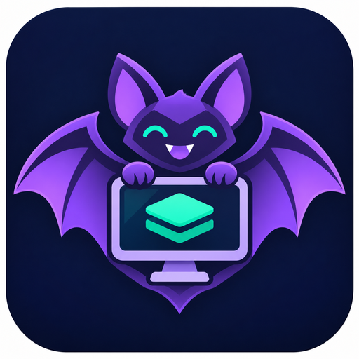

<p align="center">

Initial VM setup uses **HashiCorp Packer**: managed CLI/plugin downloads, unattended OS and post-install setup, golden image paths/sizes and confirmed cleanup.

  
</p>

**Includes VAMP Vault:** Marketplace installation includes the Vault extension. When upgrading from `wayfarer6.vamp-mcp`, first update Vault to 0.1.6+, remove the legacy extension, and reload VS Code to avoid duplicate command registrations.

**Vault is installed with VAMP.** When migrating from `wayfarer6.vamp-mcp`, update Vault to 0.1.6 or later, remove the old extension and reload VS Code.


# VAMP · Virtual Agent Machine Platform

**Local & remote (SSH) hypervisors with VM-isolated GUI RPA & screenshot control for AI agents**

Record a GUI task once, turn the reviewed actions into a reusable RPA, and let an AI agent call it again by name and inputs. VAMP is being built to reduce the tokens spent repeatedly inspecting screens and reconstructing the same GUI workflow.

Opening the Naver login page is one example: launch a browser, navigate to the page and check that the expected form appeared. The reusable workflow keeps those steps and checks in local Robot/Python code. The agent can read the result summary first, then inspect logs or screenshots when needed.

This VS Code extension provides the VirtualBox MCP tools. Recording conversion, SPICE execution and local OCR/UI recognition are separate parts of the repository. Arbitrary CUA recordings cannot be imported automatically, and the AST converter emits Robot/SPICE packages; RPA Library device replay separately supports KVM and VirtualBox.

[Workflow example](https://github.com/wayfarer6/vamp-mcp/blob/main/docs/WORKFLOWS.md) · [Documentation](https://github.com/wayfarer6/vamp-mcp/blob/main/docs/README.md) · [Releases](https://github.com/wayfarer6/vamp-mcp/releases)

## Get started

Open the **VAMP** bat icon in the activity bar. **RPA Library** is the main entry for finding, creating and exporting reusable workflows; **Open VM Manager** manages your virtual desktops; **Browse Credentials** opens the encrypted vault.

1. **VM Manager**: select VirtualBox, KVM or Hyper-V, choose your ISO, then **Create and Start**. VirtualBox and KVM show the guest in the editor. Hyper-V embedded viewing is unsupported; use VMConnect.
2. Record a task in the guest and save the Python recording to its host share, or use **Add RPA Folder** for the host folder containing it.
3. **RPA Library → Create**: choose the recording and enter its name, description, use case, tags, inputs and expected result. **Create with AI** asks you questions and fills those fields from your answers. You review and save them.
4. Find the workflow by title or description, inspect its source, edit its review state or choose **Export ZIP**.
5. Enable **VAMP RPA Library** in VS Code MCP management. Its `rpa_search`, `rpa_details` and `rpa_run_saved` tools let agents find and reuse reviewed skills before spending tokens on another CUA/multimodal loop.

**[Full click-by-click user guide](https://github.com/wayfarer6/vamp-mcp/blob/main/docs/USER_GUIDE.md)** is also bundled in the VSIX: **VAMP: Open Setup Guide**. It covers prerequisites, recording locations, Create/AI questions, export, credentials and recovery from errors.

Recorded replay currently supports VirtualBox and KVM for supported PyAutoGUI recorder actions, with an exact guest resolution match. Registration does not execute the source. Execution requires review, an explicit VM and confirmation; `completed_unverified` still needs application-result verification. VirtualBox mouse replay requires its matching Python SDK. Existing Robot packages require their matching shared runtime; ZIP exports contain source, not a standalone VM or runtime.

## Records, logs and screens

| Material | How to inspect it |
| --- | --- |
| Saved GUI action source | List and read selected shared recordings without executing them. |
| Run status and events | Query SQLite history through `vm_run_history`. |
| Saved screenshot | Use `vm_run_artifact` with `show_image:true` for the selected artifact. |
| Current screen | Capture it with `vm_screenshot`. |
| Execution video | Open the returned local path in a host player; recording is opt-in. |
| Robot log and report | Open `log.html`, `report.html` and `output.xml` in the host output folder. |

Observation must be enabled with a Robot listener or an explicit observation session. Direct MCP input is not automatically logged in full. History tools return bounded events and artifact lists; they do not read every Robot log file. [Storage and retrieval](https://github.com/wayfarer6/vamp-mcp/blob/main/docs/EXECUTION_HISTORY.md)

The extension also provides VM inventory/start, keyboard/mouse input, display setup, ISO installation startup and explicit snapshot tools, for 19 MCP tools in total. Mouse input needs the matching host VirtualBox Python SDK (`vboxapi`) and USB tablet configuration; Windows hosts also need COM Python support. [Tool reference](https://github.com/wayfarer6/vamp-mcp/blob/main/backends/virtualbox/README.md)

## Watch a running VM

Use VirtualBox Manager **Show** to open the guest. Choose **Detach / continue in background** when closing the frontend. Screenshots and input use guest coordinates independently of the viewer window.

The optional GUI recorder saves Python action recordings through `VAMPRecords` to the host. Execution video records a run for inspection and is a separate feature. [Recorder setup](https://github.com/wayfarer6/vamp-mcp/blob/main/docs/GUEST_RECORDER.md) · [Demo videos](https://github.com/wayfarer6/vamp-mcp/blob/main/docs/DEMOS.md)

## Before creating a Windows VM

You must obtain a Windows 11 installation ISO and a valid license yourself, and complete activation yourself. VAMP includes no Windows ISO, product key or license and provides no activation bypass.

Initial unattended profiles target detected Debian amd64 and Windows 11 x64 media. The public sandbox account is `vboxuser` / `password123!`; the guest administrator/root password may be the same. These credentials do not grant a Windows license. Guest recorder setup requires guest internet access.

`installation_started` means the installer was launched. OS and recorder installation completion still need checking. Failed provisioning leaves partial VMs and disks for inspection. [Guest preparation](https://github.com/wayfarer6/vamp-mcp/blob/main/docs/GUEST_AUTOMATION.md)

## Settings

| Setting | Purpose |
| --- | --- |
| `vamp.pythonExecutable` | Optional Python for creating the host venv. |
| `vamp.vboxManagePath` | Optional VBoxManage executable path. |
| `vamp.mousePythonExecutable` | Host Python with matching VirtualBox SDK bindings. |
| `vamp.remote.enabled` | Show the **VAMP Remote (SSH)** server and remote view. |
| `vamp.remote.host` / `port` / `username` / `privateKeyPath` | SSH target of the machine that owns the desktops. |
| `vamp.remote.backend` | `kvm` (libvirt/`virsh`) or `virtualbox` (`VBoxManage`) on the remote host. |
| `vamp.remote.libvirtUri` | libvirt connection used on the remote host. |
| `vamp.remote.remoteNodePath` / `remotePythonPath` | Node.js 20+ and Python 3.11+ on the remote host. |
| `vamp.remote.remoteRepoPath` / `remoteRegistryPath` | Optional VAMP checkout and RPA registry on the remote host. |

## Current state

Built in one day with Codex through vibe coding. It is an early prototype with missing features and rough edges. So far, KVM/SPICE and VirtualBox are the only virtualization paths tried. Hyper-V is experimental and untested. Token savings have not been measured.

Tests cover an Ubuntu host with existing Windows 11/Debian 13 guests, and Windows-host MCP processes with a nested diskless EFI VM. Fresh OS installation completion, snapshot restore and physical Windows/macOS hardware remain unverified. Initial unattended profiles do not support ARM guests. [Validation record](https://github.com/wayfarer6/vamp-mcp/blob/main/docs/VALIDATION.md)

YOLO/PaddleOCR and SPICE/Hyper-V are not bundled in this extension. VAMP implements no telemetry; the MCP client controls which tool results it sends to a model provider.

## License

Original integration: MIT. Bundled [mcp-virtualbox](https://github.com/chryaner/mcp-virtualbox) code: MIT. The independent guest [PyAutoGUI-Recorder](https://github.com/axel-magard/PyAutoGUI-Recorder): GPL-3.0, with source and license included. VirtualBox and optional models retain their own licenses. [Third-party notices](https://github.com/wayfarer6/vamp-mcp/blob/main/THIRD_PARTY_NOTICES.md)

## Remote desktops over SSH

Desktops can live on another machine: a home server, a lab box or a cloud VM. Set `vamp.remote.enabled`, the host and the user, then run **VAMP: Remote · Prepare Environment on the Remote Host**. The extension uploads a self-contained MCP server to `~/.vamp/remote/` there, prepares Python and libvirt/VirtualBox, and exposes SSH tools through **VAMP MCP**. Communication stays inside SSH, so no hypervisor port is opened and guest disks, credentials and the vault never leave the remote host.

Remote screens are **screenshots**, one PNG per request, with no live stream. Start/stop, list, status, key input, absolute-pointer clicks on KVM and reviewed RPA replay are available remotely. VirtualBox remote clicks and pointer movement require `--repo` and a Python runtime with the matching VirtualBox SDK. The extension automatic uploader uses a POSIX shell; native Windows SSH can use an explicit PowerShell launch command. See [docs/REMOTE_SETUP.md](https://github.com/wayfarer6/vamp-mcp/blob/main/docs/REMOTE_SETUP.md).

## Live KVM viewer

Set `vamp.kvmRepositoryPath` to the VAMP checkout. Optionally set `vamp.kvmPythonExecutable` and `vamp.kvmConfigPath`; the defaults are `.venv` and `config/vm-mcp.json` in that checkout. Start **VAMP MCP** in MCP server management and use its explicit KVM tools.

Run **VAMP: Open KVM Viewer (Live VNC)** and choose a running VM. The view receives the live binary RFB stream through a local WebSocket bridge. It is view-only, scales to the panel and supports reconnecting. The table below the screen shows the VM name, host, actual VNC port and an address copy button for external viewers. The VM image, installer ISO and model weights are outside the VSIX.

The `vboxuser` / `password123!` account is assigned by the MCP server during unattended VM installation. It is a public test default, not an operating-system-provided account.

## Version 0.1.8 validation and videos

The remote stdio startup, simultaneous hotkeys and KVM tablet click dispatch are fixed. Guidance now asks agents to implement local OCR/YOLO checks and Robot assertions in new GUI RPAs, return compact results on success and inspect targeted evidence on failures. [Low-token authoring/output policy](https://github.com/wayfarer6/vamp-mcp/blob/main/docs/LOW_TOKEN_AUTOMATION.md).

Ubuntu/KVM Windows PDF printing and nested Windows-host VirtualBox/Debian remote keyboard/mouse scenarios passed with real guest UI and local outcome checks. VM screens are fixed at **1920×1080**; Robot recordings use **2560×1440** with padding and no upscaling. Physical Windows hosts and production ERP integrations were not tested.

[Windows host remote input video](https://github.com/wayfarer6/vamp-mcp/blob/main/docs/media/windows-remote-fhd-qhd.mp4) · [Windows Print to PDF video](https://github.com/wayfarer6/vamp-mcp/blob/main/docs/media/remote-windows-print-pdf.mp4) · [Replay video](https://github.com/wayfarer6/vamp-mcp/blob/main/docs/media/remote-windows-print-pdf-replay.mp4) · [Validation and reproduction](https://github.com/wayfarer6/vamp-mcp/blob/main/docs/REMOTE_PDF_VALIDATION.md)

The complete Robot/vision demos run from the repository; the basic VSIX does not bundle the OCR/YOLO model stack or these repository-only demonstration suites. [Download v0.1.8](https://github.com/wayfarer6/vamp-mcp/releases/tag/v0.1.8).

VAMP includes VAMP Vault (`wayfarer6.vamp-vault`) in its extension pack so Marketplace installation installs both extensions.

### VM installation in 0.2.0

VirtualBox provisioning starts headless and verifies Running state. KVM VM creation is shared between the manager and the KVM tools in **VAMP MCP**. Debian amd64 installer ISOs install automatically by booting the stock ISO with a preseed injected into the initrd; VAMP no longer rewrites ISOs and **xorriso is not required**. The public sandbox login is `vboxuser` / `password123!`. Ubuntu/Windows KVM installers and Hyper-V OS installation remain manual. VM startup does not establish that OS installation, recorder setup or Vault setup completed.

### Guest setup over HTTP (port 8421)

The recorder, vault helpers and setup scripts in `guest_setup/` are served by a Python standard-library HTTP server on the fixed port **8421** (not 80 or 8800). The manager starts it for installation/setup and offers **Start Web Server (8421)** / **Stop Web Server**, with actual running/stopped status. VM installation uses a two-hour lease that is extended by another installation. Closing an editor does not interrupt this shared server; its lease or the Stop button ends it. VirtualBox NAT and QEMU user networking reach the host at `10.0.2.2`; libvirt's default NAT network uses `192.168.122.1`.

```bash
# guest, Debian/Ubuntu
wget -qO- http://10.0.2.2:8421/setup.sh | sh
```

```powershell
# guest, Windows
powershell -ExecutionPolicy Bypass -Command "irm http://10.0.2.2:8421/setup.ps1 | iex"
```

The server exposes only the staged setup folder (no directory listings, no dotfiles) and logs requests to the VAMP output channel. Delivery is not proof that the guest ran the script: check the guest screen or setup log. MCP tools: `vm_script_server_start`, `vm_script_server_status`, `vm_script_server_stop`.

Linux: shut down KVM VMs before starting VirtualBox, and vice versa. The new checks explain conflicts such as `VERR_SVM_IN_USE` instead of reporting successful startup.


## RPA privacy before export or upload

**Before uploading an RPA or ZIP, inspect every source file, comment, metadata field, filename, URL and image for private IDs, passwords, tokens and certificates. Replace actual values with declared inputs. AI review is not a guarantee that secrets are absent.**


In VAMP 0.1.9, Export ZIP requires local screening, AI review of a structural report and a final personal-review confirmation. Original source, recorded values, filenames and metadata values are withheld from AI. Detected secrets block export. Missing AI review, cancellation or changes after review prevent archive creation. Image content is not inspected by AI; users must inspect it themselves. Review every archive again before submitting it to GitHub or Script Hub. VAMP does not upload it automatically.


Windows unattended setup downloads and executes the post-install script at the first desktop login without AI input. The command is encoded for safe delivery through VirtualBox batch logging. A clean account without winget can install a signature-checked Python installer. The guest setup disables automatic idle sleep and screensaver locking; do not manually lock/suspend a VM while setup or automation runs. Failure is recorded rather than reported as completed.

After Create, the manager shows first-login/setup instructions and a recovery command. Debian resolution is a target, not a fixed guarantee; use the displayed Xorg command if necessary. Explicitly marked development VMs are hidden from the normal inventory, and development fixtures are not shipped in the VSIX.


## VM installation with HashiCorp Packer

VAMP uses **HashiCorp Packer** to automate new VM installation and post-install setup. Prepare Environment downloads the pinned Packer CLI for Windows x64, Linux x64/ARM64 or macOS Intel/Apple Silicon, verifies its SHA-256, and installs the selected official plugin with `packer init`: VirtualBox, Hyper-V or QEMU (KVM). The hypervisor itself remains a host prerequisite. Windows ARM64 has no pinned native Packer binary; current guest templates require an x64 host and Debian amd64 or Windows 11 x64 media. macOS hosts use VirtualBox; an Apple Hypervisor adapter is not implemented.

The shared installer flow boots your original ISO with the backend's Packer builder, configures the OS, reboots and waits **60 seconds** before desktop post-install setup. Debian GNOME automatically logs into the public sandbox account `vboxuser` / `password123!`; Windows uses the same public sandbox account for first-login setup and still requires your own valid license. Use these defaults only for an authorized sandbox. The guest reports successful post-install setup to a per-build token endpoint before shutting down for golden-image export. No persistent SSH/WinRM communicator is installed by Packer. Resolution still requires fresh framebuffer verification.

VirtualBox is the reference profile. Hyper-V changes generation/switch/TPM settings; KVM changes QEMU acceleration, disk, firmware and network settings. These profiles share installation and post-install scripts. A successful `packer validate` is not proof of a complete guest installation. Check each image's build status and `packer.log`; failed partial builds are preserved. Hyper-V requires Windows permissions and the Default Switch; KVM requires Linux, QEMU/libvirt, virt-install and OVMF, plus swtpm for Windows. Windows answer media is generated automatically by an isolated, pinned pycdlib helper (installed on first use); no ADK/xorriso installation is needed. VAMP creates a separate answer-media ISO; your installation ISO is not rewritten. Allow guest access to the setup server on TCP 8421 and the per-build Packer HTTP/completion ports.

VSIX and MCP use the same Packer runner. VM creation returns a queued build, not a completed VM. The live VM is deployed after OS installation, post-install confirmation and export succeed. In VM Manager, **Golden images** shows build status, absolute folder and image-file paths, byte sizes, and logs. Use **Open folder** or **Delete golden image**. Deletion asks for confirmation and is disabled while a build is active.

Storage defaults to `~/.vamp` (`%USERPROFILE%\.vamp` on Windows), overridable with `VAMP_HOME`:

- `tools/packer/`: downloaded CLI, official plugins and cache.
- `golden/<image-id>/artifact/`: golden OVA/QCOW2/Hyper-V export; builds can consume many GB.
- `golden/<image-id>/packer.log` and `image.json`: build evidence and status.
- `vms/<backend>/<name>/`: separately deployed live VM disks. Deleting a golden image does not delete these disks.

MCP exposes `vm_packer_prepare`, `vm_create`, `vm_golden_images` and `vm_golden_image_delete`; the remote host server exposes corresponding `remote_*` tools. Inspect the image ID, path and size before explicitly confirming deletion. Remote paths are on the host running that MCP server.

Manual preparation (Python 3.11+):

```sh
python backends/packer/runner.py prepare --backend virtualbox
python backends/packer/runner.py images
```

Packer and its plugins are downloaded separately under their own licenses; they are not bundled as VAMP code. Official documentation: [Packer installation](https://developer.hashicorp.com/packer/install), [plugin initialization](https://developer.hashicorp.com/packer/docs/commands/init), [VirtualBox](https://developer.hashicorp.com/packer/integrations/hashicorp/virtualbox), [Hyper-V](https://developer.hashicorp.com/packer/integrations/hashicorp/hyperv), [QEMU](https://developer.hashicorp.com/packer/integrations/hashicorp/qemu).

Guest resolution reset shortcuts are installed during setup: **Windows Desktop:** double-click `Set-Resolution-1920x1080.cmd` (companion `Set-Resolution-1920x1080.ps1`); **Debian home:** run `~/set-resolution-1920x1080.sh` in the guest terminal. All usage text is in English. These shortcuts apply Full HD to the guest and report failure if the display driver cannot provide it.

Windows guest setup and display-reset scripts request administrator PowerShell when needed. Approve the UAC prompt. The elevated process runs `Set-ExecutionPolicy -Scope Process -ExecutionPolicy Unrestricted -Force` before the script. MCP and VSIX share the same Ctrl+Shift+Enter / UAC Left+Enter bootstrap. Script execution policy changes apply to that process.

Windows guest setup now installs **VirtualBox Guest Additions** from matching vendor media, or downloads the official **virtio-win** ISO for KVM and installs the signed guest driver packages (and QEMU guest agent when provided). A privileged scheduled task resumes setup after the driver reboot, waits 60 seconds and applies Full HD before reporting completion. Packer does not treat the initial OS install or a requested reboot as completed setup. Driver media is stored in the managed tool cache; binaries retain their vendor licenses and are downloaded separately.

Ubuntu KVM profiles read the host's osinfo-db XML, then use `virt-install --dry-run --print-xml` to resolve virt-manager hardware defaults. Install `osinfo-db`, `libosinfo-bin`, `virtinst`, `qemu-system-x86`, `qemu-utils`, `ovmf` and `swtpm`. The generated `osinfo-profile.json` and `virt-manager-profile.xml` are preserved beside each Packer build. Builds use QEMU user NAT; deployed guests use user networking for `qemu:///session` or the existing `default` network/storage pool for `qemu:///system`. KVM and Hyper-V hardware testing is left to the user for this release.

Windows setup finishes with an elevated direct registry update to 1920x1080 (`PrimSurfSize.cx/cy` and `ActiveSize.cx/cy`) for the guest display configurations, on VirtualBox, KVM and Hyper-V. The Desktop reset script performs the same update before applying the display mode. Previous registry values are backed up under `%ProgramData%\VAMP\display-registry\backups`. A compatible guest display driver is still required.

Debian setup pins the connected DRM output to `1920x1080@60D` using a managed GRUB drop-in and `update-grub`. After automatic GNOME login, it persistently selects Full HD at scale 1 and distributes `monitors.xml` to the desktop users, GDM/GDM3, `/etc/xdg` and `/etc/skel`. Boot services restore these settings. GDM automatically logs in as `vboxuser`; system dconf policy disables idle blanking, dimming, automatic lock and idle sleep, while systemd sleep targets are masked. The first desktop finalization waits 60 seconds.
