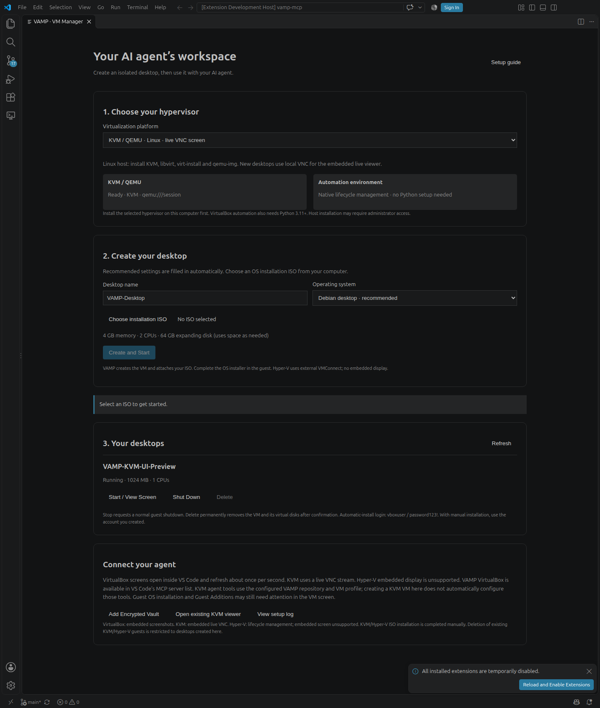
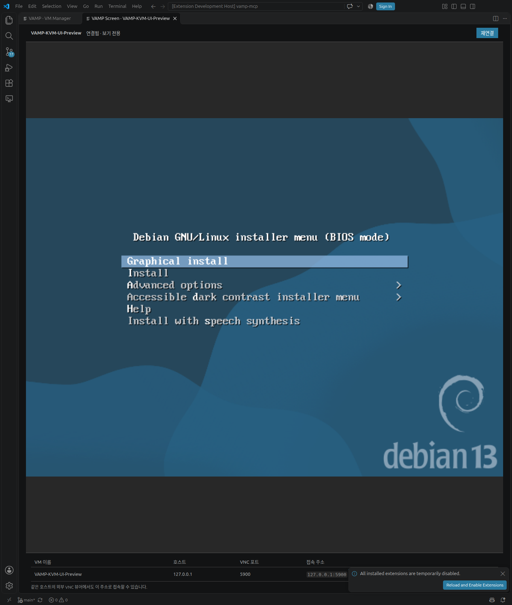
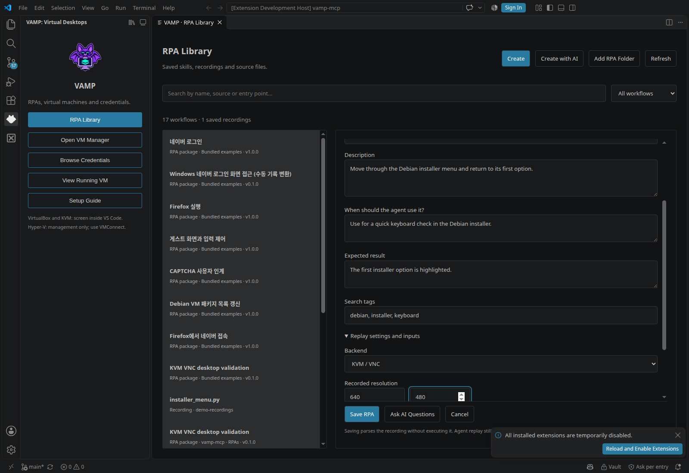
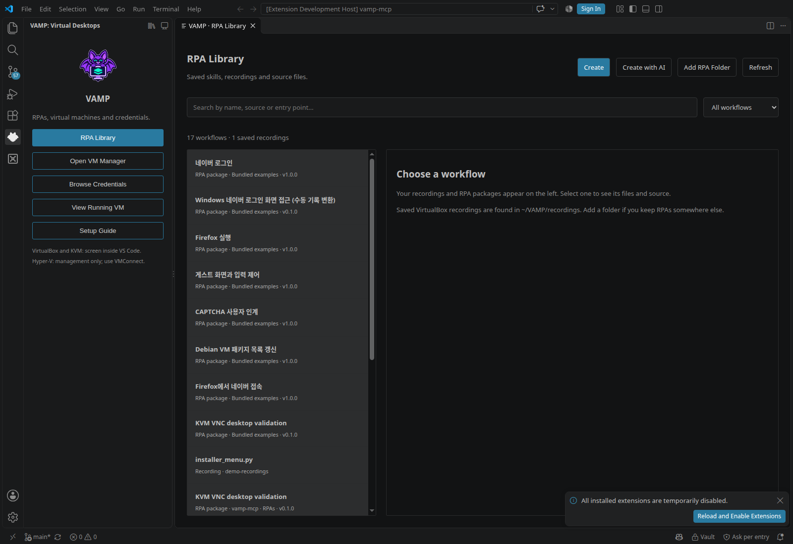

# VAMP User Guide

**VM-isolated GUI RPA & Encrypted Vault Execution for AI Agents**

Open the **VAMP bat icon** in VS Code’s activity bar. The sidebar contains **RPA Library**, **Open VM Manager**, **Browse Credentials** and **Setup Guide**. If the icon is hidden, use the activity bar’s `…` menu or search for `VAMP:` in the Command Palette.

## 1. Create and manage a VM

**Before automation, set the guest display to 1920×1080 and 100% scaling.** Open the VM Manager's **1920×1080 guide · Linux / Windows** button, or use **VAMP: Guest Resolution Guide (1920×1080)** in the Command Palette. The [resolution guide](RESOLUTION.md) covers each guest OS and missing display modes. Finish guest setup and keep the VM awake and unlocked during setup and automation.

1. Click **Open VM Manager**.
2. In **Connection → Virtualization platform**, select the hypervisor installed on this computer.
3. In **New Virtual Machine**, enter a name, select the guest OS and click **Choose installation ISO**. Select an ISO on the host, not a path inside another VM.
4. Check the recommended memory, CPU and expanding-disk settings. Click **Create and Start**, then confirm the VM name and ISO.
5. Follow the OS installer. `Running` describes VM power state; it does not prove the guest OS or recorder is ready.

| Platform | Host prerequisites | VM display in VS Code | Installation |
| --- | --- | --- | --- |
| VirtualBox | VirtualBox 7.x and Python 3.11+. Debian/Ubuntu may also need `python3-venv`. | View-only native PNG screenshots refreshed about once per second. | Supported ISOs install unattended. Unsupported detection/unattended media open a manual installer. |
| KVM / QEMU | Linux, KVM/libvirt, `virsh`, `virt-install`, `qemu-img`, and permission to use `/dev/kvm`/libvirt. | View-only live localhost VNC stream. | VAMP creates the VM and attaches the ISO. Complete OS installation yourself. |
| Hyper-V | Windows with Hyper-V enabled and permission to manage Hyper-V. | **Embedded display unsupported.** Use Windows VMConnect. | VAMP creates a Generation 2 VM and attaches the ISO. Complete installation in VMConnect. |

For KVM, **My desktops** uses `qemu:///session`; **System desktops** uses `qemu:///system`. Choose the connection where your existing VMs are registered. The system connection needs libvirt permissions.

VirtualBox’s private Python environment is prepared when needed. Host drivers, hypervisor installation and any required reboot are separate. Windows 11 requires your own ISO and license. Unattended test installations use the public sandbox login `vboxuser / password123!`; manual installations use the account you create.

In **Machines**:

- **Start / View Screen** starts the VM and opens its screen, or opens a running VM’s screen.
- **Open interactive VM window** in the VirtualBox viewer opens the native window for direct input. KVM’s viewer shows the localhost address for an external VNC viewer.
- **Shut Down** requests a normal guest shutdown. State changes only after the VM stops.
- **Delete** asks before removing a stopped VM and its virtual disks. KVM/Hyper-V deletion is restricted to desktops created here. Original installation ISOs are preserved.

This Linux host produced `VERR_SVM_IN_USE` when VirtualBox and KVM ran together. VAMP checks for another running hypervisor before starting a new VM and asks you to stop it first.

### Verify or recreate the automation environment

Click **Prepare Environment** in VM Manager. The refresh button immediately to its right activates the managed virtual environment in a fresh shell and verifies its Python path plus `mcp`, `robotframework`, `pycdlib` and `asyncvnc`. A green circle with a check appears only after verification succeeds. Use **Delete** to remove the managed environment, then **Prepare Environment** to recreate it. Stop its MCP processes before deletion. VM disks, saved RPAs and vault databases are retained.

## 2. Make a VM recording appear in the library

1. In a guest with the recorder installed, open the desktop **RPA-Recorder** folder.
2. Run **Start-Recorder.cmd** on Windows or **start-recorder.sh** on Debian/X11.
3. Use **Start recording → perform the task → Stop → Save Python**.
4. With VirtualBox Guest Additions and a mounted **VAMPRecords** share, save the recording to that share. Its host copy is under `~/VAMP/recordings`, or the configured `VAMP_DATA_DIR`.
5. Open **RPA Library**. It refreshes about every five seconds while visible. **Refresh** checks immediately.
6. If the host file lives elsewhere, click **Add RPA Folder** and choose its folder. For KVM/Hyper-V, copy the guest file to the host before adding its folder; automatic guest-file synchronization is not implied.

A manual OS installation may still need [recorder setup](https://github.com/wayfarer6/vamp-mcp/blob/main/docs/GUEST_RECORDER.md). A configured share is not proof that the guest mounted it. Avoid recording real passwords, verification codes or certificate passwords.

## 3. Create: write your own RPA title and description

1. Click **RPA Library → Create**.
2. Select the Python script recorded in your VM under **Recorded script**.
3. Enter **Name** and **Description**. Example: `Find customer` / `Search the open customer list and select the requested customer`.
4. Fill in **When should the agent use it?** Example: `When the customer-management screen is already open and the user asks to find a customer`.
5. Enter an observable **Expected result**, such as `The matching customer is visible in the result list`.
6. Add **Search tags**, for example `customer, search, list`.
7. Open **Replay settings and inputs**. Select VirtualBox or KVM and enter the actual guest resolution used when recording. Optional inputs must match `${name}` placeholders in recorded text; declare their names, separated by commas, under **Input names**. Unused input names are rejected.
8. Only after review, check **I reviewed this recording and allow agent reuse**. You can save without this check, but agent execution stays blocked.
9. Click **Save RPA**. VAMP parses supported actions without executing recorder source. Select the saved skill and use **Edit Details** to update its title, description, tags or review state.

Supported PyAutoGUI recordings are replayed as parsed guest-device actions. Arbitrary Python, host-window coordinates, unsupported operations and a different guest resolution require adaptation. Hyper-V desktop replay is unsupported.

## 4. Create with AI: answer questions, then review the metadata

1. Select a recording and click **Create with AI**. Without a selection, choose a recording from the list.
2. Choose a VS Code language model. VAMP asks before sending the selected recording; review it for private text first.
3. Answer the AI’s questions about purpose, when to reuse it, inputs and completion conditions.
4. The AI fills an editable **Create RPA** form with a proposed title, description, tags and input contract.
5. Correct anything inaccurate, check backend/resolution and review state, then click **Save RPA**.

The AI describes the existing recording. It does not silently rewrite or execute it. If no VS Code model is available, configure a model or use **Create** manually. **Copy AI Request** prepares a request for a different agent; review it before pasting.

## 5. Find, inspect, edit and export an RPA

- Search by title, description, use case, tags, source or file name. Filter **My RPA skills**, **Saved recordings**, example packages or AI drafts.
- Select a result to see its description, input contract, backend and source preview. Use ↑/↓ or Home/End to navigate the list.
- **Edit Details** changes registered metadata and its review state.
- **Export ZIP** saves the selected source and metadata with per-file SHA-256 checksums in `VAMP_EXPORT.json`. Export never runs the RPA.
- Review recorded text before sharing. A ZIP is a source export, not a VM or complete standalone runtime. Saved skills need a matching VAMP runner; existing Robot packages need their shared runtime/dependencies.
- The older SPICE converter’s private `recording.local.json` is excluded by default. Such legacy packages need that local data restored separately; see the [conversion guide](https://github.com/wayfarer6/vamp-mcp/blob/main/docs/RECORDING_CONVERSION.md).

### Per-skill version history and repairs

Install Git on the host. Each saved skill folder has its own Git repository. Creating or updating a skill commits its source, parsed actions and metadata and increments its version. **Export ZIP** includes only the latest committed revision, without `.git` history or uncommitted edits.

For an authorized repair, an agent can use **rpa_revision** to inspect history and committed source, then submit a validated source update with the expected commit ID. Conflicting revisions and tracked uncommitted changes block the repair. Repairs are committed with review cleared; inspect the result and use **Edit Details** to approve reuse before running again.

## 6. Let an agent reuse skills before another CUA loop

1. In VS Code MCP server management, start **VAMP RPA Library** and enable its tools. Enable the relevant VM provider for other VM operations.
2. Example request: `Find the saved RPA for customer search by title and description. Reuse a compatible reviewed skill on my running VM with query=Alice, then verify its expected result.`
3. The agent calls **rpa_search**, then **rpa_details** for a likely match. It checks backend, recorded resolution, input names, review state and expected result.
4. With task authorization and an exact VM UUID, it calls **rpa_run_saved** with all declared inputs and `confirmed:true`. The runner does not start another VM implicitly.
5. The runner replays parsed events on guest devices; it never executes recorder Python source on the host.
6. Read the compact result first. **completed_unverified** means the events completed, not that the application task succeeded. Verify the expected result with the cheapest reliable observation.

MCP instructions and the bundled project `rpa-reuse` skill require: **search existing skills → reuse a compatible reviewed RPA → inspect its compact result → use targeted CUA/OCR/multimodal only when needed**. If nothing matches or execution/verification fails, fall back to normal GUI control. Compatibility and authorization take priority over token savings.

VirtualBox mouse replay needs matching `vboxapi` bindings. Windows **Prepare Environment** installs them. On Linux/macOS, set **VAMP: Mouse Python Executable** when the SDK is in another Python. KVM replay requires `asyncvnc` in the host environment and an active localhost VNC display.

## 7. Browse credentials and choose agent approval levels

1. Open **Browse Credentials**, or run **VAMP Vault: Browse Credentials**.
2. Use **Open Existing Vault** for an existing `.kdbx`, or **Create New Vault**. If KeePassXC is missing, click **Prepare Vault Tools**.
3. Click **Unlock Vault** and enter the master password in the masked VS Code password prompt.
4. Search by title/group/username and filter by group. Select an entry for its username, website and notes.
5. **Copy Username** copies only the username. **Show for 15 Seconds** requires confirmation and briefly displays the password. Hiding or leaving the view clears the displayed secret.
6. **Copy Password** also requires confirmation. After 30 seconds, the clipboard clears only if it still contains that password.
7. **Lock Vault** forgets the stored master password and clears the open credential view. The MCP bridge also invalidates cached values and session approvals after a lock or policy change.
8. **Export Encrypted Vault** saves an encrypted `.kdbx` copy, not a plaintext credential list.

Click the **Approval** button in the browser, the approval indicator in the status bar, or **VAMP Vault: Change Agent Approval Level**:

| Level | Agent behavior |
| --- | --- |
| **1 · Ask every time** | Confirm every agent secret read, including a read served from cache. |
| **2 · Ask per entry** | Approve once, or explicitly remember that entry/action for the current session. This is the default. |
| **3 · No prompts** | Allow unlocked agent reads without approval prompts. Selecting this level requires an explicit warning confirmation. |

Policy changes are read through the live VS Code bridge before a secret is returned. Tightening the policy clears cached approvals; a disconnected configured bridge blocks secret reads. Direct password reveal/copy controls remain explicit user actions.

Usernames fill in for the first 200 entries in the background. Search titles/groups while large databases are loading. The UI checks are not a full screen-reader or accessibility certification.

## 8. Control desktops on a remote host (SSH)

Use this when the virtual machines live on another machine and you only have SSH to it.

1. Set `vamp.remote.enabled` and fill `vamp.remote.host`, `vamp.remote.username` (and `port`, `privateKeyPath` if needed). Or run **VAMP: Remote · Set Host and User**.
2. Run **VAMP: Remote · Prepare Environment on the Remote Host**. VAMP uploads its remote server to `~/.vamp/remote/`, creates a Python venv, installs libvirt/QEMU when passwordless sudo is available, and reports the exact command for anything an administrator must do.
3. Run **VAMP: Remote · Verify Remote Environment** to see every check.
4. Open **Remote Server (SSH)** in VM Manager. Desktops on that host appear in the list; **Start**, **Shut Down** and **Screenshot** act on the remote hypervisor.
5. For an agent, start **VAMP Remote (SSH)** in MCP server management. Tools: `remote_env_check`, `remote_env_setup`, `remote_vm_list`, `remote_vm_status`, `remote_vm_start`, `remote_vm_stop`, `remote_vm_screenshot`, `remote_vm_send_keys`, `remote_vm_mouse_click`, `remote_rpa_run`.

Remote screens are **screenshots only**: one PNG per request, refreshed every few seconds in the panel. There is no live stream, no forwarded hypervisor port, and guest credentials stay on the remote host. A started VM is not a booted guest — take a screenshot and look. Clicks use fractions of the screen so they follow the last screenshot; VirtualBox remote hosts report clicks as unsupported. Full guide: `docs/REMOTE_SETUP.md`.

## Troubleshooting

| Symptom | Next step |
| --- | --- |
| VM Create is disabled | Check hypervisor readiness, a valid name and a selected ISO. |
| Recording is missing | Verify the file exists on the host. Use Add RPA Folder; verify the guest share separately. |
| Registration rejects an operation/resolution | Select a supported guest-recorded Python script and enter its recorded guest resolution. |
| An agent cannot find a skill | Save it under My RPA skills; start VAMP RPA Library MCP; use matching titles/descriptions/tags. |
| needs_review_or_confirmation | Review the skill in Edit Details; authorize the task and provide confirmed:true. |
| Source/actions changed | Recreate and review the definition after source changes. |
| completed_unverified | Verify the expected application result. |
| Vault appears empty | Check the active database, lock state, search and group filter. |
| Hyper-V has no viewer | Embedded display is unsupported. Open VMConnect. |
| Remote: Permission denied (publickey) | Install the key on the remote host and test with `ssh -T`. |
| Remote: libvirt is not reachable | Start `libvirtd` and re-open the session after joining the `libvirt` group. |
| Remote: screenshot failed | The VM must be running and have a graphics device. |

Screenshots use example workflow metadata and a sample credential. The guest shown is a Debian installer, not proof of a completed OS installation. See [validation](https://github.com/wayfarer6/vamp-mcp/blob/main/docs/VALIDATION.md) and the [UI audit](https://github.com/wayfarer6/vamp-mcp/blob/main/docs/UI_AUDIT.md) for exact coverage.

---
