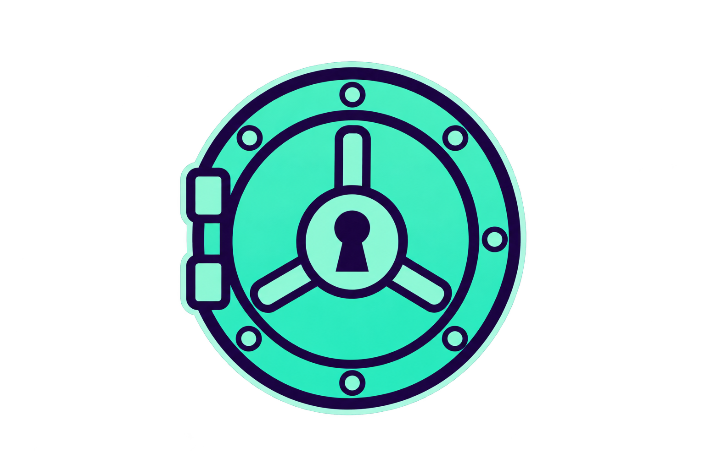

<p align="center">
  
</p>

# VAMP Vault · Credential & Certificate Isolation for AI Agents

**VM-isolated GUI RPA & Encrypted Vault Execution for AI Agents**

The AI agent on this machine can click, type and read screens, but it should not be able to take your passwords with it. VAMP Vault keeps them in a local KeePassXC database, keeps the certificates that prove who you are in an encrypted VeraCrypt volume, and hands a single approved value to the agent only when the current step of a task needs it.

It is the companion to [VAMP](https://marketplace.visualstudio.com/items?itemName=wayfarer6.vamp-mcp-tools), the local hypervisor MCP extension. VAMP gives an agent a machine to work in; VAMP Vault gives that work an identity. Enterprise identity tokens and certificates are the primary concrete case: mount the encrypted volume as removable media, let the agent perform signing or authentication in the isolated guest VM, and unmount when the step is finished.

[Source](https://github.com/wayfarer6/vamp-mcp/tree/main/vscode-vault-extension) · [Releases](https://github.com/wayfarer6/vamp-mcp/releases) · [VAMP documentation](https://github.com/wayfarer6/vamp-mcp/blob/main/docs/README.md)

## Get started

1. Install the **VAMP** extension first; VAMP Vault declares it as an extension dependency.
2. Run **VAMP Vault: Set Up KeePassXC & VeraCrypt CLI**. It reuses a KeePassXC or VeraCrypt you already have. Otherwise it installs KeePassXC on Windows through winget (`KeePassXCTeam.KeePassXC`, the full signed application) and asks you to approve the Windows User Account Control (UAC) prompt; on Linux and macOS it downloads the official build for your OS and CPU into the extension's storage, verifying the publisher's SHA-256 before use.
3. Run **VAMP Vault: Create Vault** and type a master password. It is kept in VS Code secret storage, not in a settings file or an environment variable.
4. Open MCP server management, start **VAMP Vault**, and let the agent call it.

The master password is asked once and stays in secret storage until you run **VAMP Vault: Lock**. Every secret read is approved in a VS Code dialog, or once per entry per session if you choose that setting.

## Browse your credentials

Use **VAMP Vault: Browse Credentials**, or **VAMP → Browse Credentials**. **Open Existing Vault** selects a `.kdbx`; **Unlock Vault** asks for the master password in a native VS Code password prompt. Search by title/group/username and select an entry for its username, URL and notes. **Show for 15 Seconds** and **Copy Password** each ask for confirmation. Hiding the view or locking clears the displayed secret. **Export Encrypted Vault** saves an encrypted `.kdbx` copy.

The full [user guide](https://github.com/wayfarer6/vamp-mcp/blob/main/docs/USER_GUIDE.md) is bundled in this VSIX under **VAMP Vault: Open Guide**. The companion VAMP **RPA Library** supports manual Create, AI-guided questions, keyword search and ZIP export.

## Remote vaults (SSH)

A second machine can own a second vault. Turn on **VAMP Vault: Remote Enabled**, run **VAMP Vault: Set Up Remote Vault (SSH)**, and that host gets its own KeePassXC database at `~/.vamp/vault/vault.kdbx`, its own master password and its own session cache.

The isolation rule is the whole point: **a remote vault is never the local vault, and two hosts never share one.**

- The local vault stays on this computer. A remote host's database lives on that host's filesystem and is never downloaded, uploaded or synced.
- Host A and host B each get their own file, their own master password and their own approvals. Copying `~/.vamp/vault/vault.kdbx` between hosts is something you would have to do by hand — VAMP Vault has no code path that does it.
- Passwords are kept per host in VS Code secret storage under a key that names the host (`remote-ssh://user@host:port/~/.vamp/vault/vault.kdbx`). **Lock Remote Vault** forgets that one password and leaves the local vault untouched.
- A password travels to the host on the SSH command's standard input, never in an argument, so it is absent from `ps`, shell history and any file on either machine. Nothing is written to the remote disk.

**How it works.** The extension uploads a standalone `server.mjs` into `~/.vamp/vault` on the host (mode 600) and runs `remote_vault_setup.sh` there: it creates the vault directory as 700, checks Node.js 20+, and installs or reports `keepassxc-cli` (and optionally `veracrypt`) for apt, dnf, yum, zypper, pacman or apk. The setup script is idempotent and never deletes a database.

**What the agent sees.** Set `vampVault.mcpTarget` to `remote` to route the single **VAMP Vault** MCP entry to the configured remote host. It defaults to `local`; only one target is active for MCP at a time. Its tools are the same nine, but each call runs on the selected host. The server on this side holds the bridge: it asks *you* for approval and for that host's master password, then sends the approved call over SSH. The host itself is headless and cannot reach your dialogs.

**In the sidebar.** With a remote host configured, both views split into **📦 Local Vault** and **🌐 Remote Vault · host**. Entry rows under the remote section read that host's database only — the same entry path can exist in both vaults and the two rows stay separate. Remote rows offer the same Copy Username / Copy Password / Show Details actions.

Remote settings:

| Setting | Purpose |
| --- | --- |
| `vampVault.remote.enabled` | Turn the remote vault on (off by default). |
| `vampVault.remote.useVampRemoteSettings` | Reuse host, port, username, key and node path from VAMP's `vamp.remote.*`. Vault paths are never taken from there. |
| `vampVault.remote.host` / `.port` / `.username` / `.privateKeyPath` | SSH connection to the host. |
| `vampVault.remote.kdbxPath` | That host's database, default `~/.vamp/vault/vault.kdbx`. `~` is the remote account's home. |
| `vampVault.remote.volumePath` / `.mountPoint` | That host's VeraCrypt volume and mount point. |
| `vampVault.remote.remoteNodePath` | Node.js on the host, default `node`. |
| `vampVault.remote.approvalMode` | `each-read`, `per-session` or `off` for agent reads of that host, separate from the local mode. |

Remote hosts need an OpenSSH client here, `BatchMode=yes` SSH access (a key or agent, no password prompt), and Node.js 20+ plus KeePassXC on the host.

## Agent approval levels

Click **Approval** in the credential browser or its status-bar indicator: **1 · Ask every time**, **2 · Ask per entry** (default), or **3 · No prompts**. Disabling prompts requires explicit confirmation. The running MCP server refreshes policy through the bridge before returning secrets; locking or changing policy invalidates cached approvals. Direct reveal/copy controls still require user action.

## Sidebar

The VAMP Vault icon in the activity bar opens two views.

**Vault Status** reads only files and CLI paths: lock state, database and volume presence, mounted volumes, resolved KeePassXC/VeraCrypt versions and the approval mode. Nothing secret is touched, and each row is clickable — a missing binary offers setup, a missing database offers creation, an existing one opens the folder that holds it.

**Credentials** is the database itself, as a tree:

- Locked or without a CLI, it shows the one action that fixes that — *Set up KeePassXC CLI*, *Create vault* or *Unlock vault* — instead of an empty pane.
- Unlocked, it mirrors the KeePassXC groups and entries. An entry row shows its title, and its username once it has been read (the group path before that); titles are `$(key)` and groups `$(folder)`, with the recycle bin as `$(trash)`.
- Right-click an entry for **Copy Username**, **Copy Password (Approval Required)** and **Show Entry Details**. The password copy asks in a modal dialog first, then clears the clipboard 30 seconds later if it still holds that value. Details show path, username, URL, tags and notes — never the password.
- The view title carries Refresh, Search, Lock/Unlock and a `…` menu with *Reveal .kdbx File in OS File Explorer* and *Export .kdbx Copy to…*. Search is a QuickPick over every entry path.

Reading a username costs one `keepassxc-cli show` call per entry, so usernames fill in for the first 200 entries in the background; a password is never read on this path (`show` without `-s` reports `PROTECTED`).

## Architecture

```
VS Code extension host                        MCP server process (Node, stdio)
┌───────────────────────────────┐            ┌──────────────────────────────────┐
│ vamp.vault provider           │            │ backends/vault/server.mjs        │
│  · MCP definition + env       │  spawns →  │  9 tools, session cache,         │
│  · commands, sidebar, status  │            │  approval gate                   │
│  · approval bridge (socket)   │◄──────────►│  src/bridge_client.mjs           │
│      ├─ secret storage        │  approval/ │  src/vault_cli.mjs               │
│      └─ modal dialogs         │  password  │      ├─ keepassxc-cli  (stdin)   │
└───────────────────────────────┘            │      └─ veracrypt      (--stdin) │
                                             └──────────────────────────────────┘
   src/downloader.mjs: PATH → standard install dirs → official release download
```

Three boundaries matter. **stdin, never argv** — the database and volume passwords reach the CLIs on standard input, so they do not appear in a process list. **The extension host owns the secrets** — the MCP server never reads a settings file; it asks the bridge, which reads VS Code secret storage. **The agent sees one value** — `vault_get_credential` returns the requested fields of one entry, and `vault_list_credentials` never returns a password.

For a remote host, **approval dialogs and master-password storage stay on this computer**. After local approval, the proxy sends the master password to the selected host through the encrypted SSH channel on standard input, never in command arguments or an agent result. Each host has its own database and password scope.

```
VS Code extension host            remote proxy (Node, stdio)        SSH        remote host
┌──────────────────────┐          ┌───────────────────────┐        ┌───┐      ┌────────────────────┐
│ vamp.vault (remote)  │  MCP  →  │ remote/vault_proxy.mjs│ ──────→│ → │ ────→│ ~/.vamp/vault/      │
│  · approval dialog   │ ←──────  │  · approval mode      │        └───┘      │   server.mjs        │
│  · secret storage    │          │  · password on stdin  │                 │   vault.kdbx (own)  │
└──────────────────────┘          └───────────────────────┘                 └────────────────────┘
```

## MCP tools

| Tool | Purpose | Returns |
| --- | --- | --- |
| `vault_create` | Create a `.kdbx`, optionally with an encrypted volume beside it. Refuses to overwrite unless `overwrite:true`. | `status: created`, paths, optional volume report |
| `vault_get_credential` | Read the approved fields of one entry: `username`, `password`, `totp`, `url`, `notes`, `attributes`. | The requested values, `approved_by`, `cached` |
| `vault_add_credential` | Save one credential the user dictates: `entry` (a `Group/Title` path creates the group), `username`, `password`, `url`, `notes`. Never overwrites. | `status: created`, `path`, `created: true` — or `status: exists` |
| `vault_set_credential` | Add an entry, creating its group, with optional overwrite. Use `vault_add_credential` for a plain hand-entered credential. | `status: created` or `status: exists` |
| `vault_update_credential` | Change `username`, `password`, `url` or `notes`; omitted fields are untouched. | `status: updated`, fields changed |
| `vault_delete_credential` | Move an entry to the KeePassXC recycle bin after approval. | `status: deleted`, `recyclable` |
| `vault_list_credentials` | Entry and group paths, no passwords. | `entries`, `groups`, `count` |
| `vault_mount_volume` | Mount a VeraCrypt volume (PIM, key files, read-only, slot supported). | `status: mounted`, mount point |
| `vault_unmount_volume` | Unmount one volume or all of them. | `status: unmounted` |
| `vault_status` | CLI paths and versions, database presence, lock state, mounted volumes, cache window. Reads nothing secret. | Structured status plus `next_action` |

Tool results are JSON. Errors carry a `code` (`keepassxc_missing`, `vault_locked`, `approval_required`, `entry_not_found`, `volume_missing`, …) so the agent can recover instead of guessing.

### Approval, caching and the lock

| Setting | Behaviour |
| --- | --- |
| `vampVault.approvalMode: per-session` (default) | One dialog per entry per session; later reads of the same entry are not re-asked while the server runs. |
| `vampVault.approvalMode: each-read` | A dialog for every read. Use this when the machine is shared or attended. |
| `vampVault.approvalMode: off` | No dialog. Only for a dedicated throw-away machine. |
| `vampVault.sessionCacheMinutes` (default 5, `0` disables) | How long a retrieved value stays in the server process memory. Updating or deleting an entry clears it immediately. |

When no VS Code dialog is reachable — the server was started by hand, or the bridge is down — a read returns `status: approval_required` and the agent must pass `confirm:true` after asking you. That is a fallback, not a security boundary; the dialog is the boundary.

## Where the CLIs come from

The setup command and `vault_status` report which of these applied.

| Platform | KeePassXC | VeraCrypt |
| --- | --- | --- |
| Linux x64/arm64 | PATH, `/usr/bin`, `/snap/bin`, Flatpak, else the official AppImage extracted into extension storage with a launcher that sets `LD_LIBRARY_PATH` | PATH or the official AppImage (needs GTK 3, which desktop distributions ship); mounting also needs FUSE and permission to mount as your user |
| Windows x64/ARM64 | PATH, `Program Files\KeePassXC`, else winget installs the full signed application (`winget install --id KeePassXCTeam.KeePassXC -e`), which brings `keepassxc-cli.exe` and the browser proxy. Approve the UAC prompt Windows shows for that installer | Install manually (`winget install --id IDRIX.VeraCrypt -e`): the CLI talks to a kernel driver that only the signed installer registers, and that needs administrator rights |
| macOS x64/arm64 | PATH, `/Applications/KeePassXC.app`, Homebrew, else `brew install keepassxc` | `brew install --cask veracrypt` plus macFUSE; the `.dmg` is an app bundle, not a portable binary |

Every download is checked against the SHA-256 the publisher lists (the `.DIGEST` asset for KeePassXC, `sha256sum.txt` for VeraCrypt). A mismatch deletes the file and reports `checksum_mismatch`; nothing is executed.

A winget install is the one step that leaves the extension: winget fetches the package from Microsoft's community repository, the installer runs elevated, and Windows shows a User Account Control prompt. VAMP says so before it starts — *"Please approve the Windows User Account Control (UAC) prompt to complete the KeePassXC installation."* — in the progress notification, a VS Code notification and the VAMP Vault output log. If the prompt is refused, the report says so and repeats the command you can run yourself; VAMP never retries silently.

## Security guide

- **What leaves the machine:** the approved value goes to the MCP server process that the agent's client controls. Everything stays local — no network calls except the one-time CLI download from `github.com`.
- **What is stored where:** the `.kdbx` and the VeraCrypt volume are ordinary files, encrypted with their own keys. The master password lives in VS Code secret storage (Keychain, DPAPI or libsecret) and is forgotten by **VAMP Vault: Lock**.
- **What the agent cannot do:** list a password, use a password as a shell argument, read the master password, or mount a volume without approval. It also cannot see an entry path you never gave it.
- **Chat transcripts:** a value returned by `vault_get_credential` is in the agent's context and may be summarised by the model. Ask for one field at a time, and prefer `vault_mount_volume` plus a guest-side password manager for repeated logins.
- **The clipboard is not a vault:** copying a password from the sidebar is for moving it into one login form. The copy asks for approval first and clears the clipboard 30 seconds later if it still holds that value; anything that could read the clipboard in that window already could read it before.
- **Backups:** the recycle bin is inside the `.kdbx`. Copy the file while the vault is closed, and back up the key file separately if you use one.
- **What this is not:** not a hardware token, not a password-less design, and not protection against malware running as your user. It is isolation from the agent, and a record of what the agent was given.

## Settings

| Setting | Purpose |
| --- | --- |
| `vampVault.keepassxcCliPath` | Explicit `keepassxc-cli`. Empty: system install, then the downloaded copy. |
| `vampVault.veracryptCliPath` | Explicit `veracrypt`. Same resolution order. |
| `vampVault.defaultKdbxPath` | Default database. Empty: `vault.kdbx` in this extension's global storage. |
| `vampVault.defaultVolumePath` | Default VeraCrypt volume. Empty: `vault.hc` in the same place. |
| `vampVault.mountPoint` | Default mount point. Empty: drive `V:` on Windows, `~/VAMP-Vault` elsewhere. |
| `vampVault.sessionCacheMinutes` | Credential cache window in the MCP server. |
| `vampVault.autoDownloadCli` | Allow the one-time official binary download. |
| `vampVault.approvalMode` | `each-read`, `per-session` or `off`. |
| `vampVault.remote.*` | The SSH host, its own database/volume paths and its own approval mode — see *Remote vaults (SSH)* above. |

## Commands

| Command | What it does |
| --- | --- |
| **VAMP Vault: Set Up KeePassXC & VeraCrypt CLI** | Resolve, download and verify both binaries; report versions and paths. |
| **VAMP Vault: Create Vault** | Ask for a path and master password, create the `.kdbx`, store the password in secret storage. |
| **VAMP Vault: Add Credential** | The `+` in the Credentials view title. Asks for the entry title (a `Group/Title` path creates the group), username, password, URL and notes, then adds it to the open vault. Unlock is asked first when needed; the password is never echoed. |
| **VAMP Vault: Show Status** | Database, volume, mount point, lock state, CLI versions, mounted volumes. |
| **VAMP Vault: Lock (Forget Master Password)** | Delete the master password from secret storage. |
| **VAMP Vault: Unlock** | Ask for the master password, verify it against the database, and keep it in secret storage. |
| **VAMP Vault: Refresh** | Re-read the status and credentials views. |
| **VAMP Vault: Search Credentials** | QuickPick over every entry; copy the username, copy the password after approval, or show details. |
| **VAMP Vault: Reveal .kdbx File in OS File Explorer** | Open the file manager at the database. |
| **VAMP Vault: Export .kdbx Copy to...** | Save an encrypted copy of the database wherever you choose. |
| **VAMP Vault: Copy Username / Copy Password** | Copy one value from an entry; the password asks for approval first. |
| **VAMP Vault: Show Entry Details** | Read an entry's fields with the password hidden. |
| **VAMP Vault: Open Guide** | This document. |
| **VAMP Vault: Set Up Remote Vault (SSH)** | Ask for the host, upload the vault server, prepare the vault directory and KeePassXC on that host. |
| **VAMP Vault: Verify Remote Vault** | Check SSH, Node.js, KeePassXC, the database and the lock state on that host. |
| **VAMP Vault: Create Remote Vault** | Create this host's own `.kdbx` with a master password asked here and kept for this host only. |
| **VAMP Vault: Unlock Remote Vault** | Ask for that host's master password, verify it against its database, keep it in secret storage. |
| **VAMP Vault: Lock Remote Vault** | Forget that host's master password. The local vault keeps its own. |

## Development

```bash
npm install
npm run build                    # bundle backends/vault/server.mjs into dist/
npm run package                  # build + vsce package → vamp-vault-0.1.5.vsix
npm test                         # build, MCP smoke test, sidebar checks (stand-in VS Code host), remote SSH checks
VAULT_TEST_KEEPASSXC=/path/to/keepassxc-cli npm test
node test/downloader.mjs         # opt-in: really download and verify both CLIs (~70 MB)
```

`npm test` builds the extension, then starts the real server over stdio with the official MCP client and exercises all nine
tools, the session cache, the approval fallback and a stand-in extension bridge. It also loads `extension.js`
against a stand-in `vscode` module and drives the sidebar: both views, the tree, tree items, copy with and
without approval, details, reveal, export, search, lock and unlock. `test/remote.mjs` covers the SSH path with a
stand-in `ssh` that runs each command in a shell with its own `HOME`: upload, setup, two independent hosts, the
password never appearing in an argument, and the proxy's approval and denial. It needs
`keepassxc-cli` on `PATH` or in `VAULT_TEST_KEEPASSXC`; `VAULT_TEST_VERACRYPT` enables the volume
checks. Nothing it does touches the user's configured vault.

## Roadmap

### Passkeys (WebAuthn) inside the guest VM

KeePassXC 2.8 already stores passkeys and exposes them through the KeePassXC-Browser extension, but a passkey only works where a browser can reach the native messaging host — so today it would live on the host, next to the agent, which is exactly where a passkey must not be. The planned design moves the authenticator into the guest and treats the host vault as the seed store:

1. **Provisioning (post-install hook).** After VAMP finishes installing a guest OS, a post-install hook runs inside the guest: install KeePassXC and its CLI from the distribution's signed repository, install the KeePassXC-Browser extension into the guest browser by policy (`ExtensionSettings` for Chromium-based guests, `policies.json` for Firefox), and register the native messaging manifest for the guest user so the browser can talk to the guest's KeePassXC.
2. **Seed transfer.** The host vault exports the passkey entries into the guest database once, over the existing shared folder, and then deletes the export. The guest database is opened with its own password, prompted on the guest screen where the user can see it.
3. **Unlocking.** The agent can ask the guest to open the guest database only for the duration of a login step; the unlock happens on the guest desktop, not through the MCP channel, so the passkey private key never crosses into the host agent process.
4. **Attestation and recovery.** The hook records the guest's public keys and a recovery code in the host vault so a rebuilt guest can be re-enrolled without the original device.
5. **Honest limits.** Passkey support is roadmap work, not implemented in 0.1.0: it depends on the guest hook framework in VAMP, on KeePassXC-Browser's native messaging path inside a VM, and on browser policy support for managed guest profiles. Until it ships, `vault_status` and this section are the only claims made about it.

### Shorter term

- **TOTP seeds from the vault tools.** `keepassxc-cli` in 2.8 reads TOTP (`vault_get_credential` with `fields: ["totp"]`) but cannot write an `otpauth://` seed, so seeds are added in the KeePassXC application today. A small writer for the entry attribute would close that gap.
- **Hidden volumes and PIM policy.** Mount with `--protect-hidden` and store the PIM next to the entry instead of asking for it each time.
- **Guest-side injection.** Give the guest a scoped, expiring credential instead of the host one, so a task inside the VM never receives a value that also works on the host.
- **Audit trail.** Append-only record of which entry was released, to which tool call and when — locally, readable by the user, not by the agent.

## Limitations

- Windows VeraCrypt uses its native password dialog for mounting; the Unix `--stdin` switches are not sent to the Windows executable. Creating a new Windows encrypted volume opens the native creation wizard and returns `interactive_setup_required` until the user completes it. Windows volume enumeration checks the actual VeraCrypt device mappings. KeePassXC database operations remain available through MCP.
- Mounting needs the VeraCrypt driver on Windows and macOS, and FUSE plus mount permission on Linux. A container or a locked-down host will report `failed` with the reason rather than silently succeed.
- `keepassxc-cli` has no solver for hidden-volume protection, passkey writes, or entry attributes beyond the standard set; those are done in the KeePassXC application.
- One master password per database is remembered at a time by the dialog flow; several databases work, each with its own stored password.
- The extension runs on the local desktop host and does not work in vscode.dev.

## Version 0.1.4 release validation

[Download the 0.1.4 VSIX and SHA-256](https://github.com/wayfarer6/vamp-mcp/releases/tag/vamp-vault-v0.1.4).

Linux checks passed with the real KeePassXC and VeraCrypt CLIs: MCP smoke 42, extension-host stand-in 21, remote SSH stand-in 30, browser 2 and live approval-policy 7 checks. The packaged MCP server also passed 15 native Windows checks in the nested Windows lab, using a temporary encrypted database: credential CRUD, independent deletion approval, read approval, cache invalidation and encrypted storage. [Validation receipt](https://github.com/wayfarer6/vamp-mcp/blob/main/docs/media/vault-014-validation.json).

The remote suite models separate hosts with a stand-in SSH transport. Physical Windows hardware and native Windows VeraCrypt mounting were not retested for this release. The master password is transmitted to the selected remote host through encrypted SSH stdin; approval dialogs and stored passwords remain under this computer's control.

## Version 0.1.5 icon update

[Download Vault 0.1.5](https://github.com/wayfarer6/vamp-mcp/releases/tag/vamp-vault-v0.1.5) · [Combined VAMP release](https://github.com/wayfarer6/vamp-mcp/releases/tag/v0.1.8). The Marketplace icon and activity-bar icon show the VAMP bat holding a monitor with the safe inside the screen. Vault functionality remains the same as 0.1.4.
