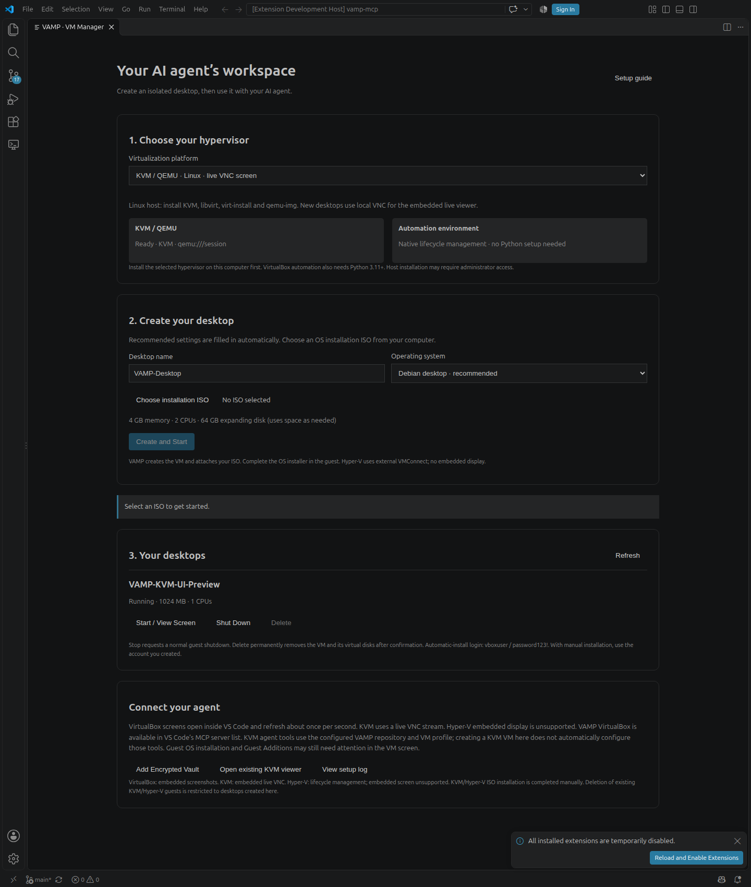
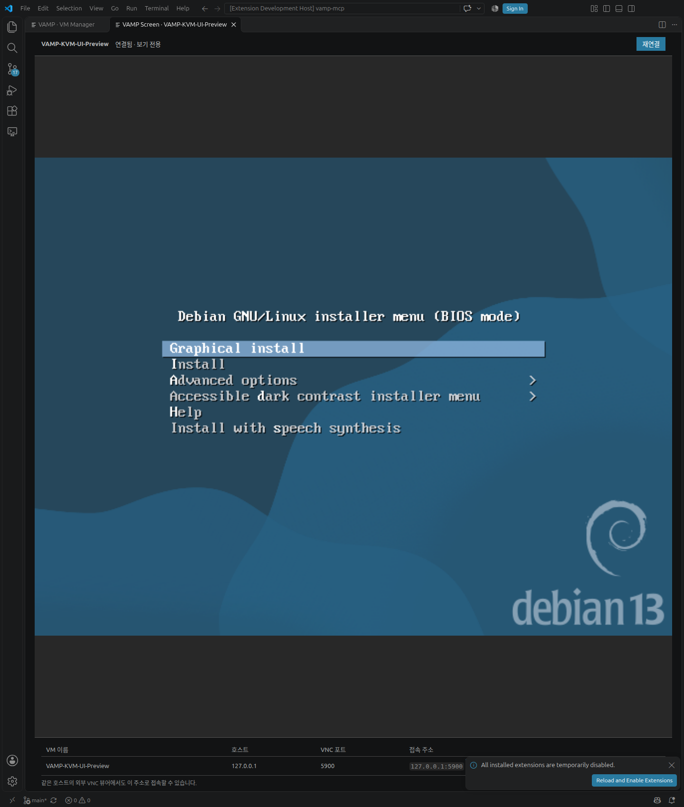
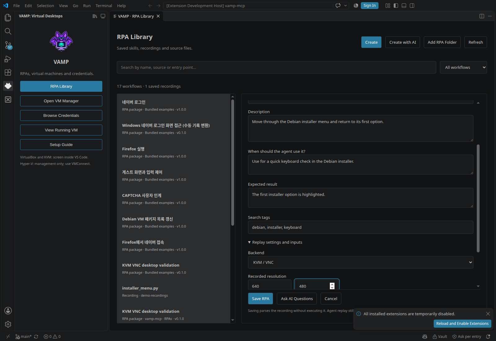
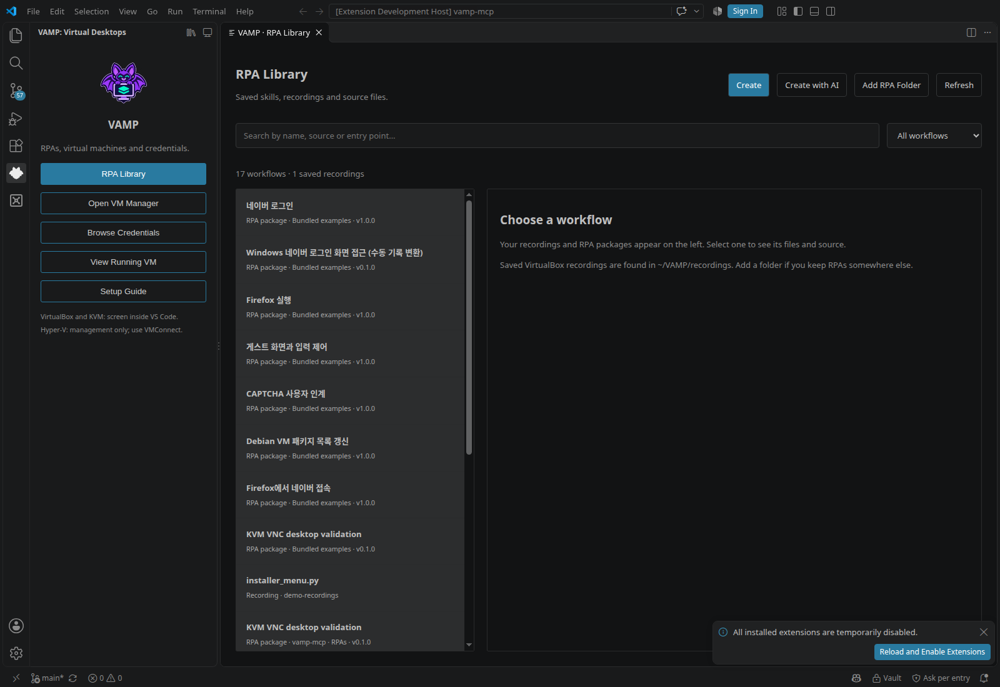
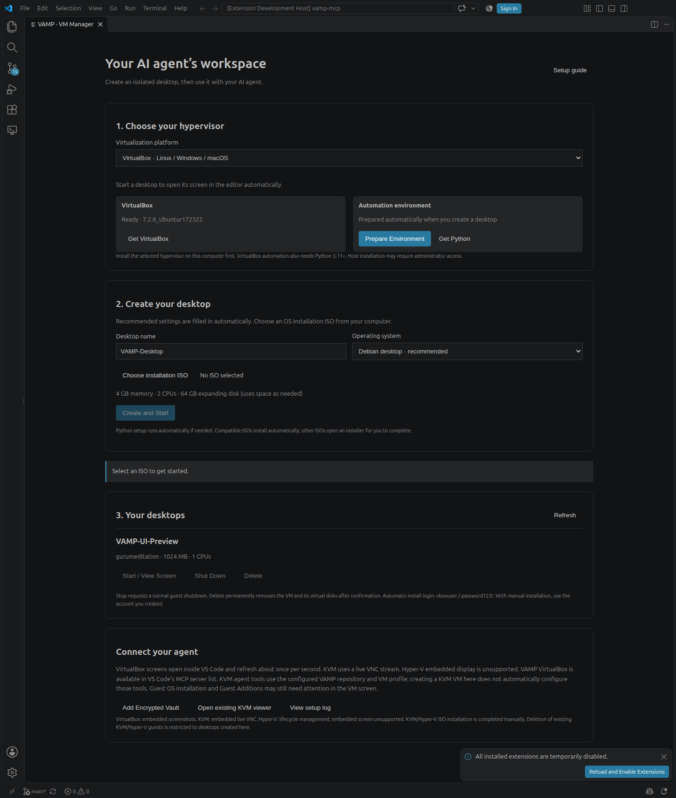

# VAMP User Guide

**VM-isolated GUI RPA & Encrypted Vault Execution for AI Agents**

English instructions come first. [한국어 안내](#한국어-안내) is below.

Open the **VAMP bat icon** in VS Code’s activity bar. The sidebar contains **RPA Library**, **Open VM Manager**, **Browse Credentials** and **Setup Guide**. If the icon is hidden, use the activity bar’s `…` menu or search for `VAMP:` in the Command Palette.

## 1. Create and manage a VM

1. Click **Open VM Manager**.
2. In **Connection → Virtualization platform**, select the hypervisor installed on this computer.
3. In **New Virtual Machine**, enter a name, select the guest OS and click **Choose installation ISO**. Select an ISO on the host, not a path inside another VM.
4. Check the recommended memory, CPU and expanding-disk settings. Click **Create and Start**, then confirm the VM name and ISO.
5. Follow the OS installer. `Running` describes VM power state; it does not prove the guest OS or recorder is ready.

| Platform | Host prerequisites | VM display in VS Code | Installation |
| --- | --- | --- | --- |
| VirtualBox | VirtualBox 7.x and Python 3.11+. Debian/Ubuntu may also need `python3-venv`. | View-only native PNG screenshots refreshed about once per second. | Supported ISOs install unattended. Unsupported detection/unattended media open a manual installer. |
| KVM / QEMU | Linux, KVM/libvirt, `virsh`, `virt-install`, `qemu-img`, and permission to use `/dev/kvm`/libvirt. | View-only live localhost VNC stream. | VAMP creates the VM and attaches the ISO. Complete OS installation yourself. |
| Hyper-V | Windows with Hyper-V enabled and permission to manage Hyper-V. | **Embedded display unsupported.** Use Windows VMConnect. | VAMP creates a Generation 2 VM and attaches the ISO. Complete installation in VMConnect. |

For KVM, **My desktops** uses `qemu:///session`; **System desktops** uses `qemu:///system`. Choose the connection where your existing VMs are registered. The system connection needs libvirt permissions.

VirtualBox’s private Python environment is prepared when needed. Host drivers, hypervisor installation and any required reboot are separate. Windows 11 requires your own ISO and license. Unattended test installations use the public sandbox login `vboxuser / password123!`; manual installations use the account you create.

In **Machines**:

- **Start / View Screen** starts the VM and opens its screen, or opens a running VM’s screen.
- **Open interactive VM window** in the VirtualBox viewer opens the native window for direct input. KVM’s viewer shows the localhost address for an external VNC viewer.
- **Shut Down** requests a normal guest shutdown. State changes only after the VM stops.
- **Delete** asks before removing a stopped VM and its virtual disks. KVM/Hyper-V deletion is restricted to desktops created here. Original installation ISOs are preserved.

This Linux host produced `VERR_SVM_IN_USE` when VirtualBox and KVM ran together. VAMP checks for another running hypervisor before starting a new VM and asks you to stop it first.

### Verify or recreate the automation environment

Click **Prepare Environment** in VM Manager. The refresh button immediately to its right activates the managed virtual environment in a fresh shell and verifies its Python path plus `mcp`, `robotframework`, `pycdlib` and `asyncvnc`. A green circle with a check appears only after verification succeeds. Use **Delete** to remove the managed environment, then **Prepare Environment** to recreate it. Stop its MCP processes before deletion. VM disks, saved RPAs and vault databases are retained.

## 2. Make a VM recording appear in the library

1. In a guest with the recorder installed, open the desktop **RPA-Recorder** folder.
2. Run **Start-Recorder.cmd** on Windows or **start-recorder.sh** on Debian/X11.
3. Use **Start recording → perform the task → Stop → Save Python**.
4. With VirtualBox Guest Additions and a mounted **VAMPRecords** share, save the recording to that share. Its host copy is under `~/VAMP/recordings`, or the configured `VAMP_DATA_DIR`.
5. Open **RPA Library**. It refreshes about every five seconds while visible. **Refresh** checks immediately.
6. If the host file lives elsewhere, click **Add RPA Folder** and choose its folder. For KVM/Hyper-V, copy the guest file to the host before adding its folder; automatic guest-file synchronization is not implied.

A manual OS installation may still need [recorder setup](https://github.com/wayfarer6/vamp-mcp/blob/main/docs/GUEST_RECORDER.md). A configured share is not proof that the guest mounted it. Avoid recording real passwords, verification codes or certificate passwords.

## 3. Create: write your own RPA title and description

1. Click **RPA Library → Create**.
2. Select the Python script recorded in your VM under **Recorded script**.
3. Enter **Name** and **Description**. Example: `Find customer` / `Search the open customer list and select the requested customer`.
4. Fill in **When should the agent use it?** Example: `When the customer-management screen is already open and the user asks to find a customer`.
5. Enter an observable **Expected result**, such as `The matching customer is visible in the result list`.
6. Add **Search tags**, for example `customer, search, list`.
7. Open **Replay settings and inputs**. Select VirtualBox or KVM and enter the actual guest resolution used when recording. Optional inputs must match `${name}` placeholders in recorded text; declare their names, separated by commas, under **Input names**. Unused input names are rejected.
8. Only after review, check **I reviewed this recording and allow agent reuse**. You can save without this check, but agent execution stays blocked.
9. Click **Save RPA**. VAMP parses supported actions without executing recorder source. Select the saved skill and use **Edit Details** to update its title, description, tags or review state.

Supported PyAutoGUI recordings are replayed as parsed guest-device actions. Arbitrary Python, host-window coordinates, unsupported operations and a different guest resolution require adaptation. Hyper-V desktop replay is unsupported.

## 4. Create with AI: answer questions, then review the metadata

1. Select a recording and click **Create with AI**. Without a selection, choose a recording from the list.
2. Choose a VS Code language model. VAMP asks before sending the selected recording; review it for private text first.
3. Answer the AI’s questions about purpose, when to reuse it, inputs and completion conditions.
4. The AI fills an editable **Create RPA** form with a proposed title, description, tags and input contract.
5. Correct anything inaccurate, check backend/resolution and review state, then click **Save RPA**.

The AI describes the existing recording. It does not silently rewrite or execute it. If no VS Code model is available, configure a model or use **Create** manually. **Copy AI Request** prepares a request for a different agent; review it before pasting.

## 5. Find, inspect, edit and export an RPA

- Search by title, description, use case, tags, source or file name. Filter **My RPA skills**, **Saved recordings**, example packages or AI drafts.
- Select a result to see its description, input contract, backend and source preview. Use ↑/↓ or Home/End to navigate the list.
- **Edit Details** changes registered metadata and its review state.
- **Export ZIP** saves the selected source and metadata with per-file SHA-256 checksums in `VAMP_EXPORT.json`. Export never runs the RPA.
- Review recorded text before sharing. A ZIP is a source export, not a VM or complete standalone runtime. Saved skills need a matching VAMP runner; existing Robot packages need their shared runtime/dependencies.
- The older SPICE converter’s private `recording.local.json` is excluded by default. Such legacy packages need that local data restored separately; see the [conversion guide](https://github.com/wayfarer6/vamp-mcp/blob/main/docs/RECORDING_CONVERSION.md).

### Per-skill version history and repairs

Install Git on the host. Each saved skill folder has its own Git repository. Creating or updating a skill commits its source, parsed actions and metadata and increments its version. **Export ZIP** includes only the latest committed revision, without `.git` history or uncommitted edits.

For an authorized repair, an agent can use **rpa_revision** to inspect history and committed source, then submit a validated source update with the expected commit ID. Conflicting revisions and tracked uncommitted changes block the repair. Repairs are committed with review cleared; inspect the result and use **Edit Details** to approve reuse before running again.

## 6. Let an agent reuse skills before another CUA loop

1. In VS Code MCP server management, start **VAMP RPA Library** and enable its tools. Enable the relevant VM provider for other VM operations.
2. Example request: `Find the saved RPA for customer search by title and description. Reuse a compatible reviewed skill on my running VM with query=Alice, then verify its expected result.`
3. The agent calls **rpa_search**, then **rpa_details** for a likely match. It checks backend, recorded resolution, input names, review state and expected result.
4. With task authorization and an exact VM UUID, it calls **rpa_run_saved** with all declared inputs and `confirmed:true`. The runner does not start another VM implicitly.
5. The runner replays parsed events on guest devices; it never executes recorder Python source on the host.
6. Read the compact result first. **completed_unverified** means the events completed, not that the application task succeeded. Verify the expected result with the cheapest reliable observation.

MCP instructions and the bundled project `rpa-reuse` skill require: **search existing skills → reuse a compatible reviewed RPA → inspect its compact result → use targeted CUA/OCR/multimodal only when needed**. If nothing matches or execution/verification fails, fall back to normal GUI control. Compatibility and authorization take priority over token savings.

VirtualBox mouse replay needs matching `vboxapi` bindings. Windows **Prepare Environment** installs them. On Linux/macOS, set **VAMP: Mouse Python Executable** when the SDK is in another Python. KVM replay requires `asyncvnc` in the host environment and an active localhost VNC display.

## 7. Browse credentials and choose agent approval levels

1. Open **Browse Credentials**, or run **VAMP Vault: Browse Credentials**.
2. Use **Open Existing Vault** for an existing `.kdbx`, or **Create New Vault**. If KeePassXC is missing, click **Prepare Vault Tools**.
3. Click **Unlock Vault** and enter the master password in the masked VS Code password prompt.
4. Search by title/group/username and filter by group. Select an entry for its username, website and notes.
5. **Copy Username** copies only the username. **Show for 15 Seconds** requires confirmation and briefly displays the password. Hiding or leaving the view clears the displayed secret.
6. **Copy Password** also requires confirmation. After 30 seconds, the clipboard clears only if it still contains that password.
7. **Lock Vault** forgets the stored master password and clears the open credential view. The MCP bridge also invalidates cached values and session approvals after a lock or policy change.
8. **Export Encrypted Vault** saves an encrypted `.kdbx` copy, not a plaintext credential list.

Click the **Approval** button in the browser, the approval indicator in the status bar, or **VAMP Vault: Change Agent Approval Level**:

| Level | Agent behavior |
| --- | --- |
| **1 · Ask every time** | Confirm every agent secret read, including a read served from cache. |
| **2 · Ask per entry** | Approve once, or explicitly remember that entry/action for the current session. This is the default. |
| **3 · No prompts** | Allow unlocked agent reads without approval prompts. Selecting this level requires an explicit warning confirmation. |

Policy changes are read through the live VS Code bridge before a secret is returned. Tightening the policy clears cached approvals; a disconnected configured bridge blocks secret reads. Direct password reveal/copy controls remain explicit user actions.

Usernames fill in for the first 200 entries in the background. Search titles/groups while large databases are loading. The UI checks are not a full screen-reader or accessibility certification.

## 8. Remote vault on another machine (SSH)

Each remote host keeps its **own** vault. The local vault and a host's vault never share entries, a master password or a cache, and host A and host B never share one either.

1. Turn on **VAMP Vault: Remote Enabled** (or run **Set Up Remote Vault (SSH)** and let it turn on).
2. Run **VAMP Vault: Set Up Remote Vault (SSH)** and enter the SSH host (`user@host` comes from `vampVault.remote.username` or VAMP's `vamp.remote.*` when reuse is on). The extension uploads `server.mjs` into `~/.vamp/vault` on that host, then runs the setup script: vault directory 700, Node.js 20+ check, `keepassxc-cli` install or install instruction.
3. Run **VAMP Vault: Create Remote Vault** and type a master password. It is stored for that host only.
4. Run **VAMP Vault: Unlock Remote Vault** to open it, and **Lock Remote Vault** to forget that host's password while the local vault keeps its own.
5. The sidebar now splits into **📦 Local Vault** and **🌐 Remote Vault · host**; entry rows under the remote section read that host only. The same entry path can exist in both and stays two separate rows.

The agent sees a second MCP server, **VAMP Vault (Remote) · user@host**, with the same nine tools. Each read is approved here first, and that host's master password travels on the SSH command's standard input — never in an argument, never written to the remote disk.

Requirements: an OpenSSH client here, key-based SSH that works without a prompt (`BatchMode=yes`), Node.js 20+ and KeePassXC on the host. A vault server left from another version is replaced on the next setup; databases are never touched.

## Troubleshooting

| Symptom | Next step |
| --- | --- |
| VM Create is disabled | Check hypervisor readiness, a valid name and a selected ISO. |
| Recording is missing | Verify the file exists on the host. Use Add RPA Folder; verify the guest share separately. |
| Registration rejects an operation/resolution | Select a supported guest-recorded Python script and enter its recorded guest resolution. |
| An agent cannot find a skill | Save it under My RPA skills; start VAMP RPA Library MCP; use matching titles/descriptions/tags. |
| needs_review_or_confirmation | Review the skill in Edit Details; authorize the task and provide confirmed:true. |
| Source/actions changed | Recreate and review the definition after source changes. |
| completed_unverified | Verify the expected application result. |
| Vault appears empty | Check the active database, lock state, search and group filter. |
| Remote vault says “not reachable” | Run **Verify Remote Vault**: check the host name, the SSH key, Node.js 20+ and KeePassXC on that host. |
| “No approval dialog is reachable” | Open VS Code with VAMP Vault running; a remote read is never sent without approval here. |
| Hyper-V has no viewer | Embedded display is unsupported. Open VMConnect. |

Screenshots use example workflow metadata and a sample credential. The guest shown is a Debian installer, not proof of a completed OS installation. See [validation](https://github.com/wayfarer6/vamp-mcp/blob/main/docs/VALIDATION.md) and the [UI audit](https://github.com/wayfarer6/vamp-mcp/blob/main/docs/UI_AUDIT.md) for exact coverage.

---

# 한국어 안내

# VAMP 사용 안내

**VM-isolated GUI RPA & Encrypted Vault Execution for AI Agents**

VS Code 활동 표시줄의 **VAMP 박쥐 아이콘**을 누릅니다. **RPA Library**, **Open VM Manager**, **Browse Credentials**가 시작점입니다. 아이콘이 숨겨져 있으면 활동 표시줄의 `…` 또는 명령 팔레트에서 `VAMP:`를 찾습니다.

## 1. VM 만들고 화면 보기

1. **Open VM Manager**를 누릅니다.
2. **Connection → Virtualization platform**에서 이 컴퓨터에 설치한 하이퍼바이저를 선택합니다.
3. **New Virtual Machine**에서 이름과 OS를 고르고 **Choose installation ISO**로 호스트의 설치 ISO를 선택합니다.
4. 메모리·CPU·확장형 디스크 권장값을 확인한 뒤 **Create and Start**를 누릅니다. 마지막 확인창의 VM 이름과 ISO가 맞는지 확인합니다.
5. 설치가 시작되면 VM 화면을 확인합니다. `Running`은 전원이 켜졌다는 뜻이며 OS 설치 완료를 뜻하지 않습니다.

| 선택 | 호스트 준비 | 편집기 안의 VM 화면 | OS 설치 |
| --- | --- | --- | --- |
| VirtualBox | VirtualBox 7.x, Python 3.11+. Debian/Ubuntu는 `python3-venv`도 필요할 수 있습니다. | 실제 게스트 PNG를 약 1초 간격으로 갱신하는 보기 전용 화면 | 지원 ISO는 자동 설치. 감지/무인 설치 미지원 ISO는 수동 설치로 전환합니다. |
| KVM / QEMU | Linux, KVM/libvirt, `virsh`, `virt-install`, `qemu-img`, `/dev/kvm` 접근 권한 | localhost VNC 실시간 보기 전용 화면 | ISO를 연결해 시작합니다. OS 설치는 사용자가 진행합니다. |
| Hyper-V | Hyper-V가 켜진 Windows, Hyper-V 모듈·관리 권한 | **미지원**. Windows의 VMConnect를 사용합니다. | ISO를 연결한 Generation 2 VM을 시작합니다. OS 설치는 사용자가 진행합니다. |

KVM의 **My desktops**는 `qemu:///session`, **System desktops**는 `qemu:///system`입니다. 기존 VM이 안 보이면 실제 VM이 등록된 연결을 고릅니다. 시스템 연결은 libvirt 권한이 필요합니다.

VirtualBox의 호스트 Python 환경은 필요할 때 자동 준비됩니다. 설치 실패 시 **View setup log**와 **Setup Guide**를 확인합니다. 호스트 드라이버·하이퍼바이저 설치와 재부팅은 별도입니다. Windows 11 ISO와 라이선스는 직접 준비해야 합니다. 무인 설치의 공개 테스트 계정은 `vboxuser / password123!`입니다. 수동 설치에서는 직접 만든 계정을 사용합니다.

**Machines**에서:

- **Start / View Screen**: VM을 켜고 편집기 안에서 화면을 엽니다. 이미 켜진 VM은 화면을 엽니다.
- **Open interactive VM window**: VirtualBox 화면에서 실제 키보드·마우스 조작용 기본 VM 창을 엽니다. KVM은 표시된 VNC 주소로 외부 뷰어를 연결할 수 있습니다.
- **Shut Down**: 게스트에 정상 종료를 요청합니다. 실제로 종료될 때까지 상태가 바뀌지 않을 수 있습니다.
- **Delete**: 종료된 VM의 삭제를 확인합니다. KVM·Hyper-V에서는 여기서 만든 VM만 삭제할 수 있습니다. 설치 ISO 원본은 삭제 대상이 아닙니다.

이 호스트의 검증에서 VirtualBox와 KVM 동시 실행 시 `VERR_SVM_IN_USE`가 관찰됐습니다. 관리 화면은 다른 하이퍼바이저의 실행 중 VM을 감지하면 먼저 종료하도록 안내합니다.

## 2. VM에서 녹화한 스크립트를 목록에 넣기

1. 레코더가 준비된 VM 바탕화면에서 `RPA-Recorder` 폴더를 엽니다.
2. Windows는 **Start-Recorder.cmd**, Debian은 **start-recorder.sh**를 실행합니다.
3. **Start recording → 작업 수행 → Stop → Save Python** 순서로 `.py` 파일을 저장합니다.
4. VirtualBox의 `VAMPRecords` 공유 폴더에 저장하면 호스트 `~/VAMP/recordings` 아래에 나타납니다. 공유 폴더에는 Guest Additions와 실제 게스트 마운트가 필요합니다. VM 생성 응답의 공유 설정만으로 마운트가 확인된 것은 아닙니다.
5. **RPA Library**를 엽니다. 창이 보이는 동안 약 5초마다 목록이 갱신됩니다. **Refresh**로 바로 갱신할 수도 있습니다.
6. 파일이 다른 호스트 폴더에 있으면 **Add RPA Folder**로 그 폴더를 선택합니다. KVM·Hyper-V 내부 파일은 호스트로 복사한 뒤 해당 폴더를 추가합니다. 게스트 파일이 자동 동기화된다고 가정하지 마세요.

레코더가 없는 수동 설치 VM은 [레코더 준비 안내](https://github.com/wayfarer6/vamp-mcp/blob/main/docs/GUEST_RECORDER.md)를 따릅니다. 새 VM의 OS·레코더 설치 전체 완료를 자동으로 판정하지는 않습니다. 비밀번호와 인증 코드는 녹화에 넣지 않고 Vault에서 별도로 처리하세요.

## 3. Create — 사용자가 직접 RPA 등록

1. **RPA Library → Create**를 누릅니다.
2. **Recorded script**에서 VM에서 저장한 Python 녹화 파일을 선택합니다.
3. **Name**과 **Description**을 직접 작성합니다. 예: `거래처 검색`, `열려 있는 거래처 목록에서 검색어를 입력하고 검색 버튼을 누른다`.
4. **When should the agent use it?**에 선택 조건을 씁니다. 예: `거래처 관리 화면에서 특정 거래처를 찾을 때`.
5. **Expected result**에 관찰 가능한 완료 조건을 씁니다. 예: `검색 결과 목록에 해당 거래처명이 표시된다`.
6. **Search tags**에 `거래처, 검색, 목록`처럼 검색어를 넣습니다.
7. **Replay settings and inputs**에서 VirtualBox/KVM과 실제 녹화 당시 게스트 해상도를 확인합니다. 입력값을 바꾸려면 녹화 소스의 텍스트에 `${query}` 같은 자리표시자를 두고 **Input names**에 `query`를 선언합니다. 소스에 없는 입력 이름은 저장할 수 없습니다.
8. 내용을 검토한 경우에만 **I reviewed this recording and allow agent reuse**를 선택합니다. 선택하지 않아도 초안을 저장할 수 있지만 에이전트 실행은 차단됩니다.
9. **Save RPA**를 누릅니다. 원본 소스는 실행하지 않고 AST로 지원 동작을 읽어 저장합니다. 등록 후 **Edit Details**에서 이름·설명·태그·검토 상태를 수정합니다.

현재 저장 실행기는 지원되는 PyAutoGUI 녹화 동작을 다룹니다. 임의 Python 프로그램, 호스트 화면 좌표, 지원되지 않는 함수, 해상도가 다른 녹화는 그대로 재생할 수 없습니다. 오류가 표시되면 소스와 녹화 조건을 검토하세요. Hyper-V 데스크톱 재생은 미지원입니다.

## 4. Create with AI — 질문에 답해 제목·설명 만들기

1. 녹화를 선택하고 **Create with AI**를 누릅니다. 선택하지 않았다면 녹화 목록에서 고릅니다.
2. 사용할 VS Code AI 모델을 선택합니다. 녹화 내용을 모델에 보내기 전 확인창이 뜹니다. 사적 입력이 없는지 소스를 먼저 검토하세요.
3. AI가 묻는 작업 목적·사용 시점·입력값·완료 조건에 답합니다.
4. 답을 바탕으로 작성된 이름·설명·태그가 **Create RPA** 양식에 채워집니다. 직접 수정할 수 있습니다.
5. 백엔드·해상도와 검토 상태를 확인하고 **Save RPA**를 누릅니다.

AI는 설명과 검색 메타데이터를 작성합니다. 녹화 동작을 몰래 다시 쓰거나 실행하지 않습니다. 사용할 AI 모델이 없으면 VS Code 모델을 설정하거나 **Create**로 직접 작성합니다. **Copy AI Request**는 다른 에이전트에 붙여 넣을 요청문을 복사합니다.

## 5. 찾기·검토·ZIP 내보내기

- 검색창에서 제목·설명·태그·사용 시점·파일 이름을 검색합니다. 유형 필터로 **My RPA skills**, **Saved recordings**, 예제 패키지를 나눠 봅니다.
- 항목을 선택하면 오른쪽에 설명·입력 계약·백엔드·소스 미리보기가 나옵니다. 목록은 키보드 ↑/↓와 Home/End로 이동할 수 있습니다.
- **Export ZIP**을 누르고 저장 위치를 고릅니다. 선택한 소스와 메타데이터, 파일별 SHA-256이 든 `VAMP_EXPORT.json`이 내보내집니다. 내보내기는 RPA를 실행하지 않습니다.
- 녹화 텍스트를 검토한 뒤 공유합니다. ZIP은 독립 실행 환경 전체가 아닙니다. 저장 RPA는 일치하는 VAMP 실행기, 기존 Robot 패키지는 공통 런타임과 의존성이 필요합니다.
- 기존 SPICE 변환기의 `recording.local.json`은 기본 내보내기에서 제외됩니다. 해당 구형 패키지는 로컬 데이터를 별도로 복원해야 하므로 [변환 안내](https://github.com/wayfarer6/vamp-mcp/blob/main/docs/RECORDING_CONVERSION.md)를 확인하세요.

## 6. AI가 RPA를 먼저 찾아 재사용하도록 하기

1. VS Code의 MCP 서버 관리에서 **VAMP RPA Library**를 시작하고 도구를 활성화합니다. VM 제어에는 필요한 VirtualBox/KVM 제공자도 사용합니다.
2. 예: `거래처 검색 작업을 해줘. 먼저 저장된 RPA를 제목과 설명으로 찾아보고, 맞는 검토 완료 RPA가 있으면 재사용해. 입력은 query=홍길동이고 대상 VM은 내가 켜 둔 VM이야.`
3. 에이전트는 `rpa_search`로 검색한 뒤 `rpa_details`에서 입력값·백엔드·해상도·검토 상태를 확인합니다.
4. 사용자 작업 권한과 정확한 VM UUID를 확인한 뒤 `rpa_run_saved`에 선언한 입력과 `confirmed:true`를 전달합니다. 실행하지 않은 VM을 임의로 켜지는 않습니다.
5. 실행은 호스트에서 녹화 Python 코드를 실행하는 방식이 아니라, 파싱된 이벤트를 해당 게스트 장치로 재생합니다.
6. `completed_unverified`는 이벤트 재생 완료입니다. 업무 성공을 의미하지 않습니다. 에이전트가 **Expected result**를 가장 저렴하고 신뢰할 수 있는 관찰로 확인해야 합니다.

MCP와 `rpa-reuse` 스킬에는 **RPA 먼저 검색 → 적합한 검토 완료 스킬 재사용 → 짧은 결과 확인 → 필요할 때만 CUA/OCR/멀티모달** 순서가 들어 있습니다. 적합한 RPA가 없거나 실행·결과 확인이 실패하면 필요한 화면 조작으로 돌아갑니다. 무조건 RPA를 고르는 지침은 아닙니다.

VirtualBox 마우스 재생은 일치하는 `vboxapi` SDK가 필요합니다. Windows는 **Prepare Environment**에서 준비합니다. Linux/macOS에서 SDK가 별도 Python에 있으면 `VAMP: Mouse Python Executable`을 지정합니다. KVM 재생은 호스트 Python 환경의 `asyncvnc`와 localhost VNC가 필요합니다.

## 7. 크리덴셜 찾아보기

1. **Browse Credentials** 또는 **VAMP Vault: Browse Credentials**를 엽니다.
2. **Open Existing Vault**로 기존 `.kdbx`를 선택하거나 **Create New Vault**로 만듭니다. KeePassXC가 없으면 **Prepare Vault Tools**를 사용합니다.
3. **Unlock Vault**를 누르고 VS Code의 가려진 암호 입력창에 마스터 암호를 입력합니다.
4. 제목·그룹·사용자명으로 검색하고 그룹 필터로 좁힙니다. 항목을 누르면 사용자명·웹사이트·메모를 볼 수 있습니다.
5. **Copy Username**은 사용자명만 복사합니다. **Show for 15 Seconds**는 확인 후 비밀번호를 잠깐 표시합니다. 탭을 숨기거나 다른 곳으로 이동하면 표시를 지웁니다.
6. **Copy Password**도 확인이 필요합니다. 30초 후 클립보드가 여전히 같은 비밀번호를 담고 있을 때만 비웁니다.
7. **Lock Vault**는 저장된 마스터 암호를 지우고 열린 조회 화면도 비웁니다.
8. 백업은 **Export Encrypted Vault**를 사용합니다. 암호화된 `.kdbx` 복사본을 저장하며 비밀번호 평문 목록을 내보내지 않습니다.

사용자명은 처음 200개 항목을 백그라운드에서 읽습니다. 큰 금고에서는 제목·그룹으로 먼저 찾고 사용자명이 채워질 때까지 기다리세요. 키보드·스크린리더 전체 호환성을 보증하는 접근성 인증을 수행한 것은 아닙니다.

## 8. 원격 서버의 볼트 (SSH)

원격 서버마다 **자기 볼트**를 가집니다. 로컬 볼트와 원격 볼트는 항목·마스터 암호·캐시를 공유하지 않고, 원격 서버 A와 B도 서로 공유하지 않습니다.

1. **VAMP Vault: Remote Enabled**를 켭니다. **Set Up Remote Vault (SSH)**를 실행하면 자동으로 켜집니다.
2. **VAMP Vault: Set Up Remote Vault (SSH)**에서 SSH 호스트를 입력합니다(계정은 `vampVault.remote.username` 또는 재사용이 켜져 있으면 VAMP의 `vamp.remote.*`를 따릅니다). 확장이 그 서버의 `~/.vamp/vault`에 `server.mjs`를 올리고 준비 스크립트를 실행합니다: 볼트 폴더 권한 700, Node.js 20 이상 확인, `keepassxc-cli` 설치 또는 설치 안내.
3. **VAMP Vault: Create Remote Vault**에서 새 마스터 암호를 입력합니다. 그 서버 전용으로만 저장됩니다.
4. **VAMP Vault: Unlock Remote Vault**로 열고, **Lock Remote Vault**는 그 서버의 암호만 잊습니다. 로컬 볼트의 암호는 그대로입니다.
5. 사이드바가 **📦 Local Vault**와 **🌐 Remote Vault · 호스트**로 나뉩니다. 원격 항목은 그 서버의 데이터베이스만 읽고, 같은 경로의 항목이 양쪽에 있어도 서로 다른 행으로 남습니다.

에이전트에게는 **VAMP Vault (Remote) · user@host**라는 두 번째 MCP 서버가 보이며 도구 9개는 같습니다. 읽기는 먼저 이 컴퓨터에서 승인되고, 그 서버의 마스터 암호는 SSH 명령의 표준 입력으로만 전달됩니다. 명령 인자에 남지 않고 원격 디스크에도 기록되지 않습니다.

필요 조건: 이 컴퓨터의 OpenSSH 클라이언트, 암호 입력 없이 동작하는 키 기반 SSH(`BatchMode=yes`), 서버의 Node.js 20 이상과 KeePassXC. 준비 스크립트를 다시 실행하면 서버 파일만 교체되고 데이터베이스는 건드리지 않습니다.

## 문제 해결

| 증상 | 다음 조치 |
| --- | --- |
| Create가 비활성 | 하이퍼바이저 준비 상태·유효한 VM 이름·ISO 선택을 확인합니다. |
| 녹화가 목록에 없음 | 호스트에 파일이 있는지 확인하고 Add RPA Folder로 실제 폴더를 추가합니다. 게스트 공유 마운트는 별도로 확인합니다. |
| RPA 등록에서 해상도/함수 오류 | 게스트 안에서 녹화한 지원 Python 소스를 선택하고 녹화 해상도를 입력합니다. |
| 에이전트가 RPA를 못 찾음 | My RPA skills에 저장됐는지, VAMP RPA Library MCP가 활성인지, 제목·설명·태그가 작업과 맞는지 확인합니다. |
| needs_review_or_confirmation | 내용을 검토하고 Edit Details에서 검토 표시를 저장합니다. 작업 권한 확인 후 confirmed:true가 필요합니다. |
| source/actions changed | 파일이 바뀌었습니다. 다시 생성·검토한 뒤 사용합니다. |
| completed_unverified | 재생은 끝났습니다. Expected result를 확인합니다. |
| Vault에 항목이 없음 | 활성 .kdbx 경로와 잠금 상태를 확인하고 검색·그룹 필터를 비웁니다. |
| 원격 볼트가 “not reachable” | **Verify Remote Vault**를 실행해 호스트 이름·SSH 키·Node.js 20 이상·KeePassXC를 확인합니다. |
| “No approval dialog is reachable” | VAMP Vault가 실행 중인 VS Code를 엽니다. 승인 없이 원격으로 비밀을 보내지 않습니다. |
| Hyper-V 화면 버튼이 없음 | 내장 화면 미지원입니다. VMConnect를 엽니다. |

검증 범위는 [VALIDATION](https://github.com/wayfarer6/vamp-mcp/blob/main/docs/VALIDATION.md), 실제 UI 점검 결과는 [UI audit](https://github.com/wayfarer6/vamp-mcp/blob/main/docs/UI_AUDIT.md)에 기록합니다.

### 에이전트 승인 단계

금고 화면의 **Approval**, 상태 표시줄 승인 표시 또는 **VAMP Vault: Change Agent Approval Level**을 누릅니다.

- **1 · Ask every time**: 캐시에서 읽더라도 매번 승인합니다.
- **2 · Ask per entry**: 한 번만 승인하거나 현재 세션 동안 해당 항목/동작을 기억하도록 명시적으로 승인합니다. 기본값입니다.
- **3 · No prompts**: 잠금 해제된 금고에서 에이전트 읽기에 승인창을 띄우지 않습니다. 선택할 때 경고 확인이 필요합니다.

잠금·정책 변경 시 MCP의 캐시와 세션 승인이 무효화됩니다. 연결된 승인 브리지가 끊기면 비밀 읽기를 차단합니다. 비밀번호 보기·복사 버튼은 사용자 조작이 필요합니다.

### 환경 확인·재생성과 RPA 버전관리

VM Manager의 **Prepare Environment** 오른쪽 새로고침은 실제 가상환경을 활성화하고 Python 경로와 필수 패키지 4개를 확인합니다. 성공하면 초록색 원 안에 체크가 표시됩니다. **Delete**로 전용 환경을 지운 뒤 다시 생성할 수 있습니다. 삭제 전에 해당 MCP 프로세스를 중지하세요. VM 디스크·RPA·Vault 파일은 유지됩니다.

호스트에 Git이 필요합니다. 저장 RPA마다 독립 Git 저장소가 생성되고 생성·수정 시 버전과 커밋이 기록됩니다. **Export ZIP**은 최신 커밋의 파일만 포함하며 Git 이력과 미커밋 수정은 제외합니다. AI는 승인된 수정에 **rpa_revision**을 사용할 수 있습니다. 커밋 충돌이나 미커밋 변경이 있으면 중단하며, 수정 후에는 검토 승인이 해제되므로 **Edit Details**에서 재검토 후 실행합니다. Vault는 별도 금고 아이콘으로 구분됩니다.
